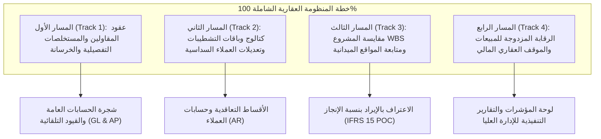

# MWHEBA ERP — Real Estate 100% Functional Parity Master Roadmap
## الخطة الاستراتيجية الشاملة للوصول إلى تغطية 100٪ من المنظومة العقارية والهندسية

> **وثيقة معيارية مرجعية لتطوير وإغلاق فجوات الموديول العقاري والمقاولات والتشطيبات**  
> **مرتكزة على التدقيق الميداني المباشر (Deep Live Crawl) لـ 55 صفحة وقالب داخلي من نظام «أبو زهرة» وتحليل 532 جدولاً تشغيلياً.**

---

### 1. الرؤية والهدف الاستراتيجي (Executive Objective)

الهدف من هذه الخطة هو نقل منظومة العقارات في **MWHEBA ERP** من مستوى الأساسات البيعية والهيكلية الحالية إلى **تغطية تنفيذية وتشغيلية ومحاسبية كاملة بنسبة 100٪** تنافس وتتجاوز النظم العقارية الكبرى (وعلى رأسها تجربة "أبو زهرة")، بحيث تغطي الدورة المستندية المتكاملة من لحظة تخطيط الأرض وتصميم النماذج، مروراً بمقايسات التنفيذ ومقاولي الباطن والمستخلصات التفصيلية، ثم أوامر وباقات التشطيب وتعديلات العملاء المعمارية، وصولاً إلى التسليم النهائي والمخالصة ومتابعة الصيانة والضمان وإدارة حقوق الشركاء.

---

### 2. مصفوفة المسارات التنفيذية الأربعة (The 4 Executive Tracks)

تم تقسيم خطة العمل إلى 4 مسارات متوازية ومتكاملة، لكل مسار وثيقة خطة تنفيذية تفصيلية مستقلة في الروت:



| المسار | النطاق الفني والهندسي | الوثيقة التنفيذية في الروت |
| :--- | :--- | :--- |
| **المسار الأول (Track 1)** | عقود المقاولين، بنود المقايسة التعاقدية، المستخلصات التراكمية، ومستخلصات الخرسانة الجاهزة. | [`TRACK_1_CONTRACTORS_AND_CERTIFICATES_PLAN.md`](TRACK_1_CONTRACTORS_AND_CERTIFICATES_PLAN.md) |
| **المسار الثاني (Track 2)** | كتالوج الفراغات والخامات، باقات التشطيب، دورة الاعتماد السداسية لطلبات التشطيب، والدفعات المقدمة. | [`TRACK_2_FINISHING_AND_VARIATIONS_PLAN.md`](TRACK_2_FINISHING_AND_VARIATIONS_PLAN.md) |
| **المسار الثالث (Track 3)** | شجرة بنود مقايسة المشروع (WBS / BOQ)، جدول متابعة تنفيذ الشقق ميدانياً بنداً بنداً، ونسب الإنجاز. | [`TRACK_3_WBS_AND_SITE_EXECUTION_PLAN.md`](TRACK_3_WBS_AND_SITE_EXECUTION_PLAN.md) |
| **المسار الرابع (Track 4)** | الرقابة المزدوجة على الحجوزات، شيكات وأسباب الاسترداد، وتوزيع مسؤوليات البيع، والموقف العقاري المالي المختصر. | [`TRACK_4_SALES_BOOKING_AND_REPORTS_PLAN.md`](TRACK_4_SALES_BOOKING_AND_REPORTS_PLAN.md) |

---

### 3. الفجوات الجوهرية المرصودة من الكراول المباشر وخريطة معالجتها

| المجال التشغيلي | ما تم رصده في قوالب «أبو زهرة» الفعلية | الوضع الحالي في MWHEBA ERP | الحل المستهدف في الخطة (100٪) |
| :--- | :--- | :--- | :--- |
| **مستخلصات المقاولين** | مستخلص تفصيلي بجدول بنود (سابق، حالي، تراكمي، نسبة صرف %، إجمالي) + استقطاعات ضرائب وتأمين حسن تنفيذ ومواد + مستخلص خرسانة جاهزة منفصل. | المستخلص يسجل كأرقام مالية مجمعة دون جدول بنود ودون عقد مقاول مسعر. | بناء `ContractorContract` ببنود مسعرة + جدول بنود المستخلص `ContractorCertificateItem` + قالب طباعة معتمد. |
| **تشطيبات الوحدات** | دورة اعتماد سداسية (خدمة عملاء > مكتب فني > إدارة التعديلات > حسابات > إدارة مالية > موافقة عميل > تنفيذ) + كتالوج فراغات وماركات. | أمر تعديل معماري سطحي فقط بفرملة مراحل بدون دورة تسعير واعتماد الفراغات. | بناء كتالوج الفراغات والخامات + دورة طلب التشطيب `UnitFinishingOrder` + ساحر اختيار المواصفات (Wizard). |
| **المتابعة الميدانية** | تقرير تفصيلي لكل شقة ودور بـ 15 بند (قد، مباني، مواسير، علب، سحب سلك، طرطشة، أوتار، ملو، عزل، سباكة، سيراميك، دهانات...). | نسبة إنجاز إجمالية للمشروع رقمية دون تفصيل للشقق والبنود المعمارية. | بناء جدول المتابعة الميداني `UnitSiteProgressRecord` وقالب العرض الشبكي المطابق لـ `site_project_report`. |
| **رقابة الحجوزات** | مراجعة حجز ثنائية (`تم مراجعة الحجز ؟` + `تم تأكيد مراجعة الحجز ؟`) + أسباب وشيكات الاسترداد + تكلفة متر وإجمالي التشطيب والمرافق. | حجز وتعاقد وأقساط عادية دون مستويات تدقيق الحجز ودون تسجيل شيك الاسترداد. | إضافة خانات التدقيق الثنائي + شيكات الاسترداد المقننة + إظهار تكاليف التشطيب والمرافق المنفصلة. |
| **الموقف العقاري** | تقرير الموقف العقاري والمالي المختصر (`tower_sales_brief`): متاح، مؤقت، محجوز، تعاقد، حصة الشريك والشركة (عدد، مساحة، قيمة، %). | تقارير محاسبية وتدفقات نقدية وعمولات سماسرة فقط. | بناء تقرير `TowerSalesBriefReportView` التفاعلي وقالب الطباعة المقارن. |

---

### 4. القواعد الهندسية والمعمارية الصارمة للمشروع (Engineering Directives)

1. **الالتزام الصارم بنظام التصميم (Design System)**:
   * استخدام متغيرات الـ CSS المعلنة في `:root` لجميع الألوان؛ **يُحظر تماماً كتابة ألوان Hex أو RGB مباشرة**.
   * الألوان مسطحة بالكامل (Flat Colors Only)؛ **يُمنع استخدام التدرجات اللونية (Gradients) نهائياً**.
   * الاحتفاظ بالخطوط النظامية الحالية وتجنب إضافة خطوط خارجية.
   * التزام الحركات الانتقالية الهادئة والمهنية (Calm, Corporate, Minimalist).
2. **الالتزام باللغة والمصطلحات (Language & Terminology Directive)**:
   * استخدام العربية المصرية في المحادثات وشرح التقارير والتعليقات التوضيحية.
   * استخدام الإنجليزية الحصرية في أسماء المتغيرات والدوال والموديلات والتوثيق البرمجي.
   * **الحظر التام لمصطلح «مستودع / مستودعات»** واستبداله حصراً بـ «مخزن / مخازن / أمين المخزن».
3. **سلامة الحسابات والتكامل المالي المزدوج (Double-Entry Financial Integrity)**:
   * أي استحقاق مالي لمستخلص مقاول أو دفعة تشطيب أو استرداد حجز يجب أن يولد قيد يومية متوازن آلياً عبر `JournalEntryService`.
   * دقة الأرقام والكسور: منزلتان عشريتان للأموال (`decimal_places=2`) و 6 منازل لأسعار الصرف.
4. **معايير الاختبار الصارمة (Testing Standards)**:
   * استخدام أداة `pytest` حصراً لتشغيل أي اختبارات؛ **يُحظر تماماً تشغيل `manage.py test`**.
   * تغطية كل مسار باختبارات Unit و Integration تضمن عدم كسر أي ميزات قائمة في النظام.

---

### 5. مراحل الجدولة والتسليم المتتابع (Execution Phasing & Gates)

```
[الأسبوع 1] ───► المسار 1: عقود المقاولين والمستخلصات التفصيلية وطباعتها
[الأسبوع 2] ───► المسار 2: كتالوج وباقات التشطيبات ودورة الاعتماد السداسية
[الأسبوع 3] ───► المسار 3: مقايسة WBS ومصفوفة متابعة التنفيذ الميداني للشقق
[الأسبوع 4] ───► المسار 4: الاعتماد المزدوج للمبيعات والموقف العقاري المالي
```

* **بوابة العبور (Quality Gate) لكل مسار**:
  1. اكتمال الموديلات وترحيل الـ Migrations بنجاح.
  2. اكتمال الـ Views والخدمات الوسيطة (Services) مع الصلاحيات والأمان.
  3. اكتمال قوالب الـ HTML والفرونت إند المتناسق مع تصميم النظام.
  4. اجتياز اختبارات الـ `pytest` بنسبة 100٪ والخلو من أي أخطاء `django check`.
