# المسار التنفيذي الأول (Track 1) — عقود المقاولين والمستخلصات التفصيلية والخرسانة الجاهزة
## Executive Implementation Plan: Contractor Contracts, BOQ Items & Progress Certificates

> **النطاق الميداني والمحاسبي والضريبي والمصرفي والقانوني المتكامل**:
> بناء منظومة متكاملة لعقود مقاولي الباطن، مقايسات التنفيذ المسعرة (BOQ)، حوكمة أوامر التغيير وتجاوز الكميات (Overrun Tolerance & Variation Orders)، خطابات الضمان البنكية (Performance & Advance LGs)، دورة تسييل الضمانات وتسوية فسخ العقود المتعثرة (Contract Termination & LG Liquidation)، التحقق من سريان المستندات القانونية للمقاولين (Commercial Register & Federation Compliance Guard)، دورة صرف الدفعة المقدمة وقيدها المالي الأصلي، الرقابة المصرفية على حساب الضمان الإلزامي للمشروع (`Escrow Account Compliance`)، التخصيص التكاليفي على مستوى العمارات والأبراج (`PropertyBlock`) وربط موازنة المشروع التقديرية (WBS Budget Codes) لمعيار الاعتراف بالإيراد (IFRS 15 POC)، مستخلصات التنفيذ التراكمية، منع تضارب المستخلصات المتزامنة بقفل تسلسلي إلزامي (`Concurrent Certificate Lock & Sequence Order`)، الحساب التراكمي الدقيق للكميات السابقة من واقع قيود قاعدة البيانات لمنع فقدان رصيد البنود المتخطاة، معالجة تصحيح الحصر بالسالب (Survey Corrections)، حساب الكميات المكافئة ونسب الإنجاز التراكمية للبند (Cumulative Progress %) لمنع إنذارات التجاوز الكاذبة، دورة تشوينات الموقع المعتمدة (Materials on Site - MOS) واستردادها التدريجي وتسوية بواقي التشوينات عند إغلاق العقد، المطابقة الثلاثية لتوريد وصب الخرسانة الجاهزة واحتساب هادر الصب الزائد على مقاول المصنعيات، المطابقة والمقارنة مع تقارير التنفيذ الميداني للشقق (Track 3 Cross-Check)، تسوية الخصومات العينية لمواد المخازن ومحاسبة هالك الخامات، الخصومات البينية بين مقاولي الباطن والربط المباشر مع عيوب الموقع المعمارية وموديل `UnitSnagItem` القائم، مصفوفة الغرامات الميدانية المفصلة (تأخير، جودة، أمن صناعي)، التمييز الضريبي المصري الصارم بين ضريبة الجدول (5%) لمقاولات التشييد وضريبة القيمة المضافة العامة (14%) للتوريدات، استقطاع دمغة نقابة المهن الهندسية (0.45%)، التأمينات الاجتماعية المصرية ودورة تسوية استمارة 19 مقاولات (`Social Insurance Clearance`)، اشتراط الفاتورة الإلكترونية بمصلحة الضرائب (ETA E-Invoice UUID) قبل الصرف المالي، قفل التنازل البنكي عن مستحقات العقد (Assignment of Proceeds Guard)، صمام الحجز القضائي والتحفظي على المستحقات، استقطاع استهلاك مياه وإنارة الإنشاءات بالموقع (Site Utilities Deduction)، معادلة فروق وتغير أسعار الخامات (Price Escalation Formula)، الإفراج المرحلي عن تأمين حسن التنفيذ (50% استلام ابتدائي و50% استلام نهائي)، ساعات تشغيل أوناش الأبراج والمعدات المشتركة، بونات رفع الرتش ومخلفات الموقع، السلف الإسعافية لعمالة المقاول لمنع إضراب الموقع، وثيقة تأمين كافة أخطار المقاولين (CAR Insurance)، صمام رقابة المقايسة الرئيسية للمشروع عند تجزئة البند على مقاولين متعددين، الاستقطاع الآلي للدفعات المستعجلة المسددة تحت الحساب بالفترة لمنع الازدواجية، حجز أمانة كسر مكعبات الخرسانة المعلقة بعد 28 يوماً، التوثيق القانوني لإخطارات المخالفات ومهلة الـ 48 ساعة قبل الخصم، استقطاع نفقات حوادث وعلاج عمالة المقاول الطارئة، صمام الرقابة على فئات المقايسة وهامش الربحية التقديري، سجل الاستلام الجزئي المرحلي وتعدد عدادات سنة الضمان، سقوف استرداد الدفعة المقدمة والتأمين، عقود العملات الأجنبية وفروق أسعار الصرف المحققة (`FX Variance Engine`)، القفل التشفيري المتكامل للرأس والبنود (Merkle-Tree Hash)، الحوكمة المرنة للاعتمادات وتفادي التجميد التشغيلي (Approval Fallback Engine)، الفصل المحاسبي بين الاستحقاق الهندسي والصرف المالي الفعلي، التكامل مع تطبيق الشيكات (`cheques`) لإصدار الشيكات الآجلة (PDCs) وأوراق الدفع `21210`، تخصيص السداد الآلي بالأقدمية (`FIFO Payment Allocation`)، دورة الإلغاء والقيد العكسي (Storno Reversal Workflow)، وتوليد القيود المحاسبية عبر `AccountingGateway` مع قوالب الطباعة الهندسية الرسمية.

---

### 1. الأهداف الفنية والتشغيلية الميدانية (Operational Scope)

1. **مستخلص مقاول تفصيلي بالبنود الهندسية والكميات المكافئة**: الانتقال من المستخلص الرقمي المجمع الإجمالي إلى مستخلص تراكمي يتتبع: (الكمية السابقة التراكمية، الكمية الحالية، الكمية المكافئة المنفذة، الكمية لتاريخه، الفئة، مرحلة ونسبة الصرف %، الإجمالي لتاريخه، إجمالي الفترة).
2. **عقود مقاولي الباطن وتخصيص الأبراج وموازنة WBS (`ContractorContract` & `PropertyBlock` & `IFRS 15`)**:
   * مقايسة البنود التعاقدية بالكميات والفئات، تتبع السقف المالي، الدفعة المقدمة وخطاب ضمانها، ونسب الاستقطاع.
   * ربط البنود بالعمارة/البرج لمنع تشتت التكاليف في كتلة صماء.
   * ربط كل بند بكود موازنة WBS بالمشروع العقاري لحساب نسبة الإنجاز التراكمية الفعلية بدقة وتطبيق معيار الاعتراف بالإيراد (IFRS 15 POC Matching).
3. **دورة تسوية أمانات التأمينات الاجتماعية (Social Insurance Clearance - استمارة 19)**:
   * إدارة حساب الأمانات الدائن `21340` وفق مسارين قانونيين: رد الأمانة للمقاول عند إرفاق استمارة 19، أو السداد المباشر للهيئة وقفل ملف المشروع التأميني.
4. **رد تأمين حسن التنفيذ مع خصم تكاليف إصلاح العيوب (Retention Release & Snag Backcharges)**:
   * عند إعداد مستخلص رد التأمين بعد سنة الضمان والاستلام النهائي، يستدعي النظام آلياً فواتير وأوامر شغل إصلاح العيوب لخصمها من التأمين وصرف الصافي فقط.
5. **تصفية العقود المفسوخة وتسييل الضمانات (Contract Termination Settlement)**:
   * تجميد الحصر فوراً (Survey Freeze)، تسييل خطاب ضمان حسن التنفيذ أو مصادرة التأمين النقدي، وقيد فروق إعادة الطرح على حساب المقاول المفسوخ عقده.
6. **حظر الصرف عند انتهاء الصلاحيات والمستندات القانونية للمقاول (Expired Vendor Compliance Guard)**:
   * صمام أمان رقابي يمنع اعتماد أي مستخلص أو إصدار أي سند صرف مالي إذا انتهت صلاحية السجل التجاري، البطاقة الضريبية، أو بطاقة الاتحاد المصري لمقاولي التشييد والبناء.
7. **الرقابة المصرفية على الصرف من حساب الضمان البنكي (`Project Escrow Account`)**:
   * إلزام ربط صرف مستحقات المقاولين والدفعات المقدمة بحساب الضمان البنكي للمشروع (`RealEstateProject.escrow_account`) لمنع خلط التدفقات النقدية.
8. **الخصومات البينية بين مقاولي الباطن والخدمات المشتركة (`Subcontractor Backcharges`)**:
   * إثبات الخصومات الناتجة عن إتلاف مقاول لأعمال مقاول آخر أو استخدام أوناش ومعدات مقاول آخر، وتوليد القيود المحاسبية البينية آلياً.
9. **عقود العملات الأجنبية وتسوية فروق أسعار الصرف (`FX Gain/Loss Engine`)**:
   * دعم التعاقد بعملات أجنبية (USD, EUR)، وتثبيت سعر الصرف المعياري، وتوليد قيود فروق أسعار الصرف المحققة عند السداد عبر `FXRevaluationService`.
10. **تخصيص السداد المالي الآلي بالأقدمية (`FIFO Auto-Allocation`)**:
    * التوزيع الآلي بالأقدمية (FIFO) لإقفال أقدم المستخلصات المعتمدة أولاً عند سداد مبالغ جزئية.
11. **دورة صرف الدفعة المقدمة الأصلية وربطها بالخزينة/البنك**:
    * إضافة إجراء وسند لصرف الدفعة المقدمة وتوليد القيد المحاسبي الأصلي: (مدين: دفعات مقدمة `11350` / دائن: البنك `11121`).
12. **المطابقة الضريبية مع منظومة الفاتورة الإلكترونية المصرية (ETA E-Invoice Compliance)**:
    * حقول تتبع الفاتورة الإلكترونية (`eta_invoice_uuid`, `eta_status`) واشتراط اعتمادها بمصلحة الضرائب قبل الإذن بالصرف المالي.
13. **المطابقة الرقابية بين حصر المستخلص والتنفيذ الميداني للشقق (Track 3 Cross-Check)**:
    * مقارنة الكميات التراكمية مع سجلات التنفيذ الميداني للوحدات (`UnitSiteProgressRecord`) وإظهار انحراف الحصر (`site_survey_variance`).
14. **معالجة مواد المخازن ومحاسبة هالك الخامات (Material Quota & Excess Scrap Penalty)**:
    * دعم الخصم المباشر أو كوتة الاستهلاك النمطية ومحاسبة تجاوز الهالك المسموح تعاقدياً.
15. **القفل التزامني ومنع المستخلصات المزدوجة المتزامنة (`Concurrent Open Certificates Guard`)**:
    * حظر فتح مستخلص جديد بوجود مستخلص سابق في مسودة أو قيد الاعتماد، والترقيم التسلسلي الإلزامي (`sequence_order`).
16. **الحساب الرياضي التراكمي الموثق للكميات السابقة (Skipped Item Cumulative Amnesia Prevention)**:
    * تجميع كافة الكميات المنفذة في جميع المستخلصات المعتمدة السابقة من واقع قاعدة البيانات لضمان عدم ضياع رصيد البنود المتخطاة.
17. **حوكمة الاعتمادات المرنة وتفادي الشلل التشغيلي (Approval Fallback Engine)**:
    * تحويل الطلب تلقائياً للمدير المالي / العام في حال عدم وجود قاعدة اعتماد مطابقة للشريحة المالية.
18. **دعم خطابات الضمان البنكية (Bank Letters of Guarantee - LGs)**: 
    * دعم التأمين عبر خطاب ضمان بنكي نهائي وتصفير الاستقطاع النقدي، مع رادار تنبيهات انتهاء الصلاحية قبل 30 يوماً.
19. **حوكمة الزيادات وتصحيح الحصر الميداني (Overrun Tolerance & Survey Corrections)**: 
    * نسبة سماحية تعاقدية للزيادة الهندسية، وحظر ما يتجاوزها دون أمر تغيير معتمد (`ContractVariationOrder`)، مع دعم تصحيح الحصر بالسالب.
20. **الفصل المعماري والتشغيلي للخرسانة الجاهزة (`ReadyMixConcrete`)**:
    * دعم المسار المنفصل (محطة خلط مستقلة ومقاول مصنعيات هيكل صب) أو عقد التوريد والمصنعية المتكامل (Turnkey).
21. **مصفوفة الغرامات الميدانية المفصلة (Granular Penalty Matrix)**:
    * تفصيل غرامات تأخير، جودة خرسانة، أمن صناعي، تجاوز هالك، وخصومات استشاري.
22. **منظومة الاستقطاعات المحاسبية وسقوف الخصم (Deduction Caps)**:
    * التوقف التلقائي عن استرداد الدفعة المقدمة عند بلوغ 100%، وسقف تأمين حسن التنفيذ، وخصم 1% خصم وإضافة، و2.8% تأمينات.
23. **القفل التشفيري المحكم للرأس والبنود (Merkle-Tree Hash)**:
    * بصمة رقمية مجمعة للرأس والبنود والتشوينات والخرسانة والغرامات والخصومات لمنع أي تلاعب بعد الاعتماد.
24. **دورة القيد العكسي والإلغاء المحاسبي (Storno Reversal Workflow)**:
    * توليد قيد عكسي مطابق وموازن تماماً يعكس الأثر المحاسبي دون حذف السجلات، ورد المبالغ المطفأة للعقد.
25. **الفصل المحاسبي الصارم بين استحقاق المستخلص والصرف المالي الفعلي (Accrual vs. Payout)**:
    * المستخلص يثبت الاستحقاق الهندسي والمحاسبي، والصرف المالي يُدار عبر سندات الصرف المالي وتتبع الرصيد المتبقي.
26. **كفاءة الأداء للمقايسات الضخمة (100+ بند)**: دعم استيراد شيت حصر Excel، وتقسيم المقايسة بحسب مجموعات WBS.
27. **قالب الطباعة الهندسي المعتمد (`contractor_certificate_print.html`)**: بتوقيعات الاعتماد الرباعية الرسمية.
28. **دورة تشوينات الموقع المعتمدة (Materials on Site - MOS) واستردادها التدريجي**:
    * تمويل 75% من قيمة المواد المشونة واستردادها التلقائي عند التركيب، والفصل الصارم عن مسحوبات عهد المخزن.
29. **الحصر الميداني بنسبة الإنجاز التراكمية الحقيقية (Cumulative Progress % Model)**:
    * قياس الإنجاز بنسب الصرف التراكمية للبند لمنع إنذارات تجاوز المقايسة الكاذبة (False Overruns).
30. **المطابقة الثلاثية للخرسانة الجاهزة واحتساب هادر الصب الزائد (Three-Way Ready-Mix Reconciliation)**:
    * ربط بونات توريد الخلاطات مع حصر الاستشاري وتحميل هادر الصب الزائد كـ Backcharge إلزامي على مقاول المصنعيات.
31. **التمييز الضريبي المصري الصارم: ضريبة الجدول 5% للمقاولات مقابل 14% للتوريدات (Table Tax 5% vs Standard VAT 14%)**:
    * ضريبة الجدول 5% كود `T2` للمقاولات بدون خصم مدخلات، وضريبة 14% كود `T1` للتوريدات مع خصم المدخلات.
32. **دورة سداد المقاولين بالشيكات الآجلة وأوراق الدفع (Contractor PDC Payout via `cheques` App)**:
    * التكامل مع تطبيق الشيكات لإصدار شيكات آجلة وربطها بأوراق الدفع `21210` وسدادها من حساب الضمان `11121`.
33. **التكامل المعماري الموحد لخصومات العيوب مع موديل `UnitSnagItem` القائم (DRY Snag Backcharges)**:
    * الربط المباشر مع موديل `UnitSnagItem` القائم لترحيل تكاليف إصلاح العيوب الفنية آلياً كخصومات على المستخلص.
34. **استقطاع استهلاك مياه وإنارة الإنشاءات بالموقع (Site Utilities Deduction)**:
    * استقطاع نسبة نمطية (0.5% - 1.0%) من أعمال الفترة لتغطية استهلاك المياه المؤقتة والكهرباء بالمشروع وتسويتها بحساب `42301 / 12101`.
35. **معادلة ومسار فروق وتغير أسعار الخامات (Price Escalation Formula - FIDIC & Law 182/2018)**:
    * تسوية الزيادات السعرية للحديد والأسمنت طبقاً لنشرات أسعار وزارة الإسكان/الجهاز المركزي للتعبئة العامة والإحصاء (CAPMAS).
36. **الإفراج المرحلي عن تأمين حسن التنفيذ (Phased Retention Release: Provisional vs Final)**:
    * الإفراج عن 50% من التأمين المحتجز عند الاستلام الابتدائي (`SUBSTANTIAL_RETENTION_RELEASE`)، والـ 50% المتبقية بعد انقضاء سنة الضمان والاستلام النهائي ومخالصة الضمان (`FINAL_RETENTION_RELEASE`).
37. **ساعات تشغيل أوناش الأبراج والمعدات المشتركة (Shared Tower Crane & Hoisting Timesheets)**:
    * تسجيل بونات وساعات تشغيل الأوناش ومعدات الرفع المشتركة (`EquipmentHoistingLog`) وتحويلها لخصومات على المقاول المستفيد.
38. **السلف الإسعافية لعمالة المقاول لمنع إضراب الموقع (Direct Emergency Site Labor Advance)**:
    * سند صرف سلفة عمالة نقدية طارئة من الخزينة يداً بيد بموجب كشوف التوقيع والبصمات وخصمها الفوري من أول مستخلص لاحق للمقاول.
39. **صمام رقابة المقايسة الرئيسية للمشروع وتجزئة الأعمال (Master Project BOQ Budget Guard for Trade Splitting)**:
    * حظر تجاوز مجموع الكميات المتعاقد عليها مع مقاولين متعددين لنفس البند والعمارة لموازنة المقايسة التقديرية العامة للمشروع (`ProjectMasterBOQItem`).
40. **الاستقطاع الآلي للدفعات المستعجلة المسددة تحت الحساب بالفترة (Interim On-Account Payment Guard)**:
    * استدعاء آلي لكافة السلف والدفعات المسددة للمقاول خلال فترة إعداد المستخلص من القيود المحاسبية (`interim_on_account_payments`) وخصمها حتمياً من صافي الشيك القابل للصرف لمنع الازدواجية المالية.
41. **حجز أمانة كسر مكعبات الخرسانة المعلقة بعد 28 يوماً (Late 28-Day Concrete Cube Failure & Lab Hold)**:
    * حظر صرف مستخلص الخرسانة واحتجاز أمانة تعادل قيمة الصبة المشكوك فيها (`pending_cube_test_hold_amount`) في حال تعليق أو رسوب اختبار الـ 28 يوماً لحين صدور تقرير الاستشاري.
42. **التوثيق القانوني لإخطارات المخالفات ومهلة الـ 48 ساعة قبل الخصم (Contractual Default Notice & Cure Period)**:
    * تسجيل إخطار إنذار المخالفة (`ContractorDefaultNotice`) مع عد تنازلي لمهلة الـ 48 ساعة القانونية، وحظر قطعي للخصم على حساب المقاول إلا بعد انقضاء المهلة تحصيناً للشركة قضائياً.
43. **استقطاع نفقات حوادث وعلاج عمالة المقاول الطارئة (HSE Incident Medical & Fine Backcharge)**:
    * ربط محاضر حوادث السلامة والصحة المهنية (HSE) بفواتير الإسعاف والمستشفيات وغرامات مكتب العمل وتوجيهها كخصم مباشر (`hse_medical_and_incident_costs`).
44. **صمام الرقابة على فئات المقايسة وهامش الربحية التقديري (Target Cost Budget Rate Guard)**:
    * مقارنة فئة بند العقد بفئة المقايسة التقديرية لدراسة الجدوى (`unit_rate_estimate`)، وإطلاق إنذار تجاوز الموازنة وحظر تفعيل العقد إلا بموافقة المدير المالي.
45. **سجل الاستلام الجزئي المرحلي وتعدد عدادات سنة الضمان (Sectional Handover & Warranty Clock)**:
    * تتبع استلام الأدوار المنجزة مبكراً (مثل الأدوار التجارية بالمول) بسجل استلام جزئي مستقل وحساب عداد سنة الضمان المستقلة لكل مرحلة لمنع النزاعات.
46. **قفل التنازل البنكي عن مستحقات العقد (Bank Assignment of Proceeds / Factoring Guard)**:
    * تثبيت بيانات البنك أو شركة التخصيم المحال إليها المستحقات (`is_assigned_to_bank`, `assigned_bank_name`, `assigned_bank_iban`) وحظر قطعي لتحرير أي شيك أو سند صرف إلا باسم البنك المحال إليه رسمياً لحماية الشركة من قضايا البنوك.
47. **استقطاع دمغة نقابة المهن الهندسية والتطبيقيين (Engineering Syndicate Stamp Tax - 0.45%)**:
    * استقطاع نسبة الدمغة الهندسية القانونية الإلزامية (0.45%) من إجمالي الأعمال المعتمدة وتجنيبها بحساب الأمانات الدائن (`21345`) لحين سدادها بشيك للنقابة.
48. **صمام الحجز القضائي والتحفظي على مستحقات المقاول (Judicial Garnishment Freeze)**:
    * تجميد الصرف فور ورود إعلانات المحاكم أو مصلحة الضرائب بحجز ما للمدين لدى الغير (`is_garnished_by_court`) وتوجيه المبالغ لخزينة المحكمة أو حساب أمانات الحجوزات القضائية (`21350`).
49. **تسوية واستيعاب بواقي تشوينات الموقع عند إنهاء العقد (Leftover MOS Reconciliation & Stock Absorption)**:
    * معالجة الخامات المشونة غير المركبة عند إقفال أو فسخ العقد؛ إما بسحبها من المقاول واسترداد تمويل الـ 75%، أو استحواذ الشركة عليها لصالح مخزن المشروع (`product.Stock`) وسداد الـ 25% المتبقية للمقاول.
50. **بونات رفع الرتش ومخلفات التكسير والنظافة الميدانية (Site Debris Clearance Backcharge)**:
    * توثيق بونات نقل الرتش ومخلفات الهدم واللوادر وسيارات النقل (`SiteDebrisClearanceLog`) وتحميل تكلفتها كخصم فوري على مستخلصات المقاولين المتسببين.
51. **وثيقة تأمين كافة أخطار المقاولين والمسؤولية المدنية (Contractor's All Risks - CAR Insurance)**:
    * تتبع سريان وثيقة تأمين أخطار المقاولين (CAR Policy) أو استقطاع قسط التأمين الموحد للمشروع (0.30%) من المستخلصات بحساب مخصص التأمين (`21360`).
52. **خوارزمية تسلسل الاستقطاعات ومنع الازدواج الضريبي لنموذج 41 (Strict Cascading Deduction Sequence & Double Withholding Tax Prevention)**:
    * إلزام الترتيب الرياضي الصارم للخصومات: وعاء خصم ضريبة أرباح تجارية وصناعية (1% نموذج 41) = (الأعمال المنفذة المعتمدة بالفترة) - (نسبة استرداد الدفعة المقدمة المستهلكة من تلك الأعمال). حظر احتساب الـ 1% على إجمالي الأعمال لمنع الازدواج الضريبي على الدفعة المقدمة التي خضعت للخصم الضريبي مسبقاً عند صرفها وفقاً لأحكام القانون 91 لسنة 2005.
53. **معادلة مطابقة حديد التسليح وهالك وتفريد الحديد (Rebar BBS Reconciliation & Scrap Weight Log)**:
    * ربط حديد التسليح المورد كتشوين/خامات من الشركة بالمقايسة التنفيذية، وإجراء مطابقة ثلاثية دورية بين الكميات الموردة فعلياً، والحصر الهندسي لجدول تفريد الحديد (Bar Bending Schedule - BBS)، ونسبة الهالك المسموحة تعاقدياً (2.5% إلى 3.0%). تحميل أي هالك زائد أو فاقد غير مبرر كخصم مالي فوري بسعر طن الحديد اليومي في السوق وإدراجه كخصم عيني/مالي (`ContractorBackcharge`).
54. **محضر حيازة وتنازل ملكية مشونات الموقع وحظر البوابة الأمنية (MOS Site Custody, Legal Vesting & Gate Pass Lock)**:
    * إصدار «محضر إثبات حيازة وتنازل ملكية مشونات الموقع» (`ContractorMOSCustodyReceipt`) معتمد من المقاول ومهندس المالك فور صرف تمويل التشوينات (75%) استناداً للمادة 658 من القانون المدني المصري وفيدك بند 70 بأن التشوينات أصبحت ملكاً خالصاً لرب العمل (`Vested in Employer`). فرض قفل أمني بالبوابة يمنع خروج أي خامات مشونة تم صرف مستخلص عنها إلا بتصريح كتابي من الاستشاري ومدير المشروع.
55. **الدفع المباشر لمقاولي الباطن المعينين والمقاصة مع المقاول العام (Direct Payment to Nominated Subcontractors & Set-Off)**:
    * حوكمة مقاولي الباطن المعينين (`Nominated Subcontractors` مثل المصاعد، التكييف المركزي، إطفاء الحريق، الواجهات) وفق فيدك بند 5.4؛ إتاحة حق المطور في الدفع المباشر لمقاول الباطن المعين عند تقاعس المقاول العام عن سداد مستحقاته، وتوليد قيد مقاصة محاسبي فوري يخصم المبلغ من مستخلص المقاول العام الجاري دون تعطيل الجدول الزمني للمشروع.
56. **حجر البنود المتنازع عليها مؤقتاً والاعتماد الجزئي للمستخلص (Disputed Line Item Holdback & Quarantine)**:
    * عزل البنود المعترض عليها هندسياً في حجر معلق مؤقت (`is_disputed_holdback`) داخل المستخلص دون تجميد المستخلص بالكامل؛ اعتماد وصرف البنود السليمة هندسياً لحماية سيولة الموقع، وتجنيب قيمة البند المتنازع عليه في حساب معلق لحين إعادة الاختبار أو البت الفني.
57. **سجل استهلاك وتلفيات الشدات والمعدات المعارة من المالك (Owner-Supplied Shoring & Scaffolding Damage Log)**:
    * تتبع حركة وفحص عهدة الشدات المعدنية (Acrow Props, Dokas, H20 Beams, Plywood) والماكينات المعارة لمقاول المصنعية عبر (`ContractorScaffoldingLog`)، واحتساب قيمة التلفيات أو النقص عند نهاية كل مرحلة صب وتوجيهها كخصم فوري على المستخلص الجاري.
58. **غرامات التأخير الجزئية المرحلية القابلة للاسترداد (Refundable Milestone Delay Penalties)**:
    * إدراج خاصية استرداد غرامة التأخير المرحلية (`is_refundable_milestone_penalty`)؛ في حال قام المقاول بتكثيف العمالة والمعدات (Schedule Crashing) وعوض التأخير وسلم محطة الإنجاز اللاحقة في موعدها التعاقدي، يتم استرداد الغرامة المحسومة وإضافتها بالمستخلص اللاحق بناءً على تقرير معتمد من الاستشاري تحفيزاً للمقاول.
59. **إعادة المعايرة الديناميكية لمعدل استرداد الدفعة المقدمة عند أوامر التغيير (Dynamic Advance Recovery Recalibration)**:
    * إعادة حساب نسبة استرداد الدفعة المقدمة آلياً بمجرد اعتماد أي أمر تغيير بالزيادة أو النقصان (`ContractVariationOrder`): معدل الاسترداد المعدل = (رصيد الدفعة المقدمة المتبقي بدون استرداد ÷ القيمة المتبقية من العقد بعد أمر التغيير) × 100، لمنع تراكم أرصدة دفعات مقدمة معلقة دون أعمال كافية لتغطيتها عند تقليص نطاق الأعمال، ومنع استهلاكها المبكر عند الزيادة.
60. **ربط بنود المستخلص بمحاضر استلام الأعمال ومحاضر فحص الخامات (WIR / MIR Quality Linkage Guard)**:
    * ربط اعتماد بنود المستخلص بمحاضر استلام الأعمال الميدانية (`Work Inspection Request - WIR`) وطلبات فحص المواد المشونة (`Material Inspection Request - MIR`) المعتمدة من الاستشاري؛ حظر صرف البنود الحساسة (مثل العزل المائي أو ضغط شبكات التغذية أو كابلات الكهرباء) دون التحقق من وجود رقم وتاريخ محضر استلام رسمي مانعاً للتلاعب أو مجاملات مهندسي الموقع.
61. **تعدد الأوعية الضريبية على مستوى بنود العقد الواحد للعقود المختلطة (Composite Contracts Item-Level Tax Regime)**:
    * دعم تعدد النظام الضريبي داخل العقد المتكامل الواحد (توريد وتركيب مصاعد، شبكات وتكييف وحريق)؛ إخضاع بنود توريد المعدات والأجهزة الرأسمالية لـ 14% ضريبة قيمة مضافة عامة، وإخضاع بنود التركيبات والمصنعيات الإنشائية لـ 5% ضريبة جدول، لضمان المطابقة 100% مع الفواتير الإلكترونية على منظومة الضرائب المصرية (ETA).
62. **سجل تشغيل طلمبات النزح الجوفي وخصم المحروقات والأعطال (Dewatering Continuous Run & Fuel Deduction Log)**:
    * حوكمة عقود مقاولي النزح الجوفي المستمر (24 ساعة يومياً) لحماية أمان الحفر واللبشة؛ إنشاء موديل (`DewateringPumpingLog`) لتسجيل ساعات تشغيل وتوقف الطلمبات، واحتساب غرامات الأعطال، والخصم المباشر لقيمة الديزل ووقود المولدات المسحوبة من مخازن الشركة لإنقاذ الموقع من الغرق.
63. **معامل سماحية تفاوت درفلة مصانع الحديد في مطابقة الهالك (Steel Rolling Margin Tolerance Coefficient)**:
    * إدراج معامل سماحية درفلة مصانع حديد التسليح (`Rolling Margin Tolerance %` ما بين ± 2% إلى ± 3.5% طبقاً للمواصفة القياسية المصرية ES 262-2) لعزل العجز في وزن الأسياخ الناتج عن وزن درفلة المصنع الفعلي عن الهالك والسرقات الفعلية الناتجة عن سوء تقطيع المقاول لضمان عدالة الخصم البيني.
64. **تعهدات السداد الثلاثية لموردي خامات مقاولي المصنعيات (Contractor Supplier Tripartite Lien & Assignment)**:
    * إنشاء موديل (`ContractorSupplierLienAssignment`) لتسجيل الاتفاقيات الثلاثية الملزمة بين (المطور، مقاول المصنعية، ومورد الخامات مثل البويات، السيراميك، والأدوات الصحية)؛ فرض حجز قضائي/تعاقدي ملزم يجمد قيمة فاتورة الخامات من صافي مستخلص المقاول وإصدار شيك مباشر باسم المورد لضمان استمرار توريد الخامات دون توقف.
65. **مسار المستخلص الاستثنائي المعجل تحت التسوية لمواسم الأعياد (Emergency Fast-Track Provisional Certificate Payout)**:
    * توفير مسار استثنائي لتمكين صرف دفعات عاجلة للعمالة قبل وقفة عيدي الفطر والأضحى بنسبة أمان محددة (70% إلى 75% من قيمة حصر مهندس الموقع الأولي)، مع التسوية التلقائية الكاملة وتوليد القيود المحاسبية التفصيلية الدقيقة في المستخلص التالي فور استئناف العمل لمنع إضراب العمالة.
66. **عقود المكون الأجنبي الهجين وسقف مخاطر سعر الصرف للمهمات المستوردة (Dual-Currency Hybrid BOQ Items with FX Volatility Collar)**:
    * حوكمة عقود الكهروميكانيك MEP (مصاعد، شيلرات تكييف، محولات) ذات المكون الأجنبي المستورد؛ دعم تحديد نسبة المكون الأجنبي للبند (مثلاً 60% مقومة بالدولار) مع تثبيت سقف تعاقدي لتحمل تقلبات سعر الصرف (FX Volatility Collar e.g. ±15%)، واشتراط تقديم نموذج الإفراج الجمركي (نموذج 4 البنكي) لاحتساب فروق العملة المعتمدة وحماية المطور من المخاطر غير المسقوفة.
67. **معامل انتفاخ وتكهف خرسانة خوازيق التربة والأساسات العميقة (Pile Bulbing & Over-break Factor %)**:
    * إدراج معامل انتفاخ خرسانة الخوازيق (`Pile Bulbing Factor %` من 10% إلى 18%) في معادلة مطابقة صب خوازيق السند والتحميل؛ عزل الفجوات والتكهفات الجوفية الطبيعية عن هادر الصب الخارجي لمنع توقيع خصومات هالك جائرة على مقاولي الأساسات العميقة.
68. **تحميل فواتير المعامل المستقلة الناتجة عن رسوب العينات (Third-Party Testing Lab Failure Backcharge)**:
    * إنشاء موديل (`ThirdPartyLabTestLog`) لتسجيل اختبارات ضبط الجودة غير الإتلافية والقلوب الخرسانية (Core Tests) المنفذة بمعامل خارجية معتمدة (جامعة القاهرة، HBRC)؛ إلزام تحميل 100% من فواتير الفحوص الفاشلة ورسوم الاستشاري الإضافية كخصم فني مباشر (`Third-Party Lab Backcharge`) من مستخلص المقاول المتسبب.
69. **سجل رفض وطرد شاحنات الخرسانة في الطقس الحار (Hot Weather Slump Loss & Rejected Batches Log)**:
    * توثيق بيانات درجة حرارة الخرسانة وقوام الهبوط (Slump Test) في شهور الصيف الحارة؛ تسجيل الشاحنات المطرودة هندسياً (`Rejected Batch`) فوراً لمنع إضافة مياه بالموقع، والتصفير التلقائي لقيمتها المالية وحظر مطالبتها نهائياً بمستخلص محطة الخلط.
70. **مخالصة المجمعة العشرية وشهادة صلاحية المبنى للإشغال (Decennial Liability Insurance & Occupancy Compliance Clearance)**:
    * اشتراط تقديم وثيقة تأمين المسؤولية العشرية (قانون البناء 119 لسنة 2008) وشهادات الإشراف النقابي واستخراج شهادة صلاحية المبنى للإشغال كشرط إلزامي مسبق لاعتماد المستخلص الختامي للمقاول العام (`FINAL_SETTLEMENT`) لضمان إدخال العدادات والمرافق للمشروع دون ابتزاز.
71. **مطالبات تعويض التوقف القسري وتعديل المخططات من المالك (Standby Demurrage & Suspension Claims under FIDIC 8.8)**:
    * إنشاء موديل (`ContractorSuspensionClaim`) لتوثيق فترات توقف البناء بقرارات المالك أو مراجعات أجهزة المدن؛ احتساب تعويضات إيجار المعدات والشدات والعمالة المعطلة (Idle Equipment) كبند مالي مستقل (`Non-BOQ Claim`) دون إدخال كميات مقايسة وهمية تشوه الحصر الهندسي.
72. **محضر الحصر المشترك وإثبات حالة التوقف والفسخ الهندسي (Joint Termination As-Built Survey Protocol)**:
    * إنشاء موديل (`JointTerminationSurveyProtocol`) لتوثيق محضر الحصر المشترك الثلاثي (المالك + الاستشاري + المقاول أو خبير قضائي) لحصر الأعمال المنجزة والتشوينات والعيوب عند فسخ العقد؛ تحصين الشركة قانونياً أمام محاكم الاستئناف ومراكز التحكيم (CRCICA) قبل تسليم الموقع لأي مقاول بديل.
73. **سياسة تسعير الخامات المنصرفة من المخزن ومعالجة فروق الأسعار المحاسبية (Store Issue Pricing Policy & Variance Allocation)**:
    * حسم الخلاف بين سعر التكلفة الفعلي بالمخزن (المتوسط المرجح المتحرك) والسعر التعاقدي الثابت المتفق عليه بالعقد؛ احتساب الخصم على المقاول بالسعر التعاقدي وتوليد قيد تلقائي لتحميل الفارق على حساب تكلفة المشروع (`12300 - فروق أسعار خامات موردة`) لضمان توازن ميزان المخازن وعدم الإخلال بالموازنة.
74. **محضر حصر وتحديد طبقات الصخر بالميزانية الشبكية وساعات الشواكيش (Rock Excavation Survey Grid & Breaker Hours Log)**:
    * إنشاء موديل (`RockExcavationSurveyLog`) لتوثيق حصر أعمال حفر الصخور عبر الميزانية الشبكية المساحية المشتركة ومناسيب أجهزة الـ Total Station؛ حظر تطبيق فئات حفر الصخور المرتفعة على كامل مكعب الحفر، وتتبع عدادات ساعات تشغيل الشواكيش الهيدروليكية لمنع التلاعب.
75. **مسار التعاقدات الحرفية المصغرة للأفراد غير المسجلين ضريبياً (Micro-Contracts for Unregistered Individual Craftsmen)**:
    * دعم مسار خاص للأسطوات الحرفيين باليومية أو المقطوعية (مصيص، دهانات ديكورية، قرميد، كريتال)؛ إصدار أذون صرف ذاتية، واحتساب الخصم الضريبي القطعي (نموذج 41 للحرفيين)، وسداد التأمينات الاجتماعية المباشرة نيابة عنهم لتقنين التكلفة ضريبياً دون اشتراط سجل تجاري أو فاتورة إلكترونية معقدة.
76. **المطالبة البنكية الإلزامية بتمديد أو تسييل خطاب الضمان (Pay or Extend Mandatory Banking Workflow)**:
    * تفعيل القفل البنكي الآلي عند بلوغ 15 يوماً قبل انتهاء صلاحية خطاب الضمان النهائي دون إثبات تجديد بنكي؛ تجميد صرف مستخلصات المقاول آلياً، وتوليد نموذج الخطاب البنكي الرسمي الموجه للبنك المصدر بالمطالبة الفورية بالتمديد أو التسييل (`Pay or Extend`) طبقاً للقواعد المصرفية الدولية URDG 758 وقانون التجارة المصري.
77. **سجل فشل اختبارات الضغط الهيدروستاتيكي وتلفيات التكسير (Hydrostatic Test Failure & Collateral Backcharges Log)**:
    * إنشاء موديل (`HydrostaticTestFailureLog`) لتوثيق حالات هبوط الضغط والتسريب في شبكات التغذية والصرف (PPR / HDPE)؛ تحميل مقاول السباكة المتسبب بكامل تكاليف تكسير وإعادة صب الخرسانة وتجديد العزل المائي المتضرر كخصم فني مباشر من مستخلصه.
78. **القائمة البيضاء المصرفية المعتمدة لحسابات المقاول ومنع الصرف الشخصي (Strict Vendor Bank Whitelist & Fraud Prevention)**:
    * فرض حظر نظامي قطعي لتحرير أي شيكات أو تحويلات بنكية على حسابات شخصية لمديري أو شركاء شركات المقاولات؛ حصر الصرف المالي في الحساب البنكي الرسمي المعتمد للكيان بالبطاقة الضريبية (`approved_bank_account_iban`) والمثبت بالعقد، ومنع تعديله إلا بملحق عقد رسمي معتمد وموثق بصحة توقيع بنكية.
79. **بروتوكول جدولة سداد المستخلصات على دفعات بتعهد رسمي (Certificate Payment Installment & Rescheduling Protocol)**:
    * إنشاء موديل (`CertificatePaymentInstallmentSchedule`) لإدارة فترات ضغط السيولة بمرونة واحترافية؛ توثيق بروتوكول رسمي معتمد لتقسيط صافي المستخلص على دفعات بتواريخ استحقاق محددة وشيكات آجلة مع التزام المقاول بعدم إيقاف العمل بالموقع وتحديث مؤشرات التدفقات النقدية (Cash Flow Forecasting).

---

### 2. بنية قواعد البيانات والموديلات (Database Architecture)

```mermaid
erDiagram
    RealEstateProject ||--o{ PropertyBlock : "contains"
    RealEstateProject ||--o{ ProjectMasterBOQItem : "governs_budget"
    ProjectMasterBOQItem ||--o{ ContractorContractItem : "limits_quantities_and_rates"
    RealEstateProject ||--o{ ContractorContract : "hosts"
    PropertyBlock ||--o{ ContractorContract : "optionally_scopes"
    Supplier ||--o{ ContractorContract : "awarded_to"
    ContractorContract ||--|{ ContractorContractItem : "defines_boq"
    ContractorContract ||--o{ ContractVariationOrder : "amends_with"
    ContractVariationOrder ||--|{ ContractVariationOrderItem : "contains"
    ContractorContract ||--o{ SectionalHandoverRecord : "tracks_sectional_warranties"
    ContractorContract ||--o{ ContractorDefaultNotice : "serves_cure_notices"
    ContractorDefaultNotice ||--o| ContractorBackcharge : "authorizes_after_48h"
    ContractorContract ||--o{ ContractorProgressCertificate : "billed_by_sequential_order"
    ContractorProgressCertificate ||--|{ ContractorCertificateItem : "details"
    ContractorContractItem ||--o{ ContractorCertificateItem : "measures"
    ContractVariationOrderItem ||--o{ ContractorCertificateItem : "measures_vo"
    PropertyBlock ||--o{ ContractorCertificateItem : "allocates_cost"
    ContractorProgressCertificate ||--o{ ContractorMaterialOnSite : "tracks_mos"
    ContractorProgressCertificate ||--o{ ConcreteBatchDelivery : "logs_concrete"
    ContractorProgressCertificate ||--o{ ConcreteBatchReconciliation : "reconciles_waste"
    ContractorProgressCertificate ||--o{ EquipmentHoistingLog : "charges_crane_hours"
    ContractorProgressCertificate ||--o{ SiteDebrisClearanceLog : "charges_debris_trucks"
    ContractorProgressCertificate ||--o{ ContractorMaterialDeduction : "deducts_store_issues"
    ContractorProgressCertificate ||--o{ ContractorBackcharge : "deducts_backcharges"
    UnitSnagItem ||--o{ ContractorBackcharge : "sources_snag_defect"
    Supplier ||--o{ ContractorBackcharge : "credited_as_beneficiary"
    ContractorProgressCertificate ||--o| EnterpriseApprovalRequest : "governed_by"
    ContractorProgressCertificate ||--o| JournalEntry : "posts_accrual"
    ContractorContract ||--o| JournalEntry : "posts_advance_payment"
    ContractorProgressCertificate ||--o{ PayableCheque : "paid_by_pdc"
```



#### تفاصيل الموديلات في `real_estate/models/contractor.py`:

```python
class ProjectMasterBOQItem(models.Model):
    """بند المقايسة التقديرية العامة للمشروع (Master Project BOQ Budget Ceiling)"""
    project = models.ForeignKey('real_estate.RealEstateProject', on_delete=models.PROTECT, related_name='master_boq_items')
    block = models.ForeignKey('real_estate.PropertyBlock', null=True, blank=True, on_delete=models.PROTECT, related_name='master_boq_items')
    item_code = models.CharField(max_length=50)
    description = models.TextField()
    unit = models.CharField(max_length=20)
    master_budget_quantity = models.DecimalField(max_digits=14, decimal_places=3, verbose_name=_('إجمالي الكمية التقديرية المعتمدة للمشروع'))
    allocated_contracted_quantity = models.DecimalField(max_digits=14, decimal_places=3, default=Decimal('0.000'), verbose_name=_('إجمالي الكميات الموزعة على عقود المقاولين'))
    unit_rate_estimate = models.DecimalField(max_digits=12, decimal_places=2, verbose_name=_('فئة الموازنة التقديرية المعتمدة (Target Budget Rate)'))


class ContractorContract(models.Model):
    """عقد مقاولة باطن أو توريد خرسانة لمشروع عقاري"""
    class ContractType(models.TextChoices):
        MEASURED_BOQ = 'MEASURED_BOQ', _('مقايسة بالكميات والأسعار (مصنعيات / توريد ومصنعية)')
        LUMP_SUM = 'LUMP_SUM', _('مقطوعية إجمالية (Lump Sum)')
        READY_MIX_SUPPLY = 'READY_MIX_SUPPLY', _('توريد خرسانة جاهزة ومضخات من محطة خلط')
        TIME_AND_MATERIALS = 'TIME_AND_MATERIALS', _('مصنعيات ومواد مستردة')

    class GuaranteeType(models.TextChoices):
        CASH_RETENTION = 'CASH_RETENTION', _('استقطاع تأمين نقدي من المستخلصات')
        BANK_LETTER_OF_GUARANTEE = 'BANK_LETTER_OF_GUARANTEE', _('خطاب ضمان بنكي نهائي (LG)')

    class MaterialDeductionPolicy(models.TextChoices):
        DIRECT_CHARGE = 'DIRECT_CHARGE', _('خصم مباشر لكامل المسحوبات من المخزن')
        STANDARD_QUOTA_AND_SCRAP = 'STANDARD_QUOTA_AND_SCRAP', _('كوتة استهلاك نمطية ومحاسبة على زيادة الهالك')

    class TaxRegime(models.TextChoices):
        TABLE_TAX_5 = 'TABLE_TAX_5', _('ضريبة جدول 5% (مقاولات وإنشاءات - قانون 67 لسنة 2016)')
        STANDARD_VAT_14 = 'STANDARD_VAT_14', _('ضريبة قيمة مضافة عامة 14% (عقود توريد خامات وخرسانة)')
        EXEMPT = 'EXEMPT', _('معفى من الضريبة')

    class ContractStatus(models.TextChoices):
        DRAFT = 'DRAFT', _('مسودة')
        UNDER_REVIEW = 'UNDER_REVIEW', _('قيد المراجعة الفنية')
        ACTIVE = 'ACTIVE', _('ساري ومعتمد')
        SUSPENDED = 'SUSPENDED', _('معلق مؤقتاً')
        COMPLETED = 'COMPLETED', _('منتهٍ تشغيلياً')
        CLOSED_OUT = 'CLOSED_OUT', _('مغلق ومخالص نهائياً بعد رد التأمين')
        TERMINATED = 'TERMINATED', _('مفسوخ بتسوية نهائية')

    contract_number = models.CharField(max_length=50, unique=True, db_index=True)
    project = models.ForeignKey('real_estate.RealEstateProject', on_delete=models.PROTECT, related_name='contractor_contracts')
    block = models.ForeignKey('real_estate.PropertyBlock', null=True, blank=True, on_delete=models.PROTECT, related_name='contractor_contracts', verbose_name=_('العمارة / البرج المحدد (اختياري)'))
    contractor = models.ForeignKey('supplier.Supplier', on_delete=models.PROTECT, related_name='construction_contracts')
    contract_type = models.CharField(max_length=30, choices=ContractType.choices, default=ContractType.MEASURED_BOQ)
    title = models.CharField(max_length=255)
    currency = models.ForeignKey('financial.Currency', on_delete=models.PROTECT, related_name='contractor_contracts', verbose_name=_('عملة التعاقد'))
    start_date = models.DateField()
    expected_end_date = models.DateField()
    actual_completion_date = models.DateField(null=True, blank=True)
    defect_liability_period_months = models.PositiveIntegerField(default=12, verbose_name=_('فترة الضمان والصيانة (بالشهور)'))

    # النظام الضريبي المصري ومنظومة ETA ونقابة المهندسين
    tax_regime = models.CharField(max_length=30, choices=TaxRegime.choices, default=TaxRegime.TABLE_TAX_5, verbose_name=_('النظام الضريبي للتعاقد'))
    eta_tax_code = models.CharField(max_length=10, default='T2', verbose_name=_('كود نوع الضريبة في منظومة الفاتورة الإلكترونية (T2/T1)'))
    syndicate_stamp_rate = models.DecimalField(max_digits=5, decimal_places=3, default=Decimal('0.450'), verbose_name=_('نسبة دمغة نقابة المهن الهندسية (%)'))

    # التنازل البنكي عن المستحقات (Bank Assignment of Proceeds)
    is_assigned_to_bank = models.BooleanField(default=False, verbose_name=_('تم التنازل رسمياً عن مستحقات العقد لصالح بنك أو شركة تخصيم'))
    assigned_bank_name = models.CharField(max_length=150, blank=True, default='', verbose_name=_('اسم البنك / جهة التخصيم المتنازل لها'))
    assigned_bank_iban_or_account = models.CharField(max_length=50, blank=True, default='', verbose_name=_('رقم حساب / IBAN البنك المتنازل له إجبارياً'))
    assigned_bank_notice_ref = models.CharField(max_length=100, blank=True, default='', verbose_name=_('رقم إخطار التنازل البنكي الرسمي'))

    # الحجز القضائي والتحفظي (Judicial Garnishment Freeze)
    is_garnished_by_court = models.BooleanField(default=False, verbose_name=_('موقع عليه حجز قضائي / تنفيذي ما للمدين لدى الغير'))
    garnishment_case_number = models.CharField(max_length=100, blank=True, default='', verbose_name=_('رقم محضر / دعوى الحجز القضائي'))
    garnishment_claimant_name = models.CharField(max_length=150, blank=True, default='', verbose_name=_('الجهة الحاجزة (محكمة / ضرائب / مورد)'))
    garnishment_held_amount = models.DecimalField(max_digits=15, decimal_places=2, default=Decimal('0.00'), verbose_name=_('المبلغ الإجمالي المحجوز عليه قضائياً'))

    # الضمانات البنكية (Performance & Advance LGs) وتسييلها
    guarantee_type = models.CharField(max_length=30, choices=GuaranteeType.choices, default=GuaranteeType.CASH_RETENTION, verbose_name=_('نوع تأمين حسن التنفيذ'))
    performance_lg_number = models.CharField(max_length=100, blank=True, default='', verbose_name=_('رقم خطاب ضمان حسن التنفيذ'))
    performance_lg_bank = models.CharField(max_length=150, blank=True, default='', verbose_name=_('البنك المصدر لخطاب الضمان'))
    performance_lg_amount = models.DecimalField(max_digits=15, decimal_places=2, default=Decimal('0.00'), verbose_name=_('قيمة خطاب ضمان حسن التنفيذ'))
    performance_lg_expiry_date = models.DateField(null=True, blank=True, verbose_name=_('تاريخ انتهاء خطاب الضمان النهائي'))
    is_performance_lg_liquidated = models.BooleanField(default=False, verbose_name=_('تم تسييل خطاب الضمان لمخالفات المقاول'))

    # وثيقة تأمين أخطار المقاولين (CAR Insurance)
    is_car_insurance_provided_by_contractor = models.BooleanField(default=True, verbose_name=_('وثيقة تأمين أخطار المقاولين مقدمة من المقاول'))
    car_insurance_policy_number = models.CharField(max_length=100, blank=True, default='', verbose_name=_('رقم وثيقة تأمين CAR'))
    car_insurance_expiry_date = models.DateField(null=True, blank=True, verbose_name=_('تاريخ انتهاء وثيقة تأمين CAR'))
    car_insurance_deduction_rate = models.DecimalField(max_digits=5, decimal_places=2, default=Decimal('0.00'), verbose_name=_('نسبة قسط تأمين CAR المقتطعة إن كان التأمين مجمعاً للمشروع (%)'))

    # الدفعة المقدمة الأصلية وصرفها المالي
    advance_payment_amount = models.DecimalField(max_digits=15, decimal_places=2, default=Decimal('0.00'), verbose_name=_('أصل الدفعة المقدمة المنصوص عليها'))
    is_advance_payment_disbursed = models.BooleanField(default=False, verbose_name=_('تم صرف الدفعة المقدمة مالياً'))
    advance_payment_disbursed_at = models.DateTimeField(null=True, blank=True, verbose_name=_('تاريخ صرف الدفعة المقدمة'))
    advance_payment_journal_entry = models.ForeignKey('financial.JournalEntry', null=True, blank=True, on_delete=models.SET_NULL, related_name='contractor_contract_advances', verbose_name=_('قيد صرف الدفعة المقدمة'))
    advance_lg_number = models.CharField(max_length=100, blank=True, default='', verbose_name=_('رقم خطاب ضمان الدفعة المقدمة'))
    advance_lg_bank = models.CharField(max_length=150, blank=True, default='', verbose_name=_('البنك المصدر لضمان الدفعة المقدمة'))
    advance_lg_expiry_date = models.DateField(null=True, blank=True, verbose_name=_('تاريخ انتهاء ضمان الدفعة المقدمة'))

    # الموازنة وسقوف الاستقطاعات ومحاسبة الهالك
    total_contract_value = models.DecimalField(max_digits=15, decimal_places=2, default=Decimal('0.00'))
    total_advance_recovered = models.DecimalField(max_digits=15, decimal_places=2, default=Decimal('0.00'))
    advance_payment_recovery_rate = models.DecimalField(max_digits=5, decimal_places=2, default=Decimal('10.00'))
    retention_rate = models.DecimalField(max_digits=5, decimal_places=2, default=Decimal('5.00'))
    retention_cap_amount = models.DecimalField(max_digits=15, decimal_places=2, default=Decimal('0.00'))
    total_retention_retained = models.DecimalField(max_digits=15, decimal_places=2, default=Decimal('0.00'))
    substantial_handover_retention_release_rate = models.DecimalField(max_digits=5, decimal_places=2, default=Decimal('50.00'), verbose_name=_('نسبة الإفراج عن التأمين عند الاستلام الابتدائي (%)'))
    
    # الاستقطاعات الميدانية ومرافق الموقع
    site_utilities_deduction_rate = models.DecimalField(max_digits=5, decimal_places=2, default=Decimal('0.50'), verbose_name=_('نسبة استقطاع مياه وإنارة الموقع (%)'))
    wht_rate = models.DecimalField(max_digits=5, decimal_places=2, default=Decimal('1.00'))
    social_insurance_rate = models.DecimalField(max_digits=5, decimal_places=2, default=Decimal('0.00'))
    vat_schedule_rate = models.DecimalField(max_digits=5, decimal_places=2, default=Decimal('5.00'))
    overrun_tolerance_rate = models.DecimalField(max_digits=5, decimal_places=2, default=Decimal('5.00'), verbose_name=_('نسبة السماحية للزيادة الهندسية للكميات (%)'))
    
    # فروق أسعار الخامات (Price Escalation)
    is_price_escalation_eligible = models.BooleanField(default=False, verbose_name=_('خاضع لمعادلة تغير وفروق أسعار الخامات'))
    price_escalation_baseline_date = models.DateField(null=True, blank=True, verbose_name=_('تاريخ الأساس للأسعار التعاقدية'))

    material_deduction_policy = models.CharField(max_length=35, choices=MaterialDeductionPolicy.choices, default=MaterialDeductionPolicy.DIRECT_CHARGE, verbose_name=_('سياسة محاسبة مواد المخزن'))
    allowed_scrap_rate = models.DecimalField(max_digits=5, decimal_places=2, default=Decimal('3.00'), verbose_name=_('نسبة هالك المواد المسموحة (%)'))
    allowed_concrete_waste_rate = models.DecimalField(max_digits=5, decimal_places=2, default=Decimal('2.00'), verbose_name=_('نسبة هالك الخرسانة الجاهزة المسموحة تعاقدياً (%)'))

    # تشوينات الموقع (Materials on Site - MOS)
    mos_advance_rate = models.DecimalField(max_digits=5, decimal_places=2, default=Decimal('75.00'), verbose_name=_('نسبة تمويل تشوينات الموقع المعتمدة (%)'))

    # إجراءات فسخ العقد وتصفية الحسابات
    termination_reason = models.TextField(blank=True, default='', verbose_name=_('أسباب ومبررات فسخ العقد'))
    retendering_delta_cost = models.DecimalField(max_digits=15, decimal_places=2, default=Decimal('0.00'), verbose_name=_('فروق تكلفة إعادة الطرح على حساب المقاول'))

    status = models.CharField(max_length=30, choices=ContractStatus.choices, default=ContractStatus.DRAFT)
    cost_center = models.ForeignKey('financial.CostCenter', null=True, blank=True, on_delete=models.PROTECT)

    # حوكمة مقاولي الباطن المعينين (Nominated Subcontractors - FIDIC Clause 5.4)
    is_nominated_subcontractor = models.BooleanField(default=False, verbose_name=_('مقاول باطن معين (Nominated Subcontractor)'))
    main_contractor = models.ForeignKey('self', on_delete=models.SET_NULL, null=True, blank=True, related_name='nominated_subcontracts', verbose_name=_('المقاول العام الرئيسي المسند إليه المشروع'))
    direct_payment_allowed = models.BooleanField(default=False, verbose_name=_('السماح بالدفع المباشر لمقاول الباطن المعين مع المقاصة من المقاول العام'))
    
    # التعاقدات الحرفية المصغرة والقائمة البيضاء المصرفية وتمديد خطابات الضمان
    is_unregistered_individual_craftsman = models.BooleanField(default=False, verbose_name=_('مقاول فردي / أسطى حرفي غير مسجل ضريبياً'))
    approved_bank_account_iban = models.CharField(max_length=50, blank=True, default='', verbose_name=_('رقم IBAN الحساب البنكي الرسمي المعتمد للكيان'))
    approved_bank_account_title = models.CharField(max_length=150, blank=True, default='', verbose_name=_('اسم المستفيد الرسمي المعتمد بالبنك'))
    lg_pay_or_extend_triggered = models.BooleanField(default=False, verbose_name=_('تم تفعيل إنذار التمديد أو التسييل لخطاب الضمان'))

    created_by = models.ForeignKey(settings.AUTH_USER_MODEL, on_delete=models.PROTECT)
    created_at = models.DateTimeField(auto_now_add=True)
    updated_at = models.DateTimeField(auto_now=True)


class SectionalHandoverRecord(models.Model):
    """سجل الاستلام المبدئي الجزئي للأدوار والمراحل وتعدد عدادات سنة الضمان"""
    contract = models.ForeignKey(ContractorContract, on_delete=models.CASCADE, related_name='sectional_handovers')
    block = models.ForeignKey('real_estate.PropertyBlock', null=True, blank=True, on_delete=models.PROTECT, related_name='sectional_handovers')
    scope_description = models.CharField(max_length=200, verbose_name=_('نطاق الأعمال المسلمة جزئياً (مثال: الأدوار التجارية 1-3)'))
    handover_date = models.DateField(verbose_name=_('تاريخ الاستلام الابتدائي للمرحلة'))
    warranty_months = models.PositiveIntegerField(default=12, verbose_name=_('مدة سنة الضمان للمرحلة'))
    warranty_expiry_date = models.DateField(verbose_name=_('تاريخ انتهاء ضمان المرحلة'))
    handover_minutes_reference = models.CharField(max_length=100, blank=True, default='', verbose_name=_('رقم محضر الاستلام المعتمد'))
    is_warranty_expired = models.BooleanField(default=False)


class ContractorContractItem(models.Model):
    """بنود مقايسة عقد المقاولة الأصلية وربط موازنة WBS والمقايسة العامة وصمام الفئات"""
    contract = models.ForeignKey(ContractorContract, on_delete=models.CASCADE, related_name='items')
    master_boq_item = models.ForeignKey(ProjectMasterBOQItem, null=True, blank=True, on_delete=models.PROTECT, related_name='subcontract_allocations', verbose_name=_('بند المقايسة العامة للمشروع'))
    block = models.ForeignKey('real_estate.PropertyBlock', null=True, blank=True, on_delete=models.PROTECT, related_name='contract_items', verbose_name=_('العمارة / البرج المستهدف'))
    wbs_group = models.CharField(max_length=100, blank=True, default='', verbose_name=_('مجموعة الأعمال / المرحلة'))
    wbs_budget_code = models.CharField(max_length=100, blank=True, default='', verbose_name=_('كود بند موازنة المشروع (WBS / POC Code)'))
    item_code = models.CharField(max_length=50)
    description = models.TextField()
    unit = models.CharField(max_length=20)
    contracted_quantity = models.DecimalField(max_digits=14, decimal_places=3)
    unit_rate = models.DecimalField(max_digits=12, decimal_places=2, verbose_name=_('فئة التعاقد'))
    is_budget_rate_overrun = models.BooleanField(default=False, verbose_name=_('فئة التعاقد تتجاوز فئة الموازنة التقديرية'))
    total_budget_amount = models.DecimalField(max_digits=15, decimal_places=2)
    tax_regime_override = models.CharField(max_length=30, blank=True, null=True, choices=ContractorContract.TaxRegime.choices, verbose_name=_('تخصيص نظام ضريبي خاص للبند (عقود مختلطة 14% توريد / 5% مصنعية)'))
    
    # حوكمة بنود المكون الأجنبي الهجين وسقف مخاطر الصرف
    has_foreign_component = models.BooleanField(default=False, verbose_name=_('بند له مكون أجنبي مستورد'))
    foreign_component_percent = models.DecimalField(max_digits=5, decimal_places=2, default=Decimal('0.00'), verbose_name=_('نسبة المكون الأجنبي (%)'))
    foreign_currency = models.ForeignKey('financial.Currency', null=True, blank=True, on_delete=models.SET_NULL, related_name='hybrid_contract_items', verbose_name=_('عملة المكون الأجنبي'))
    fx_baseline_rate = models.DecimalField(max_digits=12, decimal_places=6, default=Decimal('1.000000'), verbose_name=_('سعر الصرف الأساسي بالتعاقد'))
    fx_volatility_collar_percent = models.DecimalField(max_digits=5, decimal_places=2, default=Decimal('15.00'), verbose_name=_('سقف تحمل تقلبات سعر الصرف (Collar %)'))
    customs_form4_number = models.CharField(max_length=100, blank=True, default='', verbose_name=_('رقم نموذج 4 البنكي للإفراج الجمركي'))
    
    # خوازيق الأساسات العميقة ومعامل الانتفاخ
    is_deep_foundation_pile = models.BooleanField(default=False, verbose_name=_('بند خوازيق وأساسات عميقة'))
    pile_bulbing_factor_percent = models.DecimalField(max_digits=5, decimal_places=2, default=Decimal('12.00'), verbose_name=_('معامل انتفاخ خرسانة الخازوق في التربة (%)'))
    
    is_active = models.BooleanField(default=True)


class ContractVariationOrder(models.Model):
    """أمر تغيير معتمد للعقد"""
    class VariationStatus(models.TextChoices):
        DRAFT = 'DRAFT', _('مسودة قيد المراجعة')
        APPROVED = 'APPROVED', _('معتمد من المكتب الفني والإدارة')
        REJECTED = 'REJECTED', _('مرفوض')

    contract = models.ForeignKey(ContractorContract, on_delete=models.CASCADE, related_name='variation_orders')
    vo_number = models.CharField(max_length=50, unique=True)
    title = models.CharField(max_length=255)
    reason = models.TextField(verbose_name=_('سبب أمر التغيير والمبرر الهندسي'))
    approved_amount = models.DecimalField(max_digits=15, decimal_places=2, default=Decimal('0.00'))
    time_extension_days = models.PositiveIntegerField(default=0)
    status = models.CharField(max_length=20, choices=VariationStatus.choices, default=VariationStatus.DRAFT)
    approved_by = models.ForeignKey(settings.AUTH_USER_MODEL, null=True, blank=True, on_delete=models.PROTECT, related_name='approved_vos')
    approved_at = models.DateTimeField(null=True, blank=True)
    created_at = models.DateTimeField(auto_now_add=True)


class ContractVariationOrderItem(models.Model):
    """بنود أمر التغيير المعتمدة"""
    variation_order = models.ForeignKey(ContractVariationOrder, on_delete=models.CASCADE, related_name='items')
    block = models.ForeignKey('real_estate.PropertyBlock', null=True, blank=True, on_delete=models.PROTECT, related_name='variation_items')
    wbs_budget_code = models.CharField(max_length=100, blank=True, default='', verbose_name=_('كود بند موازنة المشروع (WBS / POC Code)'))
    item_code = models.CharField(max_length=50)
    description = models.TextField()
    unit = models.CharField(max_length=20)
    quantity = models.DecimalField(max_digits=14, decimal_places=3)
    unit_rate = models.DecimalField(max_digits=12, decimal_places=2)
    total_amount = models.DecimalField(max_digits=15, decimal_places=2)


class ContractorDefaultNotice(models.Model):
    """إخطار إنذار مخالفة رسمي للمقاول مع مهلة الـ 48 ساعة القانونية (Cure Period Notice)"""
    class NoticeStatus(models.TextChoices):
        PENDING = 'PENDING', _('ساري - قيد مهلة التصحيح')
        CURED_BY_CONTRACTOR = 'CURED_BY_CONTRACTOR', _('تمت المعالجة والإصلاح من المقاول')
        EXPIRED_EXECUTED = 'EXPIRED_EXECUTED', _('انقضت المهلة ونُفذ الإصلاح على حساب المقاول')

    notice_number = models.CharField(max_length=50, unique=True, verbose_name=_('رقم إخطار التنبيه الرسمي'))
    contract = models.ForeignKey(ContractorContract, on_delete=models.CASCADE, related_name='default_notices')
    snag_item = models.ForeignKey('real_estate.UnitSnagItem', null=True, blank=True, on_delete=models.SET_NULL, related_name='default_notices')
    description = models.TextField(verbose_name=_('توصيف العيب أو التأخير المطلوب تداركه'))
    served_at = models.DateTimeField(verbose_name=_('تاريخ وساعة توجيه الإخطار رسمياً'))
    cure_period_hours = models.PositiveIntegerField(default=48, verbose_name=_('مهلة المعالجة التعاقدية (بالساعات)'))
    cure_deadline = models.DateTimeField(verbose_name=_('الموعد النهائي لانتهاء المهلة'))
    status = models.CharField(max_length=30, choices=NoticeStatus.choices, default=NoticeStatus.PENDING)
    proof_of_service_url = models.CharField(max_length=255, blank=True, default='', verbose_name=_('رابط إثبات الاستلام (واتساب/إيميل/بريد)'))


class ContractorProgressCertificate(models.Model):
    """مستخلص مقاول الباطن التراكمي المطور"""
    class CertificateType(models.TextChoices):
        STANDARD_PROGRESS = 'STANDARD_PROGRESS', _('مستخلص جاري تفصيلي بالبنود')
        READY_MIX_CONCRETE = 'READY_MIX_CONCRETE', _('مستخلص توريدات خرسانة جاهزة لمحطة خلط')
        FINAL_SETTLEMENT = 'FINAL_SETTLEMENT', _('مستخلص ختامي للأعمال المنفذة')
        SUBSTANTIAL_RETENTION_RELEASE = 'SUBSTANTIAL_RETENTION_RELEASE', _('مستخلص رد 50% تأمين عند الاستلام الابتدائي')
        FINAL_RETENTION_RELEASE = 'FINAL_RETENTION_RELEASE', _('مستخلص رد التأمين النهائي ومخالصة الضمان (50%)')

    class CertificateStatus(models.TextChoices):
        DRAFT = 'DRAFT', _('مسودة قيد الإعداد')
        PENDING_APPROVAL = 'PENDING_APPROVAL', _('قيد المراجعة والاعتماد المؤسسي')
        APPROVED = 'APPROVED', _('معتمد نهائياً ومرحل دفترياً')
        REJECTED = 'REJECTED', _('مرفوض')
        CANCELLED = 'CANCELLED', _('ملغى بقيد عكسي')

    class PaymentStatus(models.TextChoices):
        UNPAID = 'UNPAID', _('غير مسدد')
        PARTIALLY_PAID = 'PARTIALLY_PAID', _('مسدد جزئياً')
        PAID = 'PAID', _('مسدد بالكامل')

    class ETAInvoiceStatus(models.TextChoices):
        PENDING = 'PENDING', _('قيد انتظار الفاتورة الإلكترونية')
        VERIFIED = 'VERIFIED', _('تم التحقق والمطابقة بمصلحة الضرائب')
        EXEMPT = 'EXEMPT', _('حرفي / مقاول فردي معفى ضريبياً')

    certificate_number = models.CharField(max_length=50, unique=True, db_index=True, verbose_name=_('رقم المستخلص'))
    contract = models.ForeignKey(ContractorContract, on_delete=models.PROTECT, related_name='certificates', verbose_name=_('عقد المقاولة'))
    sequence_order = models.PositiveIntegerField(default=1, verbose_name=_('رقم تسلسل المستخلص للعقد (مستخلص رقم 1، 2..)'))
    project = models.ForeignKey('real_estate.RealEstateProject', on_delete=models.PROTECT, related_name='contractor_certificates', verbose_name=_('المشروع العقاري'))
    block = models.ForeignKey('real_estate.PropertyBlock', null=True, blank=True, on_delete=models.PROTECT, related_name='contractor_certificates', verbose_name=_('العمارة / البرج المحدد'))
    contractor = models.ForeignKey('supplier.Supplier', on_delete=models.PROTECT, related_name='real_estate_certificates', verbose_name=_('المقاول / محطة الخلط'))
    certificate_type = models.CharField(max_length=35, choices=CertificateType.choices, default=CertificateType.STANDARD_PROGRESS, verbose_name=_('نوع المستخلص'))
    period_start = models.DateField(verbose_name=_('بداية فترة المستخلص'))
    period_end = models.DateField(verbose_name=_('نهاية فترة المستخلص'))

    # العملة وسعر الصرف
    currency = models.ForeignKey('financial.Currency', on_delete=models.PROTECT, related_name='contractor_certificates', verbose_name=_('العملة'))
    exchange_rate = models.DecimalField(max_digits=12, decimal_places=6, default=Decimal('1.000000'), verbose_name=_('سعر الصرف المعتمد'))

    # الأعمال المنفذة وتشوينات الموقع وفروق الأسعار
    gross_certified_work = models.DecimalField(max_digits=15, decimal_places=2, default=Decimal('0.00'), verbose_name=_('إجمالي الأعمال المنفذة تراكمياً حتى تاريخه'))
    previous_certified_work = models.DecimalField(max_digits=15, decimal_places=2, default=Decimal('0.00'), verbose_name=_('إجمالي الأعمال المعتمدة في المستخلصات السابقة'))
    current_period_work = models.DecimalField(max_digits=15, decimal_places=2, default=Decimal('0.00'), verbose_name=_('أعمال الفترة الحالية المعتمدة'))
    price_escalation_amount = models.DecimalField(max_digits=15, decimal_places=2, default=Decimal('0.00'), verbose_name=_('مبلغ فروق أسعار الخامات المعتمدة بالفترة'))
    
    # تفاصيل تشوينات الموقع (Materials on Site - MOS)
    current_mos_amount = models.DecimalField(max_digits=15, decimal_places=2, default=Decimal('0.00'), verbose_name=_('قيمة تشوينات الموقع الجديدة المعتمدة بالفترة'))
    previous_recovered_mos_amount = models.DecimalField(max_digits=15, decimal_places=2, default=Decimal('0.00'), verbose_name=_('المسترد من تشوينات سابقة بعد تركيبها'))
    net_materials_on_site = models.DecimalField(max_digits=15, decimal_places=2, default=Decimal('0.00'), verbose_name=_('صافي حركة تشوينات الموقع للفترة'))

    # الضرائب والاستقطاعات
    vat_schedule_rate = models.DecimalField(max_digits=5, decimal_places=2, default=Decimal('5.00'), verbose_name=_('نسبة ضريبة الجدول أو القيمة المضافة (%)'))
    vat_schedule_amount = models.DecimalField(max_digits=15, decimal_places=2, default=Decimal('0.00'), verbose_name=_('مبلغ ضريبة الجدول / القيمة المضافة'))
    retention_rate = models.DecimalField(max_digits=5, decimal_places=2, default=Decimal('5.00'), verbose_name=_('نسبة تأمين حسن التنفيذ (%)'))
    retention_amount = models.DecimalField(max_digits=15, decimal_places=2, default=Decimal('0.00'), verbose_name=_('مبلغ تأمين حسن التنفيذ المحتجز بالفترة'))
    released_retention_amount = models.DecimalField(max_digits=15, decimal_places=2, default=Decimal('0.00'), verbose_name=_('مبلغ التأمين المفرج عنه في المستخلص'))
    advance_payment_recovery = models.DecimalField(max_digits=15, decimal_places=2, default=Decimal('0.00'), verbose_name=_('استقطاع استرداد الدفعة المقدمة'))
    site_utilities_deduction_rate = models.DecimalField(max_digits=5, decimal_places=2, default=Decimal('0.50'), verbose_name=_('نسبة استقطاع مياه وإنارة الموقع (%)'))
    site_utilities_deduction_amount = models.DecimalField(max_digits=15, decimal_places=2, default=Decimal('0.00'), verbose_name=_('مبلغ استقطاع مياه وإنارة الموقع'))
    
    # دمغة نقابة المهندسين والتأمين CAR
    syndicate_stamp_rate = models.DecimalField(max_digits=5, decimal_places=3, default=Decimal('0.450'), verbose_name=_('نسبة دمغة نقابة المهندسين (%)'))
    syndicate_stamp_amount = models.DecimalField(max_digits=15, decimal_places=2, default=Decimal('0.00'), verbose_name=_('مبلغ دمغة نقابة المهندسين'))
    car_insurance_amount = models.DecimalField(max_digits=15, decimal_places=2, default=Decimal('0.00'), verbose_name=_('مبلغ قسط تأمين أخطار المقاولين CAR المقتطع'))

    # الدفعات المستعجلة تحت الحساب وسلف العمالة وحجز المعمل ونظافة الرتش
    interim_on_account_payments = models.DecimalField(max_digits=15, decimal_places=2, default=Decimal('0.00'), verbose_name=_('سلف ودفعات تحت الحساب مسددة خلال فترة المستخلص'))
    direct_labor_advances_deduction = models.DecimalField(max_digits=15, decimal_places=2, default=Decimal('0.00'), verbose_name=_('استقطاع سلف العمالة النقدية الطارئة'))
    pending_cube_test_hold_amount = models.DecimalField(max_digits=15, decimal_places=2, default=Decimal('0.00'), verbose_name=_('أمانة معلقة لصبات مشكوك في نتائج كسر مكعباتها 28 يوم'))
    equipment_hoisting_charges = models.DecimalField(max_digits=15, decimal_places=2, default=Decimal('0.00'), verbose_name=_('تكاليف ساعات تشغيل أوناش الأبراج والمعدات'))
    debris_clearance_charges = models.DecimalField(max_digits=15, decimal_places=2, default=Decimal('0.00'), verbose_name=_('تكاليف سيارات ولودر رفع الرتش والمخلفات'))
    hse_medical_and_incident_costs = models.DecimalField(max_digits=15, decimal_places=2, default=Decimal('0.00'), verbose_name=_('تكاليف علاج وإسعاف حوادث عمالة المقاول وغرامات السلامة'))
    
    # تسلسل الاستقطاعات ومنع الازدواج الضريبي لنموذج 41
    taxable_base_form41 = models.DecimalField(max_digits=15, decimal_places=2, default=Decimal('0.00'), verbose_name=_('الوعاء الضريبي لنموذج 41 (أعمال الفترة - الدفعة المقدمة المستردة)'))
    wht_rate = models.DecimalField(max_digits=5, decimal_places=2, default=Decimal('1.00'), verbose_name=_('نسبة ضريبة الخصم والإضافة (%)'))
    wht_amount = models.DecimalField(max_digits=15, decimal_places=2, default=Decimal('0.00'), verbose_name=_('مبلغ ضريبة الخصم والإضافة'))
    social_insurance_rate = models.DecimalField(max_digits=5, decimal_places=2, default=Decimal('0.00'), verbose_name=_('نسبة تأمينات المقاولات النمطية (%)'))
    social_insurance_amount = models.DecimalField(max_digits=15, decimal_places=2, default=Decimal('0.00'), verbose_name=_('مبلغ تأمينات المقاولات المستقطع'))
    store_materials_deduction = models.DecimalField(max_digits=15, decimal_places=2, default=Decimal('0.00'), verbose_name=_('خصم مواد منصرفة من مخازن الشركة'))
    total_backcharges = models.DecimalField(max_digits=15, decimal_places=2, default=Decimal('0.00'), verbose_name=_('إجمالي الخصومات البينية وتكاليف العيوب بعد إخطار 48 ساعة'))
    defect_rectification_costs = models.DecimalField(max_digits=15, decimal_places=2, default=Decimal('0.00'), verbose_name=_('تكاليف إصلاح العيوب المخصومة من رد التأمين'))
    
    # مقاصة مقاولي الباطن المعينين وتلفيات الشدات والبنود المتنازع عليها
    nominated_subcontractor_setoff = models.DecimalField(max_digits=15, decimal_places=2, default=Decimal('0.00'), verbose_name=_('مقاصة سداد مباشر لمقاول باطن معين مخصوم من المقاول العام'))
    scaffolding_damage_deduction = models.DecimalField(max_digits=15, decimal_places=2, default=Decimal('0.00'), verbose_name=_('استقطاع إهلاك وتلفيات الشدات والمعدات المعارة'))
    disputed_items_holdback_total = models.DecimalField(max_digits=15, decimal_places=2, default=Decimal('0.00'), verbose_name=_('إجمالي مبالغ البنود المتنازع عليها والمحجوزة مؤقتاً'))
    tripartite_supplier_liens_deduction = models.DecimalField(max_digits=15, decimal_places=2, default=Decimal('0.00'), verbose_name=_('استقطاعات التعهدات الثلاثية لصالح موردي الخامات'))
    dewatering_fuel_and_stoppage_charges = models.DecimalField(max_digits=15, decimal_places=2, default=Decimal('0.00'), verbose_name=_('تكاليف محروقات وأعطال طلمبات النزح الجوفي'))
    
    # مسار المستخلص الاستثنائي المعجل تحت التسوية (أعياد وطوارئ)
    is_fast_track_provisional = models.BooleanField(default=False, verbose_name=_('مستخلص استثنائي معجل تحت التسوية (أعياد وطوارئ)'))
    provisional_safety_percentage = models.DecimalField(max_digits=5, decimal_places=2, default=Decimal('75.00'), verbose_name=_('نسبة أمان الصرف المعجل المعتمدة (%)'))
    third_party_lab_charges = models.DecimalField(max_digits=15, decimal_places=2, default=Decimal('0.00'), verbose_name=_('استقطاع فواتير المعامل المستقلة لرسوب العينات'))
    approved_suspension_standby_claims = models.DecimalField(max_digits=15, decimal_places=2, default=Decimal('0.00'), verbose_name=_('تعويضات التوقف القسري المعتمدة للمقاول'))
    
    # متطلبات الإغلاق الختامي والمجمعة العشرية وصلاحية الإشغال
    decennial_liability_insurance_policy = models.CharField(max_length=100, blank=True, default='', verbose_name=_('رقم وثيقة تأمين المسؤولية العشرية (المجمعة العشرية)'))
    syndicate_supervision_clearance = models.BooleanField(default=False, verbose_name=_('شهادة الإشراف الهندسي المعتمدة من نقابة المهندسين'))
    certificate_of_occupancy_number = models.CharField(max_length=100, blank=True, default='', verbose_name=_('رقم شهادة صلاحية المبنى للإشغال (ترخيص الحي/الجهاز)'))

    # مصفوفة الغرامات
    delay_penalties = models.DecimalField(max_digits=15, decimal_places=2, default=Decimal('0.00'), verbose_name=_('غرامات تأخير الجدول الزمني'))
    refundable_milestone_penalties = models.DecimalField(max_digits=15, decimal_places=2, default=Decimal('0.00'), verbose_name=_('غرامات تأخير مرحلية محتجزة قابلة للاسترداد'))
    recovered_milestone_penalties = models.DecimalField(max_digits=15, decimal_places=2, default=Decimal('0.00'), verbose_name=_('غرامات تأخير مرحلية مستردة ومردودة للمقاول بالفترة'))
    concrete_quality_penalties = models.DecimalField(max_digits=15, decimal_places=2, default=Decimal('0.00'), verbose_name=_('غرامات جودة وكسر مكعبات الخرسانة'))
    hse_safety_penalties = models.DecimalField(max_digits=15, decimal_places=2, default=Decimal('0.00'), verbose_name=_('غرامات أمن صناعي وسلامة وصحة مهنية'))
    excess_material_waste_penalties = models.DecimalField(max_digits=15, decimal_places=2, default=Decimal('0.00'), verbose_name=_('غرامات تجاوز هالك المواد والمخازن'))
    punch_list_penalties = models.DecimalField(max_digits=15, decimal_places=2, default=Decimal('0.00'), verbose_name=_('خصومات استشاري وعيوب مصنعيات'))
    penalty_deductions = models.DecimalField(max_digits=15, decimal_places=2, default=Decimal('0.00'), verbose_name=_('إجمالي الغرامات المستقطعة'))

    # الصافي وحالة السداد والفاتورة الإلكترونية
    net_amount = models.DecimalField(max_digits=15, decimal_places=2, default=Decimal('0.00'), verbose_name=_('صافي المستحق للصرف'))
    paid_amount = models.DecimalField(max_digits=15, decimal_places=2, default=Decimal('0.00'), verbose_name=_('إجمالي المسدد فعلياً بشيكات/سندات صرف'))
    payment_status = models.CharField(max_length=20, choices=PaymentStatus.choices, default=PaymentStatus.UNPAID, verbose_name=_('حالة السداد الفعلي'))
    
    eta_invoice_uuid = models.CharField(max_length=64, blank=True, default='', verbose_name=_('رقم الفاتورة الإلكترونية بمصلحة الضرائب (ETA UUID)'))
    eta_status = models.CharField(max_length=20, choices=ETAInvoiceStatus.choices, default=ETAInvoiceStatus.PENDING, verbose_name=_('حالة الفاتورة الإلكترونية'))

    status = models.CharField(max_length=20, choices=CertificateStatus.choices, default=CertificateStatus.DRAFT, db_index=True, verbose_name=_('حالة المستخلص'))

    # تسوية استمارة 19 تأمينات
    is_social_insurance_cleared = models.BooleanField(default=False, verbose_name=_('تمت تسوية أمانات التأمينات باستمارة 19 أو السداد للهيئة'))
    social_insurance_clearance_date = models.DateField(null=True, blank=True, verbose_name=_('تاريخ تسوية أمانة التأمينات'))

    # الحوكمة والقفل التشفيري
    approval_request = models.ForeignKey('financial.EnterpriseApprovalRequest', on_delete=models.SET_NULL, null=True, blank=True, related_name='real_estate_certificates')
    approval_snapshot_hash = models.CharField(max_length=64, blank=True, verbose_name=_('البصمة الرقمية المجمعة للرأس والبنود (Merkle Hash)'))
    version = models.PositiveIntegerField(default=1, verbose_name=_('إصدار المستخلص'))
    journal_entry = models.ForeignKey('financial.JournalEntry', on_delete=models.SET_NULL, null=True, blank=True, related_name='contractor_certificates', verbose_name=_('قيد استحقاق المستخلص'))
    reversal_journal_entry = models.ForeignKey('financial.JournalEntry', on_delete=models.SET_NULL, null=True, blank=True, related_name='reversed_contractor_certificates', verbose_name=_('قيد الإلغاء العكسي'))
    cancellation_reason = models.TextField(blank=True, default='', verbose_name=_('سبب إلغاء المستخلص'))
    cancelled_by = models.ForeignKey(settings.AUTH_USER_MODEL, null=True, blank=True, on_delete=models.PROTECT, related_name='cancelled_contractor_certificates')
    cancelled_at = models.DateTimeField(null=True, blank=True)

    notes = models.TextField(blank=True, verbose_name=_('ملاحظات وتفاصيل الأعمال'))
    created_by = models.ForeignKey(settings.AUTH_USER_MODEL, on_delete=models.PROTECT, related_name='created_contractor_certificates')
    created_at = models.DateTimeField(auto_now_add=True)
    updated_at = models.DateTimeField(auto_now=True)

    class Meta:
        constraints = [
            models.UniqueConstraint(fields=['contract', 'sequence_order'], name='uniq_contract_certificate_sequence')
        ]


class ContractorCertificateItem(models.Model):
    """بند تفصيلي في مستخلص المقاول التراكمي"""
    certificate = models.ForeignKey(ContractorProgressCertificate, on_delete=models.CASCADE, related_name='items')
    contract_item = models.ForeignKey(ContractorContractItem, null=True, blank=True, on_delete=models.PROTECT, related_name='certified_items')
    variation_item = models.ForeignKey(ContractVariationOrderItem, null=True, blank=True, on_delete=models.PROTECT, related_name='certified_items')
    block = models.ForeignKey('real_estate.PropertyBlock', null=True, blank=True, on_delete=models.PROTECT, related_name='certificate_items', verbose_name=_('العمارة / البرج المحمل عليه التكلفة'))
    sub_stage_description = models.CharField(max_length=150, blank=True, default='', verbose_name=_('توصيف المرحلة المنفذة (مثال: طرطشة وأوتار)'))
    item_code = models.CharField(max_length=50)
    description = models.TextField()
    unit = models.CharField(max_length=20)
    
    # الحصر الكمي
    previous_quantity = models.DecimalField(max_digits=14, decimal_places=3, default=Decimal('0.000'))
    current_quantity = models.DecimalField(max_digits=14, decimal_places=3, default=Decimal('0.000'))
    is_negative_survey_correction = models.BooleanField(default=False)
    survey_correction_reason = models.TextField(blank=True, default='')
    total_cumulative_quantity = models.DecimalField(max_digits=14, decimal_places=3, default=Decimal('0.000'))
    
    # نسب الإنجاز التراكمية للبند (Cumulative Progress % Model)
    previous_cumulative_percent = models.DecimalField(max_digits=5, decimal_places=2, default=Decimal('0.00'))
    current_cumulative_percent = models.DecimalField(max_digits=5, decimal_places=2, default=Decimal('100.00'))
    
    unit_rate = models.DecimalField(max_digits=12, decimal_places=2)
    disbursement_rate = models.DecimalField(max_digits=5, decimal_places=2, default=Decimal('100.00'))
    equivalent_quantity = models.DecimalField(max_digits=14, decimal_places=3, default=Decimal('0.000'))
    total_cumulative_amount = models.DecimalField(max_digits=15, decimal_places=2, default=Decimal('0.00'))
    current_period_amount = models.DecimalField(max_digits=15, decimal_places=2, default=Decimal('0.00'))
    
    is_overrun_within_tolerance = models.BooleanField(default=False)
    site_survey_variance = models.DecimalField(max_digits=14, decimal_places=3, default=Decimal('0.000'))
    
    # حجر البنود المتنازع عليها مؤقتاً والاعتماد الجزئي
    is_disputed_holdback = models.BooleanField(default=False, verbose_name=_('بند محجوز عليه مؤقتاً لوجود نزاع فني'))
    dispute_reason = models.TextField(blank=True, default='', verbose_name=_('أسباب النزاع الفني أو ملاحظات الاستشاري المعلقة'))
    disputed_amount = models.DecimalField(max_digits=15, decimal_places=2, default=Decimal('0.00'), verbose_name=_('قيمة المبلغ المحجوز عن البند'))
    
    # ربط محاضر استلام الأعمال ومحاضر فحص الخامات الميدانية
    wir_reference = models.CharField(max_length=100, blank=True, default='', verbose_name=_('رقم محضر استلام الأعمال الميداني المعتمد (WIR)'))
    mir_reference = models.CharField(max_length=100, blank=True, default='', verbose_name=_('رقم محضر فحص واعتماد المواد (MIR)'))
    
    notes = models.TextField(blank=True, default='')


class EquipmentHoistingLog(models.Model):
    """سجل تشغيل أوناش الأبراج ومعدات الرفع المشتركة (Tower Crane Timesheet)"""
    certificate = models.ForeignKey(ContractorProgressCertificate, on_delete=models.CASCADE, related_name='equipment_logs')
    equipment_name = models.CharField(max_length=100, verbose_name=_('اسم ونوع المعدة (ونش برجي / أسانسير بضائع)'))
    operation_date = models.DateField(verbose_name=_('تاريخ التشغيل'))
    hours_operated = models.DecimalField(max_digits=6, decimal_places=2, verbose_name=_('عدد ساعات التشغيل المسجلة بالبون'))
    hourly_rate = models.DecimalField(max_digits=10, decimal_places=2, verbose_name=_('فئة ساعة التشغيل'))
    fuel_and_operator_charge = models.DecimalField(max_digits=10, decimal_places=2, default=Decimal('0.00'), verbose_name=_('مصاريف السولار والمشغل'))
    total_charge = models.DecimalField(max_digits=15, decimal_places=2, verbose_name=_('إجمالي تكلفة الرفع المحملة'))
    timesheet_voucher_number = models.CharField(max_length=50, blank=True, default='', verbose_name=_('رقم بون التشغيل الميداني'))


class SiteDebrisClearanceLog(models.Model):
    """سجل بونات رفع الرتش ومخلفات الهدم والتكسير من الموقع"""
    certificate = models.ForeignKey(ContractorProgressCertificate, on_delete=models.CASCADE, related_name='debris_logs')
    clearance_date = models.DateField(verbose_name=_('تاريخ رفع المخلفات'))
    truck_loads_count = models.PositiveIntegerField(default=1, verbose_name=_('عدد نقلات سيارات القلاب'))
    equipment_and_labor_cost = models.DecimalField(max_digits=10, decimal_places=2, verbose_name=_('تكلفة اللودر والعمالة'))
    dumping_fees = models.DecimalField(max_digits=10, decimal_places=2, default=Decimal('0.00'), verbose_name=_('رسوم المقلب العمومي'))
    total_debris_charge = models.DecimalField(max_digits=15, decimal_places=2, verbose_name=_('إجمالي تكلفة رفع الرتش المحملة'))
    voucher_reference = models.CharField(max_length=50, blank=True, default='', verbose_name=_('رقم إذن / بون النظافة الميداني'))


class ContractorMaterialOnSite(models.Model):
    """سجل تشوينات المواد بالموقع المعتمدة (Materials on Site - MOS) واستردادها"""
    class LeftoverStatus(models.TextChoices):
        ACTIVE = 'ACTIVE', _('نشط - قيد الاسترداد بالتركيب')
        ABSORBED_BY_COMPANY = 'ABSORBED_BY_COMPANY', _('تم الاستحواذ عليه لصالح مخزن الشركة وسداد 25% للمقاول')
        RETURNED_TO_CONTRACTOR = 'RETURNED_TO_CONTRACTOR', _('تم سحبه من المقاول واسترداد تمويل 75% نقداً')

    certificate = models.ForeignKey(ContractorProgressCertificate, on_delete=models.CASCADE, related_name='mos_records')
    contract_item = models.ForeignKey(ContractorContractItem, null=True, blank=True, on_delete=models.SET_NULL, related_name='mos_records')
    material_description = models.CharField(max_length=200, verbose_name=_('توصيف خامات التشوين بالموقع (حديد، طوب، كابلات)'))
    unit = models.CharField(max_length=20)
    delivered_quantity = models.DecimalField(max_digits=12, decimal_places=3)
    invoice_unit_cost = models.DecimalField(max_digits=12, decimal_places=2)
    total_invoice_value = models.DecimalField(max_digits=15, decimal_places=2)
    advance_rate = models.DecimalField(max_digits=5, decimal_places=2, default=Decimal('75.00'))
    approved_mos_amount = models.DecimalField(max_digits=15, decimal_places=2)
    is_fully_recovered = models.BooleanField(default=False)
    leftover_status = models.CharField(max_length=30, choices=LeftoverStatus.choices, default=LeftoverStatus.ACTIVE, verbose_name=_('موقف المواد غير المركبة عند إغلاق العقد'))


class ContractorBackcharge(models.Model):
    """الخصومات البينية وتكاليف إصلاح العيوب (مربوطة مع UnitSnagItem ومهلة إخطار 48 ساعة)"""
    certificate = models.ForeignKey(ContractorProgressCertificate, on_delete=models.CASCADE, related_name='backcharges', verbose_name=_('المستخلص المخصوم منه'))
    beneficiary_contractor = models.ForeignKey('supplier.Supplier', null=True, blank=True, on_delete=models.PROTECT, related_name='beneficiary_backcharges', verbose_name=_('المقاول المستفيد من التعويض (أو فارغ للشركة)'))
    snag_item = models.ForeignKey('real_estate.UnitSnagItem', null=True, blank=True, on_delete=models.SET_NULL, related_name='backcharges', verbose_name=_('ملاحظة العيب المعماري الميداني المرتبطة'))
    default_notice = models.ForeignKey(ContractorDefaultNotice, null=True, blank=True, on_delete=models.PROTECT, related_name='authorized_backcharges', verbose_name=_('إخطار إنذار الـ 48 ساعة المنقضي'))
    reason = models.TextField(verbose_name=_('سبب الخصم البيني وتوصيف التلفيات أو الخدمة'))
    memo_reference = models.CharField(max_length=100, blank=True, default='', verbose_name=_('رقم مذكرة الاستشاري / أمر الشغل للإصلاح'))
    amount = models.DecimalField(max_digits=15, decimal_places=2, verbose_name=_('مبلغ الخصم البيني'))


class ConcreteBatchDelivery(models.Model):
    """سجل بون توريد خرسانة جاهزة ملحق بمستخلص الخرسانة أو موقع المشروع"""
    certificate = models.ForeignKey(ContractorProgressCertificate, null=True, blank=True, on_delete=models.CASCADE, related_name='concrete_batches')
    project = models.ForeignKey('real_estate.RealEstateProject', on_delete=models.PROTECT, related_name='concrete_deliveries')
    block = models.ForeignKey('real_estate.PropertyBlock', null=True, blank=True, on_delete=models.PROTECT, related_name='concrete_deliveries', verbose_name=_('العمارة / البرج'))
    supplier_contract = models.ForeignKey(ContractorContract, null=True, blank=True, on_delete=models.PROTECT, related_name='concrete_batches')
    delivery_note_number = models.CharField(max_length=50)
    delivery_date = models.DateField()
    casting_location = models.CharField(max_length=150)
    concrete_grade = models.CharField(max_length=50)
    cement_content = models.PositiveIntegerField(default=350)
    truck_mixer_code = models.CharField(max_length=50)
    slump_test_cm = models.DecimalField(max_digits=4, decimal_places=1, default=Decimal('12.0'))
    quantity_m3 = models.DecimalField(max_digits=10, decimal_places=2)
    unit_rate = models.DecimalField(max_digits=10, decimal_places=2)
    pump_fee = models.DecimalField(max_digits=10, decimal_places=2, default=Decimal('0.00'))
    cube_test_7days_kg_cm2 = models.DecimalField(max_digits=6, decimal_places=2, null=True, blank=True)
    cube_test_28days_kg_cm2 = models.DecimalField(max_digits=6, decimal_places=2, null=True, blank=True)
    is_sample_passed = models.BooleanField(default=True)
    
    # فحص الطقس الحار ومطابقة القوام ورفض الشاحنات
    concrete_temperature_celsius = models.DecimalField(max_digits=4, decimal_places=1, null=True, blank=True, verbose_name=_('درجة حرارة الخرسانة عند الوصول (°م)'))
    slump_test_cm = models.DecimalField(max_digits=4, decimal_places=1, null=True, blank=True, verbose_name=_('نتيجة اختبار الهبوط Slump (سم)'))
    is_batch_rejected = models.BooleanField(default=False, verbose_name=_('شاحنة خرسانة مرفوضة ومطرودة'))
    rejection_reason = models.CharField(max_length=200, blank=True, default='', verbose_name=_('سبب الرفض (حرارة > 32°م، فاقد هبوط، إضافة مياه)'))
    
    penalty_deduction = models.DecimalField(max_digits=10, decimal_places=2, default=Decimal('0.00'))


class ConcreteBatchReconciliation(models.Model):
    """المطابقة الرقابية الثلاثية لهادر الخرسانة بين التوريد والمصنعيات وحصر الاستشاري"""
    certificate = models.ForeignKey(ContractorProgressCertificate, on_delete=models.CASCADE, related_name='concrete_reconciliations')
    casting_contractor = models.ForeignKey('supplier.Supplier', on_delete=models.PROTECT, related_name='casting_concrete_reconciliations', verbose_name=_('مقاول المصنعيات والصب'))
    structural_element = models.CharField(max_length=150)
    delivered_volume_m3 = models.DecimalField(max_digits=12, decimal_places=2)
    surveyed_volume_m3 = models.DecimalField(max_digits=12, decimal_places=2)
    allowed_waste_rate = models.DecimalField(max_digits=5, decimal_places=2, default=Decimal('2.00'))
    allowed_volume_m3 = models.DecimalField(max_digits=12, decimal_places=2)
    excess_waste_volume_m3 = models.DecimalField(max_digits=12, decimal_places=2, default=Decimal('0.00'))
    concrete_unit_rate = models.DecimalField(max_digits=10, decimal_places=2)
    excess_waste_backcharge = models.DecimalField(max_digits=15, decimal_places=2, default=Decimal('0.00'))
    is_backcharge_posted = models.BooleanField(default=False)


class ContractorMaterialDeduction(models.Model):
    """تسوية خصم مواد منصرفة من مخزن المشروع للمقاول"""
    certificate = models.ForeignKey(ContractorProgressCertificate, on_delete=models.CASCADE, related_name='store_deductions')
    store_issue_voucher = models.CharField(max_length=100)
    issue_date = models.DateField()
    item_name = models.CharField(max_length=150)
    quantity = models.DecimalField(max_digits=12, decimal_places=3)
    unit_price = models.DecimalField(max_digits=12, decimal_places=2)
    total_deduction = models.DecimalField(max_digits=15, decimal_places=2)
    pricing_policy = models.CharField(max_length=30, default='CONTRACTUAL_FIXED', choices=[('CONTRACTUAL_FIXED', _('سعر تعاقدي ثابت')), ('STORE_ACTUAL_COST', _('متوسط تكلفة المخزن الفعلي'))], verbose_name=_('سياسة تسعير المادة المنصرفة'))
    contractual_unit_rate = models.DecimalField(max_digits=12, decimal_places=2, null=True, blank=True, verbose_name=_('السعر التعاقدي للخصم'))
    store_unit_cost = models.DecimalField(max_digits=12, decimal_places=2, null=True, blank=True, verbose_name=_('تكلفة الوحدة الفعلية من المخزن'))
    material_price_variance_amount = models.DecimalField(max_digits=15, decimal_places=2, default=Decimal('0.00'), verbose_name=_('فرق السعر المحمل على تكلفة المشروع'))
    is_excess_scrap_penalty = models.BooleanField(default=False)


class RebarConsumptionLog(models.Model):
    """سجل حركة حديد التسليح وتفريد الحدادة (Bar Bending Schedule - BBS)"""
    project = models.ForeignKey('real_estate.RealEstateProject', on_delete=models.PROTECT, related_name='rebar_logs')
    block = models.ForeignKey('real_estate.PropertyBlock', null=True, blank=True, on_delete=models.PROTECT, related_name='rebar_logs')
    contractor = models.ForeignKey('supplier.Supplier', on_delete=models.PROTECT, related_name='rebar_logs')
    contract = models.ForeignKey(ContractorContract, on_delete=models.PROTECT, related_name='rebar_logs')
    element_name = models.CharField(max_length=150, verbose_name=_('العنصر الإنشائي (أعمدة، قواعد، سقف الدور الأول)'))
    rebar_diameter_mm = models.PositiveIntegerField(verbose_name=_('قطر حديد التسليح (مم)'))
    bbs_theoretical_weight_tons = models.DecimalField(max_digits=12, decimal_places=3, verbose_name=_('الوزن النظري لجدول التفريد BBS (طن)'))
    actual_delivered_weight_tons = models.DecimalField(max_digits=12, decimal_places=3, verbose_name=_('الوزن الفعلي المنصرف من المخزن (طن)'))
    allowed_waste_rate = models.DecimalField(max_digits=5, decimal_places=2, default=Decimal('2.50'), verbose_name=_('نسبة الهالك المسموحة تعاقدياً (%)'))
    scrap_returned_weight_tons = models.DecimalField(max_digits=12, decimal_places=3, default=Decimal('0.000'), verbose_name=_('وزن فضل الحديد الخردة المسلمة للمخزن (طن)'))
    excess_waste_weight_tons = models.DecimalField(max_digits=12, decimal_places=3, default=Decimal('0.000'), verbose_name=_('الوزن الزائد عن الهالك المسموح (طن)'))
    rolling_margin_tolerance_percent = models.DecimalField(max_digits=5, decimal_places=2, default=Decimal('2.50'), verbose_name=_('سماحية تفاوت درفلة مصنع الحديد (%)'))
    adjusted_net_waste_weight_tons = models.DecimalField(max_digits=12, decimal_places=3, default=Decimal('0.000'), verbose_name=_('صافي وزن الهالك الفعلي بعد استبعاد تفاوت الدرفلة (طن)'))
    steel_market_price_per_ton = models.DecimalField(max_digits=12, decimal_places=2, verbose_name=_('سعر طن الحديد في السوق للخصم'))
    excess_waste_backcharge_amount = models.DecimalField(max_digits=15, decimal_places=2, default=Decimal('0.00'), verbose_name=_('قيمة الخصم المالي لهالك الحديد الزائد'))
    created_at = models.DateTimeField(auto_now_add=True)


class ContractorMOSCustodyReceipt(models.Model):
    """محضر إثبات حيازة وتنازل ملكية مشونات الموقع وحظر البوابة الأمنية (Vesting Receipt)"""
    mos_item = models.ForeignKey(ContractorMaterialOnSite, on_delete=models.CASCADE, related_name='custody_receipts')
    receipt_number = models.CharField(max_length=50, unique=True, verbose_name=_('رقم محضر نقل الملكية والحيازة'))
    vesting_date = models.DateField(verbose_name=_('تاريخ نقل الملكية لرب العمل'))
    is_vested_in_employer = models.BooleanField(default=True, verbose_name=_('أصبحت ملكاً خالصاً للشركة طبقاً للمادة 658 مدني'))
    gate_exit_locked = models.BooleanField(default=True, verbose_name=_('حظر أمني مشدد على البوابة لمنع خروج الخامات من الموقع'))
    consultant_engineer_approval = models.BooleanField(default=False, verbose_name=_('اعتماد مهندس استشاري المالك'))
    notes = models.TextField(blank=True, default='')


class ContractorScaffoldingLog(models.Model):
    """سجل حركة وعهد الشدات المعدنية والمعدات المعارة لمقاول المصنعية وحساب التلفيات"""
    contract = models.ForeignKey(ContractorContract, on_delete=models.PROTECT, related_name='scaffolding_logs')
    certificate = models.ForeignKey(ContractorProgressCertificate, null=True, blank=True, on_delete=models.SET_NULL, related_name='scaffolding_logs')
    equipment_type = models.CharField(max_length=150, verbose_name=_('نوع الشدة / المعدة (Acrow Props, Dokas, H20, Plywood)'))
    delivered_quantity = models.PositiveIntegerField(verbose_name=_('الكمية المسلمة للمقاول عهدة'))
    returned_good_quantity = models.PositiveIntegerField(default=0, verbose_name=_('الكمية المرتجعة بحالة سليمة'))
    damaged_quantity = models.PositiveIntegerField(default=0, verbose_name=_('الكمية التالفة'))
    missing_quantity = models.PositiveIntegerField(default=0, verbose_name=_('الكمية المفقودة / العجز'))
    unit_repair_or_replacement_cost = models.DecimalField(max_digits=12, decimal_places=2, verbose_name=_('تكلفة إصلاح أو استعواض الوحدة'))
    total_damage_deduction = models.DecimalField(max_digits=15, decimal_places=2, default=Decimal('0.00'), verbose_name=_('إجمالي استقطاع التلفيات من المستخلص'))
    log_date = models.DateField()


class DewateringPumpingLog(models.Model):
    """سجل تشغيل ومتابعة طلمبات النزح الجوفي واحتساب الأعطال والمحروقات"""
    contract = models.ForeignKey(ContractorContract, on_delete=models.PROTECT, related_name='dewatering_logs')
    certificate = models.ForeignKey(ContractorProgressCertificate, null=True, blank=True, on_delete=models.SET_NULL, related_name='dewatering_logs')
    log_date = models.DateField(verbose_name=_('تاريخ يومية التشغيل'))
    pumps_operating_count = models.PositiveIntegerField(verbose_name=_('عدد الطلمبات العاملة'))
    daily_running_hours = models.DecimalField(max_digits=5, decimal_places=2, default=Decimal('24.00'), verbose_name=_('ساعات التشغيل الفعلية'))
    breakdown_hours = models.DecimalField(max_digits=5, decimal_places=2, default=Decimal('0.00'), verbose_name=_('ساعات التوقف والأعطال'))
    stoppage_penalty_rate_per_hour = models.DecimalField(max_digits=10, decimal_places=2, default=Decimal('500.00'), verbose_name=_('غرامة ساعة التوقف التعاقدية'))
    total_stoppage_penalty = models.DecimalField(max_digits=12, decimal_places=2, default=Decimal('0.00'), verbose_name=_('إجمالي غرامة الأعطال والتوقف'))
    diesel_liters_supplied_by_owner = models.DecimalField(max_digits=10, decimal_places=2, default=Decimal('0.00'), verbose_name=_('لترات ديزل منصرفة من الشركة للطلمبات'))
    diesel_price_per_liter = models.DecimalField(max_digits=8, decimal_places=2, default=Decimal('15.00'), verbose_name=_('سعر لتر السولار للخصم'))
    diesel_total_backcharge = models.DecimalField(max_digits=12, decimal_places=2, default=Decimal('0.00'), verbose_name=_('إجمالي خصم المحروقات المستردة'))
    created_at = models.DateTimeField(auto_now_add=True)


class ContractorSupplierLienAssignment(models.Model):
    """تعهدات السداد الثلاثية لصالح موردي خامات مقاولي المصنعيات (Tripartite Lien)"""
    contract = models.ForeignKey(ContractorContract, on_delete=models.PROTECT, related_name='supplier_liens')
    contractor = models.ForeignKey('supplier.Supplier', on_delete=models.PROTECT, related_name='contractor_assigned_liens', verbose_name=_('مقاول المصنعية'))
    material_supplier = models.ForeignKey('supplier.Supplier', on_delete=models.PROTECT, related_name='supplier_guaranteed_liens', verbose_name=_('مورد الخامات المستفيد'))
    agreement_reference = models.CharField(max_length=100, unique=True, verbose_name=_('رقم اتفاقية التعهد الثلاثي'))
    material_description = models.CharField(max_length=200, verbose_name=_('بيان الخامات الموردة (سيراميك، بويات، مواسير)'))
    total_lien_amount = models.DecimalField(max_digits=15, decimal_places=2, verbose_name=_('إجمالي المبلغ المتعهد بسداده للمورد'))
    deducted_to_date = models.DecimalField(max_digits=15, decimal_places=2, default=Decimal('0.00'), verbose_name=_('المسدد للمورد والمخصوم من المقاول حتى تاريخه'))
    remaining_balance = models.DecimalField(max_digits=15, decimal_places=2, verbose_name=_('الرصيد المتبقي تحت التعهد'))
    is_active = models.BooleanField(default=True, verbose_name=_('تعهد ساري وملزم للخصم'))
    created_at = models.DateTimeField(auto_now_add=True)


class ThirdPartyLabTestLog(models.Model):
    """سجل اختبارات المعامل المستقلة الخارجية وتحميل مصاريف الفحوص الفاشلة"""
    certificate = models.ForeignKey(ContractorProgressCertificate, null=True, blank=True, on_delete=models.SET_NULL, related_name='lab_test_logs')
    contract = models.ForeignKey(ContractorContract, on_delete=models.PROTECT, related_name='lab_test_logs')
    lab_name = models.CharField(max_length=150, verbose_name=_('اسم المعمل المعتمد (هندسة القاهرة، HBRC)'))
    invoice_number = models.CharField(max_length=100, verbose_name=_('رقم فاتورة المعمل المستقل'))
    test_type = models.CharField(max_length=150, verbose_name=_('نوع الفحص (قلب خرساني، مطرقة شميدت، شد حديد، تحميل خوازيق)'))
    test_date = models.DateField(verbose_name=_('تاريخ إجراء الفحص'))
    tested_element = models.CharField(max_length=150, verbose_name=_('العنصر المختبر'))
    is_test_passed = models.BooleanField(default=True, verbose_name=_('هل اجتاز الاختبار المواصفات'))
    total_invoice_amount = models.DecimalField(max_digits=12, decimal_places=2, verbose_name=_('قيمة فاتورة المعمل'))
    is_backcharged_to_contractor = models.BooleanField(default=False, verbose_name=_('تم تحميل الفاتورة كخصم على المقاول لرسوب الفحص'))
    created_at = models.DateTimeField(auto_now_add=True)


class ContractorSuspensionClaim(models.Model):
    """مطالبات تعويض التوقف القسري للأعمال وحراسة الموقع بقرارات المالك (FIDIC 8.8)"""
    contract = models.ForeignKey(ContractorContract, on_delete=models.PROTECT, related_name='suspension_claims')
    certificate = models.ForeignKey(ContractorProgressCertificate, null=True, blank=True, on_delete=models.SET_NULL, related_name='suspension_claims')
    suspension_order_reference = models.CharField(max_length=100, verbose_name=_('رقم أمر إيقاف العمل الصادر من المالك/الجهاز'))
    start_date = models.DateField(verbose_name=_('تاريخ بدء التوقف القسري'))
    end_date = models.DateField(verbose_name=_('تاريخ استئناف العمل'))
    idle_days_count = models.PositiveIntegerField(verbose_name=_('عدد أيام التوقف'))
    idle_scaffolding_cost = models.DecimalField(max_digits=15, decimal_places=2, default=Decimal('0.00'), verbose_name=_('تعويض إيجار الشدات المعطلة'))
    idle_equipment_cost = models.DecimalField(max_digits=15, decimal_places=2, default=Decimal('0.00'), verbose_name=_('تعويض المعدات المتوقفة'))
    site_overhead_and_security = models.DecimalField(max_digits=15, decimal_places=2, default=Decimal('0.00'), verbose_name=_('تكاليف حراسة ومصاريف الموقع الإدارية'))
    total_approved_claim_amount = models.DecimalField(max_digits=15, decimal_places=2, verbose_name=_('إجمالي مبلغ التعويض المعتمد للصرف'))
    is_approved_by_cfo = models.BooleanField(default=False, verbose_name=_('موافقة واعتماد المدير المالي'))
    created_at = models.DateTimeField(auto_now_add=True)


class JointTerminationSurveyProtocol(models.Model):
    """محضر الحصر المشترك وإثبات حالة التوقف عند فسخ العقد لتحصين المطور قضائياً"""
    contract = models.OneToOneField(ContractorContract, on_delete=models.PROTECT, related_name='termination_protocol')
    protocol_reference = models.CharField(max_length=100, unique=True, verbose_name=_('رقم محضر إثبات الحالة والحصر المشترك'))
    survey_date = models.DateField(verbose_name=_('تاريخ الحصر المشترك بالموقع'))
    consultant_representative = models.CharField(max_length=150, verbose_name=_('ممثل الاستشاري المشرف'))
    employer_representative = models.CharField(max_length=150, verbose_name=_('ممثل شركة التطوير'))
    contractor_representative = models.CharField(max_length=150, verbose_name=_('ممثل المقاول (أو خبير إثبات الحالة القضائي)'))
    as_built_completed_value = models.DecimalField(max_digits=15, decimal_places=2, verbose_name=_('قيمة الأعمال المنجزة المقبولة هندسياً حتى تاريخ الفسخ'))
    uninstalled_materials_value = models.DecimalField(max_digits=15, decimal_places=2, default=Decimal('0.00'), verbose_name=_('قيمة التشوينات المحصورة بالموقع'))
    snag_and_remedial_costs = models.DecimalField(max_digits=15, decimal_places=2, default=Decimal('0.00'), verbose_name=_('تكاليف إزالة ومعالجة العيوب المصنعية القائمة'))
    court_expert_minutes_number = models.CharField(max_length=100, blank=True, default='', verbose_name=_('رقم محضر إثبات الحالة بمحكمة الأمور المستعجلة إن وجد'))
    site_vacated_and_handed_over = models.BooleanField(default=True, verbose_name=_('تم إخلاء الموقع واستلام الحيازة لصالح المطور رسمياً'))
    created_at = models.DateTimeField(auto_now_add=True)


class RockExcavationSurveyLog(models.Model):
    """محضر حصر وتحديد طبقات الصخر بالميزانية الشبكية وساعات تشغيل الشواكيش الهيدروليكية"""
    contract = models.ForeignKey(ContractorContract, on_delete=models.PROTECT, related_name='rock_excavation_logs')
    certificate = models.ForeignKey(ContractorProgressCertificate, null=True, blank=True, on_delete=models.SET_NULL, related_name='rock_excavation_logs')
    grid_location_reference = models.CharField(max_length=150, verbose_name=_('رقم ورشة/محور الميزانية الشبكية'))
    survey_date = models.DateField(verbose_name=_('تاريخ الرفع المساحي المشترك'))
    top_rock_elevation_m = models.DecimalField(max_digits=8, decimal_places=3, verbose_name=_('منسوب ظهر طبقة الصخر (م)'))
    bottom_excavation_elevation_m = models.DecimalField(max_digits=8, decimal_places=3, verbose_name=_('منسوب قاع الحفر النهائي (م)'))
    solid_rock_volume_m3 = models.DecimalField(max_digits=12, decimal_places=3, verbose_name=_('مكعب الصخر المحصور هندسياً (م3)'))
    breaker_operating_hours = models.DecimalField(max_digits=6, decimal_places=2, default=Decimal('0.00'), verbose_name=_('ساعات تشغيل الشاكوش الهيدروليكي'))
    surveyor_consultant_approval = models.BooleanField(default=False, verbose_name=_('اعتماد مهندس المساحة والاستشاري'))
    created_at = models.DateTimeField(auto_now_add=True)


class HydrostaticTestFailureLog(models.Model):
    """سجل فشل اختبارات الضغط الهيدروستاتيكي وتلفيات التكسير وإعادة العزل والصب"""
    contract = models.ForeignKey(ContractorContract, on_delete=models.PROTECT, related_name='hydrostatic_failures')
    certificate = models.ForeignKey(ContractorProgressCertificate, null=True, blank=True, on_delete=models.SET_NULL, related_name='hydrostatic_failures')
    network_segment = models.CharField(max_length=150, verbose_name=_('قطاع الشبكة المختبر (مياه/صرف/ري/إطفاء)'))
    test_date = models.DateField(verbose_name=_('تاريخ إجراء اختبار الضغط'))
    tested_pressure_bar = models.DecimalField(max_digits=5, decimal_places=2, verbose_name=_('ضغط الاختبار المستهدف (بار)'))
    pressure_drop_bar = models.DecimalField(max_digits=5, decimal_places=2, verbose_name=_('مقدار هبوط الضغط المسجل (بار)'))
    leak_location = models.CharField(max_length=200, verbose_name=_('مكان التسريب والعيب المكتشف'))
    concrete_breaking_cost = models.DecimalField(max_digits=12, decimal_places=2, default=Decimal('0.00'), verbose_name=_('تكلفة تكسير الخرسانة والردم للوصول للعيب'))
    re_casting_and_waterproofing_cost = models.DecimalField(max_digits=12, decimal_places=2, default=Decimal('0.00'), verbose_name=_('تكلفة إعادة العزل والصب'))
    total_remedial_backcharge = models.DecimalField(max_digits=15, decimal_places=2, verbose_name=_('إجمالي الخصم الفني على مقاول السباكة'))
    created_at = models.DateTimeField(auto_now_add=True)


class CertificatePaymentInstallmentSchedule(models.Model):
    """بروتوكول جدولة سداد المستخلص على دفعات بتعهد رسمي لمواجهة ضغط السيولة"""
    certificate = models.ForeignKey(ContractorProgressCertificate, on_delete=models.CASCADE, related_name='installment_schedules')
    installment_number = models.PositiveIntegerField(verbose_name=_('رقم الدفعة المجدولة'))
    due_date = models.DateField(verbose_name=_('تاريخ استحقاق الدفعة'))
    amount = models.DecimalField(max_digits=15, decimal_places=2, verbose_name=_('مبلغ الدفعة'))
    payment_method = models.CharField(max_length=30, default='PDC_CHEQUE', choices=[('PDC_CHEQUE', _('شيك بنكي آجل')), ('BANK_TRANSFER', _('تحويل بنكي في الموعد'))], verbose_name=_('طريقة السداد المتفق عليها'))
    pdc_cheque = models.ForeignKey('cheques.PayableCheque', null=True, blank=True, on_delete=models.SET_NULL, related_name='contractor_installments', verbose_name=_('الشيك البنكي الآجل المرتبط'))
    is_settled = models.BooleanField(default=False, verbose_name=_('تم السداد الفعلي'))
    contractor_agreement_signed = models.BooleanField(default=True, verbose_name=_('تعهد المقاول باستمرار العمل بالموقع وعدم الإيقاف'))
    created_at = models.DateTimeField(auto_now_add=True)
```

---

### 3. محرك الحسابات الهندسية والتسوية المحاسبية والهاش المحدث (Engine Logic)

#### أ. حسابات الكميات وتصحيح الحصر وسقوف الاستقطاعات:
1. **استدعاء الكميات السابقة بتجميع قاعدة البيانات**:
   $$\text{previous\_quantity} = \sum_{\text{Approved Prior Certs}} \text{current\_quantity}$$
2. **الرقابة على تجاوز موازنة المقايسة العامة للمشروع (Master BOQ Ceiling Guard)**:
   $$\sum_{\text{All Contracts for Item}} \text{contracted\_quantity} \le \text{master\_budget\_quantity} \times \left(1 + \frac{\text{overrun\_tolerance\_rate}}{100}\right)$$
3. **فحص تجاوز فئة الموازنة التقديرية (Target Cost Budget Rate Guard)**:
   $$\text{is\_budget\_rate\_overrun} = (\text{unit\_rate} > \text{unit\_rate\_estimate})$$
4. **حساب استحقاق الفترة بنسبة الإنجاز التراكمية (Cumulative Progress % Model)**:
   $$\text{Current Period Amount} = \text{contracted\_quantity} \times \text{unit\_rate} \times \frac{\text{current\_cumulative\_percent} - \text{previous\_cumulative\_percent}}{100}$$
5. **حساب تشوينات الموقع المعتمدة (Materials on Site - MOS)**:
   $$\text{Approved MOS} = \sum (\text{Delivered Quantity} \times \text{Invoice Unit Cost} \times \frac{\text{MOS Advance Rate}}{100})$$
   $$\text{Net MOS Period} = \text{Current Approved MOS} - \text{Recovered Installed MOS}$$
6. **معادلة استقطاع دمغة نقابة المهن الهندسية (0.45%)**:
   $$\text{syndicate\_stamp\_amount} = \text{current\_period\_work} \times \frac{\text{syndicate\_stamp\_rate}}{100}$$
7. **معادلة فروق وتغير أسعار الخامات (Price Escalation Formula)**:
   $$\text{price\_escalation\_amount} = \sum \left( \text{Certified Quantity} \times (\text{Current Official Rate} - \text{Baseline Contract Rate}) \right)$$
8. **معادلة استقطاع مياه وإنارة الموقع (Site Utilities Deduction)**:
   $$\text{site\_utilities\_deduction\_amount} = \text{current\_period\_work} \times \frac{\text{site\_utilities\_deduction\_rate}}{100}$$
9. **حجز أمانة كسر مكعبات الخرسانة المعلقة بعد 28 يوماً**:
   $$\text{pending\_cube\_test_hold\_amount} = \text{Unpassed Concrete Batch Volume} \times \text{Unit Rate}$$
10. **الاستدعاء التلقائي للدفعات المستعجلة تحت الحساب بالفترة**:
    $$\text{interim\_on\_account\_payments} = \sum_{\text{GL Entries in Period}} \text{Debit to Contractor (21110) tagged with Contract}$$
11. **سقف تأمين حسن التنفيذ والإفراج المرحلي**:
    * عند الاستلام الابتدائي للمشروع أو المرحلة (`SUBSTANTIAL_RETENTION_RELEASE`):
      $$\text{released\_retention\_amount} = \text{total\_retention\_retained\_to\_date} \times 0.50$$
    * عند الاستلام النهائي ومخالصة الضمان (`FINAL_RETENTION_RELEASE`):
      $$\text{released\_retention\_amount} = \text{Remaining Held Retention} - \text{Defect Rectification Costs}$$
12. **معادلة صافي المستحق للمستخلص الجاري**:
    $$\text{Net Amount} = (\text{Work} + \text{Net MOS} + \text{Escalation} + \text{VAT}) - \text{Retention} - \text{Advance} - \text{WHT} - \text{Insurance} - \text{Syndicate Stamp} - \text{CAR Insurance} - \text{Utilities} - \text{Interim On-Account} - \text{Labor Advances} - \text{Cube Hold} - \text{Disputed Holdback} - \text{Hoisting} - \text{Debris} - \text{HSE Costs} - \text{Store} - \text{Scaffolding Damage} - \text{Nominated Set-Off} - \text{Backcharges} - (\text{Penalties} - \text{Recovered Milestone Penalties})$$

13. **خوارزمية تسلسل الاستقطاعات الصارمة ومنع الازدواج الضريبي لنموذج 41 (Cascading Deduction Algorithm)**:
    * **الخطوة الأولى**: وعاء خصم ضريبة الأرباح التجارية والصناعية (نموذج 41):
      $$\text{taxable\_base\_form41} = \max\left(0, \text{current\_period\_work} - \text{advance\_payment\_recovery}\right)$$
    * **الخطوة الثانية**: حساب ضريبة الخصم 1%:
      $$\text{wht\_amount} = \text{taxable\_base\_form41} \times \frac{\text{wht\_rate}}{100}$$
    * **الخطوة الثالثة**: استقطاعات تأمين حسن التنفيذ والتأمينات والدمغات على إجمالي الأعمال:
      $$\text{retention\_amount} = \text{current\_period\_work} \times \frac{\text{retention\_rate}}{100}$$
      $$\text{social\_insurance\_amount} = \text{current\_period\_work} \times \frac{\text{social\_insurance\_rate}}{100}$$
      $$\text{syndicate\_stamp\_amount} = \text{current\_period\_work} \times \frac{\text{syndicate\_stamp\_rate}}{100}$$
      $$\text{site\_utilities\_amount} = \text{current\_period\_work} \times \frac{\text{site\_utilities\_deduction\_rate}}{100}$$

14. **معادلة مطابقة حديد التسليح وهالك وتفريد الحديد (Rebar BBS Reconciliation Formula)**:
    * **الوزن النظري لجدول التفريد**:
      $$\text{Theoretical BBS Weight} = \sum (\text{Bar Cut Length} \times \text{Count} \times \text{Nominal Weight per Meter})$$
    * **سقف الاستهلاك المسموح بالهالك التعاقدي**:
      $$\text{Max Allowed Consumption} = \text{Theoretical BBS Weight} \times \left(1 + \frac{\text{allowed\_waste\_rate}}{100}\right)$$
    * **الوزن الفعلي المستهلك بالموقع**:
      $$\text{Net Site Consumption} = \text{Delivered Rebar from Store} - \text{Scrap Returned to Store}$$
    * **قيمة الخصم المالي للهالك الزائد**:
      $$\text{excess\_waste\_backcharge} = \max\left(0, \text{Net Site Consumption} - \text{Max Allowed Consumption}\right) \times \text{steel\_market\_price\_per\_ton}$$

15. **أمر الدفع المباشر لمقاول الباطن المعين وقيد المقاصة مع المقاول العام**:
    * عند تعثر المقاول العام، يُصدر إذن دفع مباشر لمقاول الباطن المعين (المصاعد/التكييف) وتوليد قيد مقاصة فوري:
      $$\text{Debit: 21310 (حساب المقاول العام الرئيسي)} \quad \rightarrow \quad \text{Credit: 12101 / 12102 (البنك / أوراق دفع)}$$
    * إدراج مبلغ السداد تلقائياً كاستقطاع (`nominated_subcontractor_setoff`) في المستخلص التالي للمقاول العام.

16. **حجر البنود المتنازع عليها مؤقتاً والاعتماد الجزئي للمستخلص (Disputed Line Item Holdback)**:
    * البنود المعتمدة تصرف بصورة طبيعية، وتُعزل البنود المتنازع عليها بقيد الأمانات المعلقة:
      $$\text{Debit: 12300 (أعمال تحت التنفيذ - أعمال معتمدة)} \quad \text{Debit: 12399 (أعمال تحت التنفيذ - مبالغ متنازع عليها معلقة)}$$
      $$\text{Credit: 21310 (مستحقات المقاول المعتمدة)} \quad \text{Credit: 21355 (أمانات بنود متنازع عليها لحين البت)}$$

17. **استرداد غرامة التأخير المرحلية عند الالتزام بالموعد النهائي (Milestone Delay Penalty Recovery)**:
    * في حال إنجاز محطة الربط اللاحقة في موعدها، يعكس النظام قيد الغرامة السابقة:
      $$\text{Debit: 42390 (مخصص/إيراد غرامات تأخير معلق)} \quad \rightarrow \quad \text{Credit: 21310 (مستحقات المقاول الجارية)}$$

18. **المعايرة الديناميكية لمعدل استرداد الدفعة المقدمة عند أوامر التغيير (Dynamic Advance Recovery Recalibration)**:
    * عند اعتماد أمر تغيير بالزيادة أو النقصان (`ContractVariationOrder`):
      $$\text{Adjusted Advance Recovery Rate} = \min\left(100, \frac{\text{Unrecovered Advance Balance}}{\text{Remaining Contract Value Post-VO}} \times 100\right)$$
    * يضمن إطفاء كامل الدفعة المقدمة بدقة بالتزامن مع آخر مستخلص دون ترك عجز معلق عند تقليص الأعمال.

19. **معادلة استبعاد تفاوت درفلة مصانع الحديد من هالك المقاول (Rolling Margin Isolation)**:
    * سماحية تفاوت وزن المصنع للمتر الطولي ($\text{rolling\_margin\_rate}$ بين $\pm 2.0\%$ إلى $\pm 3.5\%$):
      $$\text{Adjusted Delivered Net Weight} = \text{Actual Scale Weight} \times \left(1 - \frac{\text{rolling\_margin\_rate}}{100}\right)$$
      $$\text{Contractor Real Excess Scrap} = \max\left(0, (\text{Adjusted Delivered Net Weight} - \text{Scrap Returned}) - \text{Max Allowed BBS Weight}\right)$$

20. **معادلة غرامات أعطال وخصم محروقات طلمبات النزح الجوفي (Dewatering Deductions)**:
      $$\text{dewatering\_deduction} = (\text{breakdown\_hours} \times \text{stoppage\_penalty\_rate}) + (\text{diesel\_liters} \times \text{diesel\_price\_per\_liter})$$

21. **تعهدات السداد الثلاثية وقيد الصرف المباشر لمورد الخامات (Tripartite Supplier Lien Entry)**:
    * قيد حجز وسداد استحقاق تاجر الخامات من مستخلص المقاول:
      $$\text{Debit: 21310 (مستحقات مقاول المصنعية)} \quad \rightarrow \quad \text{Credit: 21315 (أمانات مورد خامات المقاول / البنك 12101)}$$

22. **قيد المستخلص الاستثنائي المعجل تحت التسوية لمواسم الأعياد (Fast-Track Provisional Eid Certificate Entry)**:
    * صرف دفعة عاجلة بنسبة أمان (75%) قبل إتمام الفحص المستندي الكامل لمنع إضراب العمالة:
      $$\text{Debit: 11355 (دفعات عاجلة تحت التسوية لمقاولي الباطن)} \quad \rightarrow \quad \text{Credit: 12101 / 12102 (البنك / الخزينة)}$$
    * في المستخلص التالي المعياري، يقفل حساب `11355` بالكامل كاستقطاع آلي (`interim_on_account_payments`) وتثبت قيود التكلفة والاستقطاعات الضريبية النهائية.

23. **معادلة تسوية بنود المكون الأجنبي الهجين وسقف تقلبات الصرف (Hybrid Dual-Currency Valuation)**:
    * قيمة المكون الأجنبي الفعلي للبند بعد تطبيق سقف التحمل (FX Collar e.g. $\pm 15\%$):
      $$\text{Effective FX Rate} = \min\left(\text{Baseline Rate} \times (1 + \frac{\text{Collar}}{100}), \max\left(\text{Baseline Rate} \times (1 - \frac{\text{Collar}}{100}), \text{Actual ETA/Customs Rate}\right)\right)$$
      $$\text{Foreign Component Value EGP} = \text{Certified Qty} \times \text{Unit Rate} \times \frac{\text{Foreign Component \%}}{100} \times \frac{\text{Effective FX Rate}}{\text{Baseline Rate}}$$

24. **معادلة مطابقة خرسانة خوازيق الأساسات العميقة بمعامل الانتفاخ (Pile Bulbing Factor)**:
    * الحجم الهندسي الأسطواني: $V_{\text{cylinder}} = \sum (\pi r^2 h)$
    * سقف الخرسانة المعتمدة هندسياً للخوازيق:
      $$V_{\text{approved\_pile}} = V_{\text{cylinder}} \times \left(1 + \frac{\text{pile\_bulbing\_factor}}{100}\right) \times \left(1 + \frac{\text{concrete\_waste\_tolerance}}{100}\right)$$
    * يحظر تطبيق خصم هالك زائد على محطة الخلط أو مقاول الخوازيق إلا لما تجاوز $V_{\text{approved\_pile}}$.

25. **قيد تحميل فواتير رسوب المعامل الخارجية لضبط الجودة (Third-Party Lab Failure Backcharge Entry)**:
    * عند رسوب عينات القلب الخرساني أو فحص التربة أو شد الحديد:
      $$\text{Debit: 21310 (مستحقات المقاول المتسبب)} \quad \rightarrow \quad \text{Credit: 21370 / 12101 (مستحقات المعمل المستقل / البنك)}$$

26. **قيد اعتماد وصرف تعويضات التوقف القسري للأعمال (Employer Suspension Standby Claim Entry)**:
    * عند توقف البناء بقرارات المالك/المدينة:
      $$\text{Debit: 12380 (أعمال تحت التنفيذ - تعويضات توقف قسري وخسائر معتمدة)} \quad \rightarrow \quad \text{Credit: 21310 (مستحقات المقاول الجارية)}$$

27. **صمام مطابقة الإغلاق الختامي والمجمعة العشرية (Final Settlement Occupancy & Decennial Guard)**:
    * يحظر النظام تحويل حالة المستخلص إلى `FINAL_SETTLEMENT` أو صرف رصيد الختامي ومخالصة الضمان إلا بعد التحقق من:
      $$\text{is\_ready\_for\_final} = (\text{decennial\_policy} \ne '') \land (\text{syndicate\_clearance} = \text{True}) \land (\text{occupancy\_cert} \ne '') \land (\text{joint\_termination\_signed} = \text{True})$$

28. **قيد تسوية فروق أسعار خامات المخزن المنصرفة للمقاول (Material Price Variance Entry)**:
    * عند صرف خامات من المخزن بتكلفة فعلية تختلف عن السعر التعاقدي الثابت المتفق عليه بالعقد:
      $$\text{Variance Amount} = (\text{Store Actual Unit Cost} - \text{Contractual Unit Rate}) \times \text{Issued Quantity}$$
    * توليد قيد تسوية فرق السعر المباشر:
      $$\text{Debit: 12300 (تكلفة المشروع - فروق أسعار خامات تعاقدية)} \quad \rightarrow \quad \text{Credit: 11400 (مخزون خامات المشروع - تسوية المنصرف)}$$
      $$\text{Debit: 21310 (مستحقات المقاول الجارية بالسعر التعاقدي)} \quad \rightarrow \quad \text{Credit: 11400 (مخزون خامات المشروع - قيمة الخصم)}$$

29. **حوكمة حفر الصخور بالميزانية الشبكية وساعات الشواكيش**:
    * لا تُعتمد فئة حفر الصخور للمتر المكعب إلا بمطابقة فرق المناسيب المساحية:
      $$\text{Rock Depth} = \text{Top Rock Elevation} - \text{Bottom Excavation Elevation}$$
      $$V_{\text{certified\_rock}} = \text{Grid Area} \times \text{Rock Depth} \le \text{Total Excavation Volume}$$

30. **مسار العقود الحرفية المصغرة والأذون الذاتية لغير المسجلين (Micro-Contract Self-Billing)**:
    * عند الصرف للأسطوات والحرفيين غير المسجلين، يولد النظام قيد الشراء الذاتي مع خصم 1% ضرائب وتأمينات قطعية:
      $$\text{Debit: 12300 (أعمال تحت التنفيذ - مصنعيات حرفية)} \quad \rightarrow \quad \text{Credit: 21340 (أمانات ضرائب أرباح حرفيين نموذج 41)}$$
      $$\quad \rightarrow \quad \text{Credit: 21330 (أمانات تأمينات مقاولات)} \quad \rightarrow \quad \text{Credit: 12102 (الخزينة - صافي الصرف للأسطى)}$$

31. **صمام تمديد أو تسييل خطابات الضمان البنكية (LG Pay or Extend Mandatory Automation)**:
    * إذا أصبحت $\text{Days to LG Expiry} \le 15$ دون تسجيل تمديد بنكي مثبت:
      $$\text{Certificate Payout Lock} = \text{True} \quad \text{and} \quad \text{Generate Official Bank Letter: Pay or Extend}$$

32. **قيد تحميل تكاليف تكسير وإعادة صب فشل اختبارات الضغط (Hydrostatic Failure Backcharge Entry)**:
    * تحميل تكاليف التكسير والمعالجة على مقاول السباكة المتسبب:
      $$\text{Debit: 21310 (حساب مقاول السباكة المتسبب)} \quad \rightarrow \quad \text{Credit: 12300 / 21310 (استرداد تكلفة المقاولين المنفذين للإصلاح)}$$

33. **صمام القائمة البيضاء المصرفية للمقاول (Vendor Bank Whitelist Lock)**:
    * يحظر النظام اعتماد أو سداد أي مستخلص ما لم يكن رقم الـ IBAN واسم المستفيد مطابقين 100% لبيانات الحساب المعتمد بالعقد (`approved_bank_account_iban`).

34. **حوكمة جدولة سداد المستخلصات والتنبؤ بالتدفقات النقدية (Installment Rescheduling)**:
    * ربط دفعات الجدولة بمحفظة الشيكات الآجلة (`PayableCheque`) وتحديث رادار التدفقات النقدية الخارجة المتوقعة أسبوعياً وشهرياً.

#### ب. القفل التشفيري المحكم (Merkle-Tree Hash):
$$\text{Snapshot Hash} = \text{SHA256}\left(\text{Header Payload} + \text{Items Hash} + \text{MOS Hash} + \text{Hoisting Hash} + \text{Debris Hash} + \text{Notices Hash} + \text{Concrete Hash} + \text{Backcharges Hash} + \text{Penalties Hash} + \text{Version}\right)$$

#### ج. القيود اليومية التلقائية عبر `AccountingGateway`:

##### 1. قيد صرف الدفعة المقدمة الأصلية (من حساب الضمان Escrow):
* **من حـ/ دفعات مقدمة لمقاولي الباطن (11350):** [مدين: بقيمة الدفعة المقدمة]
* **إلى حـ/ بنك حساب الضمان للمشروع (Escrow 11121):** [دائن: بقيمة المنصرف فعلياً]

##### 2. قيد استحقاق المستخلص الجاري (`STANDARD_PROGRESS`):
* **من حـ/ مشروعات تحت التنفيذ - أعمال مقاولات (12101):** [مدين: أعمال الفترة + التشوينات + فروق الأسعار، محملة بـ `block_code` وبند WBS]
* **من حـ/ ضريبة القيمة المضافة - مدخلات (11410):** [مدين: ضريبة الجدول 5% كود T2، أو 14% كود T1]
* **إلى حـ/ تأمينات محتجزة للغير - حسن تنفيذ (21310):** [دائن: استقطاع التأمين النقدي]
* **إلى حـ/ تأمينات ومبالغ محتجزة مؤقتاً - أمانة كسر مكعبات خرسانة معلقة (21315):** [دائن: أمانة اختبارات 28 يوم]
* **إلى حـ/ أمانات جهات خارجية - دمغة نقابة المهندسين (21345):** [دائن: استقطاع دمغة النقابة 0.45%]
* **إلى حـ/ مخصص وأقساط وثيقة تأمين أخطار المقاولين CAR (21360):** [دائن: قسط التأمين الموحد]
* **إلى حـ/ دفعات مقدمة للمقاولين (11350):** [دائن: استرداد الدفعة المقدمة]
* **إلى حـ/ مصلحة الضرائب - خصم وإضافة (21330):** [دائن: 1% خصم وإضافة]
* **إلى حـ/ أمانات جهات خارجية - تأمينات اجتماعية مقاولات (21340):** [دائن: تأمينات العملية استمارة 19]
* **إلى حـ/ إيرادات خدمات إنشائية / استرداد استهلاك مياه وإنارة (42301):** [دائن: استقطاع مياه وإنارة الموقع]
* **إلى حـ/ إيرادات خدمات إنشائية / استرداد نفقات رفع رتش ومخلفات (42304):** [دائن: تكاليف سيارات ولودر النظافة]
* **إلى حـ/ سلف عمالة مقاولين نقدية (11355):** [دائن: استقطاع سلفة العمالة المستعجلة]
* **إلى حـ/ إيرادات تشغيل معدات وأوناش للغير (42302):** [دائن: تكاليف ساعات تشغيل ونش البرج]
* **إلى حـ/ استرداد نفقات طبية وحوادث أمن صناعي (42303):** [دائن: تكاليف علاج وإسعاف حوادث العمالة]
* **إلى حـ/ مخزن المشروع - مواد منصرفة للمقاول (11201):** [دائن: مسحوبات المخزن]
* **إلى حـ/ مقاولي الباطن - المقاول المستفيد من التعويض البيني (21110):** [دائن: Backcharges المعتمدة بعد إخطار 48 ساعة]
* **إلى حـ/ إيرادات متنوعة - غرامات تأخير وجودة (42101 / 42102):** [دائن]
* **إلى حـ/ مقاولي الباطن - المورد المحدد (21110) [أو البنك المتنازل له إجبارياً إن وجد تنازل بنكي]:** [دائن: صافي المستحق القابل للصرف بعد خصم الدفعات تحت الحساب بالفترة]

##### 3. قيد الحجز القضائي والتحفظي عند تجميد مستحقات المقاول:
* **من حـ/ مقاولي الباطن (21110):** [مدين: بقيمة المبلغ المحجوز عليه قضائياً]
* **إلى حـ/ أمانات حجوزات قضائية وتنفيذية للغير (21350):** [دائن: تجنيب المبلغ لحين سداده لخزينة المحكمة]

##### 4. قيد استحواذ الشركة على بواقي تشوينات الموقع عند إنهاء العقد (Stock Absorption):
* **من حـ/ مخزن المشروع - خامات تشوينات مستحوذ عليها (11201):** [مدين: بكامل القيمة الدفترية العادلة للخامات 100%]
* **إلى حـ/ تسوية تشوينات الموقع المنصرفة للمقاول (12101):** [دائن: استرداد تمويل الـ 75% السابق صرفه للمقاول]
* **إلى حـ/ مقاولي الباطن (21110):** [دائن: سداد الـ 25% المتبقية للمقاول]

##### 5. قيد صرف سلفة العمالة الميدانية المستعجلة نقداً من الخزينة:
* **من حـ/ سلف عمالة مقاولين نقدية (11355):** [مدين]
* **إلى حـ/ الخزينة الرئيسية / عهدة الموقع النقدية (11111):** [دائن]

##### 6. قيد الإفراج الجزئي عن التأمين عند الاستلام الابتدائي (50%):
* **من حـ/ تأمينات محتجزة للغير - حسن تنفيذ (21310):** [مدين: 50% من التأمين المحتجز]
* **إلى حـ/ مقاولي الباطن [أو البنك المتنازل له] (21110):** [دائن: مفرج عنه للصرف]

##### 7. قيد رد التأمين النهائي ومخالصة الضمان بعد سنة الصيانة (50%):
* **من حـ/ تأمينات محتجزة للغير - حسن تنفيذ (21310):** [مدين: رصيد التأمين المتبقي]
* **إلى حـ/ إيرادات متنوعة / استرداد إصلاح عيوب (42201):** [دائن: تكاليف العيوب إن وجدت]
* **إلى حـ/ مقاولي الباطن [أو البنك المتنازل له] (21110):** [دائن: صافي الصرف]

##### 8. قيد سداد المستخلص بشيك بنكي آجل (PDC Payout via `cheques` App):
* عند إصدار الشيك باسم المقاول أو البنك المتنازل له: (مدين: `21110` / دائن: أوراق الدفع `21210`).
* عند الصرف في تاريخ الاستحقاق: (مدين: أوراق الدفع `21210` / دائن: حساب الضمان البنكي `11121`).

##### 9. قيد الإلغاء العكسي المعياري (`Storno Reversal Workflow`):
* توليد قيد عكسي مطابق وموازن تماماً يعكس الحسابات المدينة والدائنة مع تثبيت الـ Reference الأصلي ورد المبالغ المطفأة للعقد فوراً.

---

### 4. حصر وتوصيف قوالب واجهات المستخدم بنسبة 100% (Complete 100% Templates Specification)

تلتزم منظومة المسار الأول التزاماً صارماً بالقواعد القياسية لتصميم الـ UI/UX بالمشروع (ألوان مسطحة حصراً بالاعتماد على متغيرات `:root`، حظر التدرجات اللونية Gradients، الحفاظ على خطوط النظام بدون تغيير، استبعاد مصطلح «مستودع» نهائياً واستخدام «مخزن / مخازن / أمين المخزن»، واستخدام المكونات المشتركة DRY).

تتكون المنظومة الكاملة بنسبة **100%** من **33 قالباً ومكوناً برمجياً** مقسمة تشغيلياً على النحو التالي:

---

#### الفئة الأولى: قوالب إدارة عقود المقاولين والمقايسات (Contractor Contracts & BOQs)
1. **`templates/real_estate/contractor_contract_list.html`** (قالب شاشة القائمة الرئيسية للعقود):
   * الهيدر الموحد: `` متضمناً `breadcrumb_items` وأزرار الإجراءات (`header_buttons`: إنشاء عقد جديد، وتصدير Excel).
   * كروت الإحصائيات (KPIs): شبكة كروت `.stats-card` مستقلة داخل `<div class="row g-3 mb-4">` تعرض: (إجمالي العقود النشطة، القيمة التعاقدية الكلية، إجمالي الدفعات المقدمة المسددة، والرصيد المتبقي تحت التنفيذ).
   * الفلاتر القابلة للطي: داخل `.section-container.mb-4` بـ `collapse`، وتضم: (المشروع العقاري، العمارة/البرج، المقاول، النظام الضريبي 5% جدول أو 14% مضافة، وحالة العقد)، مع استخدام `.select2-filter` تدعم الـ RTL.
   * جدول البيانات: حاوية `#contract-table-container` مدمج بها `` والبحث الفوري `window.doSearch()`.
   * الترقيم الخادمي: مغلف داخل `#pagination-wrapper` عبر ``.

2. **`templates/real_estate/contractor_contract_detail.html`** (قالب التفاصيل البانورامية للعقد):
   * الهيدر ومسار التنقل: `` مع أزرار الإجراءات (تعديل العقد، صرف دفعة مقدمة، إنشاء أمر تغيير، تسجيل خطاب ضمان، وإنشاء مستخلص).
   * كروت الملخص المالي: شريط تقدم استهلاك الموازنة (`Master BOQ Progress Bar`)، رصيد الدفعة المقدمة المستردة، والتأمين المحتجز.
   * بادجات الحوكمة القانونية والبنكية: بادج التنازل البنكي (`is_assigned_to_bank`)، بادج الحجز القضائي والتحفظي (`is_garnished_by_court`)، وبادج النظام الضريبي.
   * التبويبات التفاعلية (`.nav-tabs`):
     * **تبويب بنود المقايسة المسعرة (BOQ Items)**: جدول البنود، الكمية التعاقدية، الفئة، سقف الموازنة، وبادج إنذار تجاوز فئة دراسة الجدوى (`is_budget_rate_overrun`).
     * **تبويب أوامر التغيير (Variation Orders)**: سجل أوامر التغيير المعتمدة وأثرها على قيمة العقد ومعدل استرداد الدفعة المقدمة.
     * **تبويب خطابات الضمان البنكية (LGs)**: بيانات خطابات الضمان وتتبع تاريخ الانتهاء وإنذار التمديد أو التسييل (Pay or Extend).
     * **تبويب الاستلام الجزئي وسنة الضمان (`SectionalHandoverRecord`)**: سجل استلام الأدوار والمراحل المستقلة وتتبع عداد الضمان.
     * **تبويب إخطارات إنذار المخالفات (48h Default Notices)**: تتبع الإنذارات والمهل الزمنية قبل توقيع أي خصم.
     * **تبويب الشدات والنزح الجوفي**: سجل حركة عهدة الشدات وطلمبات النزح الجوفي.

3. **`templates/real_estate/contractor_contract_form.html`** (نموذج إنشاء وتعديل العقد):
   * حقول البيانات الأساسية: اختيار المشروع والعمارة والمقاول ومركز التكلفة ونوع العقد.
   * شروط الدفعة المقدمة ونسب التأمين: نسبة الدفعة المقدمة، نسبة تأمين حسن التنفيذ، وسقوف الاستقطاعات.
   * حقول الحوكمة المصرفية: تحديد بيانات التنازل البنكي، والتحقق من الـ IBAN المعتمد بالقائمة البيضاء.
   * جدول إدخال بنود المقايسة الديناميكي: إضافة وحذف الأسطر، كود WBS، ربط بند المقايسة العامة للمشروع، الفئة، ونسبة المكون الأجنبي الهجين إن وجد.

4. **`templates/real_estate/partials/contractor_contract_table.html`** (الجدول الجزئي للتبديل عبر AJAX):
   * جدول أسطر العقود مع تمييز الحالات ببادجات الألوان الرسمية (`status_badge.html`).
   * أزرار الإجراءات الموحدة في أقصى اليسار: زر تفاصيل العقد، زر التعديل، وزر القائمة المنسدلة للعمليات السريعة.

---

#### الفئة الثانية: قوالب مستخلصات التنفيذ التراكمية (Progress Certificates)
5. **`templates/real_estate/contractor_list.html`** (قالب قائمة المستخلصات الجارية والختامية):
   * الهيدر الموحد: `` مع أزرار إنشاء مستخلص جديد وتصدير الكشوف.
   * كروت إحصائيات المستخلصات: إجمالي الأعمال المنفذة تراكمياً، إجمالي المستخلصات المعتمدة، إجمالي الاستقطاعات والضرائب، وصافي المستحق غير المسدد.
   * فلاتر البحث والفرز: المشروع، المقاول، العقد، نوع المستخلص (جاري، خرسانة، ختامي، إفراج تأمين، معجل أعياد)، وحالة الاعتماد والفاتورة الإلكترونية.
   * الحاوية التفاعلية: `#contractor-table-container` المربوطة بالـ AJAX وتبديل الجداول آلياً.

6. **`templates/real_estate/contractor_detail.html`** (قالب شاشة تفاصيل المستخلص الشاملة):
   * كروت الإجماليات الثلاثية: (إجمالي الأعمال الحالية، إجمالي الاستقطاعات والغرامات، وصافي المستحق للصرف).
   * بادج البصمة التشفيرية (`Merkle-Tree Hash Status`): إثبات سلامة المستخلص وعدم التلاعب به بعد الاعتماد.
   * شريط التايم لاين لدورة حياة المستخلص: من الحصر الميداني للاستشاري حتى اعتماد الإدارة المالية وربط الفاتورة الإلكترونية والسداد.
   * جداول البنود المفصلة عبر التبويبات:
     * جدول حصر الأعمال التراكمية (السابق، الحالي، الإجمالي، ونسب الإنجاز).
     * جدول تشوينات الموقع المعتمدة (MOS) ومحضر نقل الحيازة والملكية.
     * جدول بونات الخرسانة الجاهزة والمطابقة الثلاثية وحجز نتائج كسر المكعبات 28 يوماً.
     * جدول تفصيل الاستقطاعات: (الدفعة المقدمة، تأمين حسن التنفيذ، خصم 1% نموذج 41، دمغة نقابة المهندسين 0.45%، استهلاك المياه والكهرباء، التأمينات الاجتماعية، وسلف العمالة النقدية).
     * جدول الخصومات البينية وتكاليف العيوب المربوطة بموديل `UnitSnagItem` وإخطار الـ 48 ساعة.
     * جدول بونات الرتش ومخلفات النظافة، وساعات تشغيل أوناش الأبراج والمعدات.
   * زر الطباعة المباشرة `contractor_certificate_print.html` وزر إلغاء المستخلص وتوليد قيد الاستورنو العكسي.

7. **`templates/real_estate/contractor_form.html`** (نموذج إدخال واعتماد المستخلص التفاعلي):
   * محرك الحسابات الميداني المباشر عبر JavaScript: الحساب التلقائي للاستقطاعات فور إدخال الكميات المنجزة لمنع أخطاء الحساب اليدوي.
   * حقول ربط محاضر استلام الأعمال (WIR) وفحص المواد (MIR) لكل سطر أعمال.
   * أدوات الاستيراد السريع: زر استيراد شيت حصر Excel لتغذية مئات البنود في ثوانٍ.
   * محددات الأمان: منع الحفظ في حال وجود مستخلص مفتوح سابق للعقد أو وجود حجز قضائي.

8. **`templates/real_estate/partials/contractor_certificate_table.html`** (الجدول الجزئي للمستخلصات للـ AJAX):
   * أسطر جدول المستخلصات، أرقام المستخلصات المتسلسلة، فترات الأعمال، الصافي، وحالة الاعتماد والفاتورة الإلكترونية.

9. **`templates/real_estate/partials/contractor_certificate_totals.html`** (كروت الإجماليات الجزئية المحدثة ديناميكياً):
   * ملخص إحصائي سريع يتغير لحظياً عند تصفية الفلاتر بواسطة `window.doSearch()`.

---

#### الفئة الثالثة: قالب الطباعة الهندسي المعتمد (Official Engineering Print Template)
10. **`templates/real_estate/contractor_certificate_print.html`** (قالب الطباعة الهندسي الرسمي A4):
    * وراثة القالب المؤسسي: ``.
    * ترويسة الشركة الرسمية: الشعار، اسم المشروع العقاري، كود العمارة/البرج، رقم العقد، ورقم المستخلص المتسلسل.
    * جدول الحصر الهندسي التراكمي: الأعمدة القياسية الصامتة بدون ألوان مشتتة (البند، الوحدة، الكمية التعاقدية، الفئة، الكمية السابقة، الكمية الحالية، الإجمالي التراكمي، ونسبة الإنجاز).
    * الملخص المالي والتفقيط: جدول تفقيط المبالغ باللغة العربية والإنجليزية، وإبراز اسم البنك المحال إليه الصرف رسمياً.
    * جدول التوقيعات الرباعية الإلزامية:
      1. **مهندس التنفيذ والموقع** (إعداد ومراجعة الحصر الميداني).
      2. **المهندس الاستشاري المشرف** (اعتماد مطابقة المواصفات والجودة).
      3. **مدير الإدارة المالية** (مراجعة الحسابات والاستقطاعات والضرائب).
      4. **العضو المنتدب / المدير العام** (الاعتماد النهائي للصرف المالي).

---

#### الفئة الرابعة: قوالب المودالز والنوافذ المنبثقة التفاعلية (Modals & Actions)
11. **`templates/real_estate/modals/contractor_boq_import_modal.html`** (مودال استيراد المقايسة من Excel):
    * رفع ملف Excel ومطابقة الأعمدة (كود البند، التوصيف، الوحدة، الكمية، والفئة) وعرض معاينة قبل الاستيراد النهائي.
12. **`templates/real_estate/modals/contractor_variation_order_modal.html`** (مودال أمر التغيير VO):
    * إضافة بنود مستجدة أو تعديل كميات مع إعادة حساب معدل استرداد الدفعة المقدمة آلياً وإرفاق موافقة المالك.
13. **`templates/real_estate/modals/contractor_backcharge_modal.html`** (مودال الخصومات البينية):
    * تسجيل خصم تلفيات أو مصنعيات، مع قائمة منسدلة لاختيار عيوب التشطيب من `UnitSnagItem` وتحديد المقاول المستفيد.
14. **`templates/real_estate/modals/contractor_default_notice_modal.html`** (مودال إنذار الـ 48 ساعة):
    * تحرير خطاب إنذار المخالفة وتوثيق تاريخ وتوقيت الاستلام لحساب مهلة الـ 48 ساعة القانونية قبل توقيع أي خصم.
15. **`templates/real_estate/modals/contractor_lg_modal.html`** (مودال خطابات الضمان البنكية):
    * تسجيل خطابات ضمان الدفعة المقدمة وحسن التنفيذ، البنك المصدر، ورقم الخطاب، وتاريخ الصلاحية، وزر أمر التمديد أو التسييل (Pay or Extend).
16. **`templates/real_estate/modals/contractor_advance_payment_modal.html`** (مودال صرف الدفعة المقدمة):
    * تسجيل سند صرف الدفعة المقدمة، وتحديد الحساب البنكي للصرف (حساب الضمان Escrow)، وتوليد القيد المحاسبي الأصلي.
17. **`templates/real_estate/modals/contractor_joint_termination_modal.html`** (مودال محضر الفسخ والحصر المشترك):
    * توثيق بيانات لجنة الحصر الثلاثية وقفل خط الأساس الهندسي والقانوني للأعمال والتشوينات والعيوب عند فسخ العقد.
18. **`templates/real_estate/modals/contractor_installment_reschedule_modal.html`** (مودال جدولة سداد المستخلص):
    * تقسيم صافي المستخلص على دفعات مؤرخة وربطها بالشيكات الآجلة (PDC) لمواجهة عجز السيولة.
19. **`templates/real_estate/modals/contractor_tripartite_lien_modal.html`** (مودال اتفاقية التعهد الثلاثي لمورد الخامات):
    * تسجيل التعهد بحجز قيمة فاتورة مورد الخامات من مستخلص المقاول وتوجيه الصرف المباشر للتاجر.

---

#### الفئة الخامسة: القوالب والمكونات المشتركة المستدعاة عبر النظام (Shared Core Components)
20. **`templates/shared/page_header.html`**: الهيدر الموحد القياسي لصفحات النظام، يعرض العنوان والأيقونة وأزرار الإجراءات ومسار التنقل (`breadcrumb_items`).
21. **`templates/shared/print_base.html`**: الإطار العام للطباعة الصامتة، إعدادات CSS لوسائط الطباعة (`@media print`)، وإخفاء الأزرار وشريط الأدوات أثناء الطباعة.
22. **`templates/components/data_table.html`**: مكون الجداول الموحد الذي يدير الفرز وتنسيق الأعمدة والتجاوب مع الشاشات المختلفة.
23. **`templates/components/stats_card.html`** (و `templates/shared/stats_card.html`): المكون القياسي لبطاقات الـ KPI الإحصائية المسطحة بالشبكة الرباعية.
24. **`templates/partials/pagination.html`**: مكون أزرار الانتقال بين الصفحات الخادمية الموحد بنظام الـ SSR.
25. **`templates/partials/filters.html`**: الحاوية القابلة للطي لأقسام الفلاتر والتصفية الميدانية.
26. **`templates/partials/select2.html`**: كود التهيئة الموحد لقوائم البحث المنسدلة بدعم كامل للـ RTL واللغة العربية وتوافق المودالز.
27. **`templates/components/status_badge.html`**: مكون عرض بادجات الحالة بالألوان المسطحة الموحدة (مسودة، قيد المراجعة، معتمد، معلق، ملغي).
28. **`templates/components/document_lifecycle_timeline.html`**: المكون البصري لعرض التايم لاين وتطور حركة المستند من الإنشاء حتى الصرف المالي النهائي.
29. **`templates/components/amount_breakdown.html`**: المكون التوضيحي لتفصيل المبالغ وقيم الضرائب والخصومات وصافي المستحق.

---

#### الفئة السادسة: القوالب التبادلية في التطبيقات الشقيقة (Cross-Module Templates)
30. **`templates/real_estate/project_detail.html`**: شاشة تفاصيل المشروع العقاري، تضم تبويب «عقود ومستخلصات المقاولين» لعرض تكاليف ونسب إنجاز المقاولين وموازنة المشروع.
31. **`templates/real_estate/snag_list.html`**: شاشة قائمة عيوب الموقع المعمارية (`UnitSnagItem`) المرتبطة بخصومات مقاولي التشطيبات.
32. **`templates/real_estate/reports/wip_revenue_report.html`**: تقرير مشروعات تحت التنفيذ (WIP) والاعتراف بالإيراد وفق معيار IFRS 15 المستند إلى تكاليف المستخلصات التراكمية.
33. **`templates/cheques/partials/payable_cheque_modal.html`**: مودال إصدار الشيكات البنكية الآجلة (PDC) وتوجيهها لسداد أوراق دفع مستخلصات المقاولين.

---

### 5. خطة الفحص والتحقق الصارم (`pytest` Suite)

* ملف الاختبار: `real_estate/tests/test_track1_contractors_and_certificates.py` (50 سيناريو فحص شامل):
  1. `test_contractor_contract_lifecycle`: التحقق من دورة حياة العقد وتتبع السقف المالي وربط WBS.
  2. `test_vendor_credentials_expiry_guard`: حظر الصرف عند انتهاء السجل التجاري أو بطاقة الاتحاد.
  3. `test_social_insurance_clearance_form19`: تسوية أمانات التأمينات باستمارة 19 أو السداد للهيئة.
  4. `test_retention_release_with_defect_rectification`: رد التأمين مع خصم فواتير إصلاح العيوب.
  5. `test_contract_termination_and_lg_liquidation`: فسخ العقد وتسييل خطاب الضمان وتجميد الحصر.
  6. `test_escrow_account_payout_guard`: إلزام الصرف من حساب الضمان البنكي للمشروع.
  7. `test_subcontractor_backcharge_accounting`: توجيه الخصم البيني لمقاول آخر وانعكاسه الدائن.
  8. `test_fx_contract_variance_posting`: عقود العملات الأجنبية وتوليد قيد فروق العملة المحققة.
  9. `test_fifo_payment_allocation`: التوزيع الآلي لسداد الدفعات النقدية بالأقدمية.
  10. `test_advance_payment_disbursement_entry`: صرف الدفعة المقدمة وقيد اليومية بالبنك.
  11. `test_eta_e_invoice_compliance_guard`: اشتراط الفاتورة الإلكترونية ومنع الصرف قبل التحقق.
  12. `test_concurrent_open_certificates_guard`: منع إنشاء مستخلصين مفتوحين والترقيم التسلسلي الإلزامي.
  13. `test_skipped_item_cumulative_math`: دقة حساب الكميات السابقة التراكمية للبند المتخطي.
  14. `test_bank_letter_of_guarantee_flow`: خطابات الضمان البنكية وتصفير الاستقطاع وتتبع الصلاحية.
  15. `test_advance_payment_recovery_cap`: توقف استرداد الدفعة المقدمة عند بلوغ 100%.
  16. `test_quantity_overrun_tolerance_and_vo_guard`: نسبة السماحية وحظر التجاوز دون أمر تغيير معتمد.
  17. `test_negative_survey_correction`: إدخال كمية سالبة لتصحيح حصر سابق وتوثيق السبب.
  18. `test_equivalent_quantity_calculation`: حساب الكميات المكافئة لمراحل الصرف الجزئي.
  19. `test_block_cost_allocation`: تحميل تكلفة البنود على عمارات وأبراج محددة بالقيد المحاسبي.
  20. `test_merkle_tree_mutation_lock`: انكسار البصمة التشفيرية عند تعديل أي بند بعد الاعتماد.
  21. `test_granular_penalty_and_waste_matrix`: تفصيل الغرامات وتوجيهها للحسابات الدائنة السليمة.
  22. `test_storno_reversal_workflow`: توليد القيد العكسي بدقة ورد أرصدة الدفعات والتأمينات للعقد.
  23. `test_concrete_deliveries_and_penalties`: تسجيل بونات الخرسانة وغرامات كسر المكعبات.
  24. `test_store_material_deduction`: صحة خصم المواد العينية المسحوبة من المخزن.
  25. `test_accounting_gateway_double_entry_balance`: توازن القيد المحاسبي المولد آلياً بالمليم.
  26. `test_print_view_http200`: قالب الطباعة واستجابته بنجاح مع كافة التوقيعات.
  27. `test_materials_on_site_mos_lifecycle_and_unwinding`: دورة تشوينات الموقع وصرف التمويل واسترداده.
  28. `test_cumulative_progress_percentage_model`: الحصر بنسبة الإنجاز التراكمية ومنع إنذارات التجاوز الكاذبة.
  29. `test_three_way_concrete_waste_reconciliation_and_backcharge`: المطابقة الثلاثية للخرسانة وهادر الصب.
  30. `test_egyptian_tax_regime_differentiation_table_tax_vs_vat`: تطبيق ضريبة الجدول 5% وضريبة 14%.
  31. `test_contractor_pdc_cheque_payout_lifecycle`: سداد المستخلص بشيك آجل وإقفال أوراق الدفع 21210.
  32. `test_unit_snag_item_integration_with_backcharges`: ربط ملاحظات العيوب المعمارية UnitSnagItem بخصومات المستخلص.
  33. `test_site_utilities_deduction_calculation_and_posting`: استقطاع مياه وإنارة الموقع وتوليد قيد التسوية اليومي.
  34. `test_price_escalation_adjustment_formula`: معادلة فروق أسعار الخامات وإدراجها بتكلفة المشروع.
  35. `test_phased_retention_release_substantial_and_final`: الإفراج عن 50% استلام ابتدائي و50% استلام نهائي ومخالصة الضمان.
  36. `test_equipment_hoisting_timesheet_backcharge`: تسجيل ساعات تشغيل أوناش الأبراج وتحميلها على المستخلص.
  37. `test_direct_emergency_labor_advance_deduction`: صرف سلفة العمالة الطارئة وخصمها من مستخلص المقاول.
  38. `test_master_project_boq_trade_splitting_budget_guard`: منع تجاوز مجموع كميات عقود المقاولين لموازنة مقايسة المشروع العامة.
  39. `test_interim_on_account_payment_auto_deduction`: استدعاء وخصم الدفعات المسددة تحت الحساب بالفترة تلقائياً من المستخلص.
  40. `test_late_28day_concrete_cube_failure_lab_hold`: حجز أمانة نتائج المعمل لصبات الخرسانة المشكوك فيها لكسر 28 يوم.
  41. `test_default_cure_notice_48h_grace_period_enforcement`: حظر الخصم على حساب المقاول إلا بعد انقضاء مهلة إخطار الـ 48 ساعة.
  42. `test_hse_emergency_medical_and_penalty_backcharge`: توجيه مصاريف علاج حوادث عمالة المقاول وغرامات السلامة للخصم بالمستخلص.
  43. `test_target_cost_budget_rate_overrun_guard`: إنذار وحظر تفعيل عقود المقاولين بفئات تتجاوز فئات الموازنة التقديرية.
  44. `test_sectional_handover_and_independent_warranty_clocks`: تتبع استلام الأدوار المنجزة مبكراً بحسابات عداد ضمان مستقلة.
  45. `test_bank_assignment_of_proceeds_hard_payout_guard`: التحقق من حظر الصرف للمقاول وإلزام تحرير الدفعات باسم البنك المحال إليه رسمياً.
  46. `test_engineering_syndicate_stamp_tax_deduction_and_remittance`: التحقق من استقطاع دمغة نقابة المهندسين بنسبة 0.45% وتوجيهها لحساب الأمانات الدائن.
  47. `test_judicial_garnishment_freeze_and_escrow_holding`: التحقق من تجميد الصرف وتجنيب مستحقات المقاول بحساب الأمانات القضائية عند ورود محضر حجز تنفيذي.
  48. `test_leftover_materials_on_site_absorption_into_stock`: التحقق من تسوية تشوينات الموقع المتبقية والاستحواذ عليها لمخزن المشروع وسداد 25% للمقاول.
  49. `test_site_debris_and_rubble_clearance_backcharge`: التحقق من تسجيل بونات نقل الرتش والمخلفات وتوجيهها كخصم فوري على مستخلص المقاول المتسبب.
  50. `test_contractors_all_risks_car_insurance_compliance_and_deduction`: التحقق من فحص سريان وثيقة تأمين أخطار المقاولين CAR واستقطاع قسطها التعاقدي.
  51. `test_cascading_deduction_sequence_and_double_wht_prevention`: التحقق من خوارزمية تسلسل الاستقطاعات ومنع احتساب ضريبة 1% نموذج 41 على الدفعة المقدمة المستردة.
  52. `test_rebar_bbs_reconciliation_and_excess_scrap_backcharge`: التحقق من مطابقة حديد التسليح بين جدول التفريد BBS والمنصرف الفعلي وخصم الهالك الزائد.
  53. `test_mos_site_custody_receipt_and_gate_pass_lock`: التحقق من تحرير محضر إثبات الحيازة وتنازل الملكية للمشونات وقفل تصريح الخروج بالبوابة الأمنية.
  54. `test_direct_payment_to_nominated_subcontractor_and_setoff`: التحقق من السداد المباشر لمقاول الباطن المعين وتوليد قيد المقاصة الفوري على المقاول العام.
  55. `test_disputed_line_item_quarantine_and_partial_approval`: التحقق من حجر البنود المتنازع عليها مؤقتاً واعتماد وصرف باقي بنود المستخلص السليمة.
  56. `test_owner_scaffolding_and_equipment_damage_backcharge`: التحقق من تسجيل عهدة الشدات والمعدات المعارة واحتساب استقطاع التلفيات من المستخلص.
  57. `test_refundable_milestone_delay_penalty_recovery`: التحقق من استرداد غرامة التأخير المرحلية وردها للمقاول عند تسليم المحطة اللاحقة في موعدها.
  58. `test_dynamic_advance_recovery_recalibration_on_variation_orders`: التحقق من إعادة الحساب الديناميكي لمعدل استرداد الدفعة المقدمة عند تقليص أو زيادة قيمة العقد بأوامر التغيير.
  59. `test_wir_mir_inspection_requests_linkage_to_certificate_items`: التحقق من التحقق الإلزامي من وجود محاضر استلام الأعمال WIR وفحص المواد MIR قبل صرف البنود.
  60. `test_composite_contract_item_level_tax_regime_differentiation`: التحقق من تعدد الأوعية الضريبية بالعقد الواحد (14% لتوريد المعدات و5% لأعمال المصنعية والتركيب).
  61. `test_dewatering_pumping_log_and_breakdown_fuel_deduction`: التحقق من تسجيل يوميات النزح الجوفي واحتساب غرامات ساعات التوقف وخصم لترات الديزل المنصرفة.
  62. `test_steel_rolling_margin_tolerance_isolation_from_scrap`: التحقق من عزل تفاوت وزن درفلة مصنع الحديد عن احتساب الهالك الفعلي المستقطع كـ Backcharge.
  63. `test_tripartite_supplier_lien_assignment_and_direct_payout`: التحقق من قيد وتجميد التعهد الثلاثي وسداد مستحقات مورد الخامات مباشرة بشيك مستقل.
  64. `test_emergency_fast_track_provisional_eid_certificate_flow`: التحقق من دورة صرف المستخلص الاستثنائي المعجل بنسبة أمان 75% للأعياد وإقفاله وتسويته بالمستخلص التالي.
  65. `test_dual_currency_hybrid_boq_items_with_fx_volatility_collar`: التحقق من تقييم بنود المكون الأجنبي الهجين وتطبيق سقف تقلبات سعر الصرف (FX Collar).
  66. `test_pile_bulbing_factor_in_deep_foundation_concrete_reconciliation`: التحقق من معامل انتفاخ خرسانة الخوازيق وعزل تكهفات التربة عن هالك المقاول.
  67. `test_third_party_lab_test_failure_backcharge_accounting`: التحقق من تحميل فواتير المعامل المستقلة الخارجية كخصم فني مباشر عند رسوب العينات.
  68. `test_hot_weather_concreting_batch_rejection_and_zero_billing`: التحقق من تسجيل الشاحنات المطرودة في الطقس الحار وتصفير قيمتها بمستخلص محطة الخلط.
  69. `test_decennial_liability_and_occupancy_compliance_guard_for_final_settlement`: التحقق من اشتراط المجمعة العشرية وشهادة صلاحية الإشغال قبل إغلاق المستخلص الختامي.
  70. `test_employer_suspension_standby_demurrage_claim_posting`: التحقق من إثبات واعتماد تعويضات التوقف القسري للأعمال كبند مالي مستقل بدون تشويه المقايسة.
  71. `test_joint_termination_as_built_survey_protocol_baseline_lock`: التحقق من تحرير وقفل محضر الحصر المشترك الثلاثي لإثبات الحالة الهندسية عند فسخ العقد.
  72. `test_store_issue_pricing_policy_contractual_rate_variance_posting`: التحقق من سياسة تسعير خامات المخزن بالسعر التعاقدي وتوليد قيد فروق الأسعار المحمل على المشروع.
  73. `test_rock_excavation_survey_grid_and_hydraulic_breaker_hours_check`: التحقق من اعتماد مكعبات حفر الصخور عبر الميزانية الشبكية وحساب ساعات تشغيل الشواكيش.
  74. `test_unregistered_craftsmen_micro_contract_self_billing_and_wht`: التحقق من مسار العقود الحرفية المصغرة للأفراد وإصدار الإذن الذاتي بخصم 1% ضرائب وتأمينات.
  75. `test_pay_or_extend_mandatory_bank_instruction_and_payout_freeze`: التحقق من تجميد صرف المستخلصات وتوليد خطاب البنك الرسمي Pay or Extend قبل 15 يوماً من انتهاء الضمان.
  76. `test_hydrostatic_pressure_test_failure_collateral_damage_backcharge`: التحقق من تسجيل فشل اختبار الضغط الهيدروستاتيكي وتحميل تكاليف التكسير والصب كخصم فني.
  77. `test_vendor_bank_whitelist_guard_blocks_unauthorized_account_payout`: التحقق من صمام القائمة البيضاء وحظر تحرير شيكات أو تحويلات لحسابات شخصية غير معتمدة.
  78. `test_certificate_payment_installment_rescheduling_protocol_lifecycle`: التحقق من بروتوكول جدولة سداد المستخلص على دفعات مؤرخة وربطها بالتدفقات النقدية والشيكات الآجلة.

---

### 7. جدول المطابقة الصارمة لقواعد المشروع (Project Rules Checklist)

| القاعدة | حالة المطابقة والالتزام |
|---|---|
| **اللغة (Language Policy)** | الإنجليزية في الكود والموديلات (`ContractorContract`, `ContractorProgressCertificate`)، والعربية المصرية في الشات والتعليقات. |
| **مصطلحات المخازن (Warehouse Terminology)** | الالتزام الصارم والقطعي بـ «مخزن / مخازن / أمين المخزن»، وحظر استخدام «مستودع» نهائياً. |
| **نظام الألوان والتصميم (Design System)** | ألوان مسطحة حصراً بالاعتماد الكامل على متغيرات `:root`، منع الـ Gradients تماماً، والحفاظ على خطوط النظام بدون تغيير. |
| **دقة العمليات المحاسبية (Accounting Integrity)** | قيد مزدوج متوازن عبر `AccountingGateway`، تقريب منزلتين للعملات المحلية و6 منازل لأسعار الصرف، وحساب فروق التقريب (Penny Rounding). |
| **أدوات الاختبار (Testing Tool)** | استخدام `pytest` حصراً لتنفيذ كافة سيناريوهات الفحص، والتحقق التام قبل تسليم الكود. |
