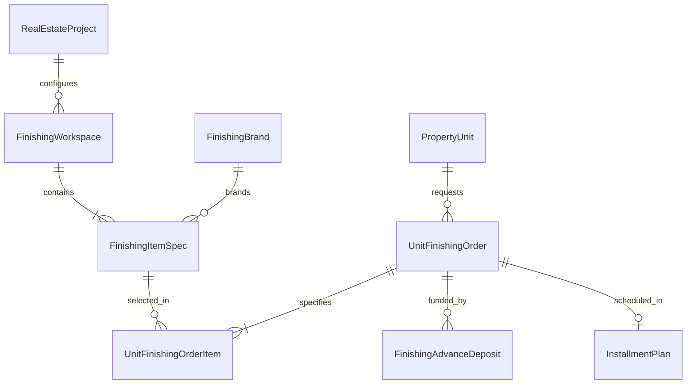

# المسار التنفيذي الثاني (Track 2) — كتالوج وتشطيبات الوحدات وتعديلات العملاء السداسية
## Executive Implementation Plan: Finishing Specifications, Catalogs & Multi-Stage Approval Requests

> **النطاق**: بناء كتالوج باقات وتشطيبات الفراغات المعمارية (الغرف والأماكن)، إدارة الخامات والماركات المعتمدة، دورة الاعتماد السداسية لطلبات التشطيب والتعديل، مقايسة أسعار التشطيب، والدفعات المقدمة وجدولة الأقساط.

---

### 1. الأهداف الفنية والتشغيلية (Operational Scope)

1. **كتالوج الفراغات المعمارية والمواصفات (Workspace & Specification Directory)**:
   * تمكين إدارة المشروعات من تعريف الفراغات المعمارية للوحدات (ريسبشن، صالون، ماستر بيدروم، غرف أطفال، مطبخ، حمام رئيسي، حمام ضيوف، تراس).
   * ربط كل فراغ بكتالوج بنود الأعمال (أرضيات، حوائط، أسقف، سباكة، كهرباء، نجارة، ألوميتال) والماركات المعتمدة (جوتن، كليوباترا، الجوهرة، ديورافيت، جروهي، إلخ).
2. **دورة الاعتماد السداسية المحوكمة (Multi-Stage Approval Workflow)**:
   * محاكاة دورة العمل المعمارية والمالية التي كشفتها قوالب أبو زهرة وتطويرها:
     1. **خدمة العملاء / تقديم الطلب**: تسجيل طلب العميل واختيار الفراغات ونوع التشطيب.
     2. **المكتب الفني**: عمل المقايسة الهندسية وتحديد الخامات والكميات والرسومات.
     3. **مدير إدارة التعديلات**: المراجعة الإنشائية والمعمارية والمطابقة الفنية.
     4. **حسابات التكاليف**: تسعير البنود واحتساب أتعاب الإشراف وهوامش الربح.
     5. **الإدارة المالية (CFO Approval)**: اعتماد الجدولة وتحديد آلية السداد (دفعة مقدمة / أقساط).
     6. **موافقة وتوقيع العميل**: توقيع العميل على كراسة المقايسة المالية والمخططات.
     7. **التنفيذ الميداني والتسليم**: تسليم البنود لمهندس الموقع واستلامها من المقاولين.
3. **الدفعات المقدمة والجدولة المالية (Deposits & Slicing)**:
   * تسجيل الدفعات المقدمة لجدية التعديل (`FinishingAdvanceDeposit`).
   * إمكانية ترحيل تكلفة التشطيب المتبقية كأقساط ملحقة على جدول أقساط الوحدة الأصلي، أو فتح خطة أقساط تشطيب منفصلة.
4. **كراسة ومقايسة التشطيب المعتمدة للطباعة (`finishing_order_print.html`)**.

---

### 2. بنية قواعد البيانات والموديلات (Database Architecture)



#### الموديلات المطلوب إنشاؤها في `real_estate/models/finishing.py`:

```python
class FinishingWorkspace(models.Model):
    """الفراغ / الحيز المعماري بالوحدة (غرفة، ريسبشن، مطبخ...)"""
    project = models.ForeignKey('real_estate.RealEstateProject', on_delete=models.CASCADE, related_name='finishing_workspaces')
    name = models.CharField(max_length=100) # e.g. "ريسبشن", "غرفة نوم رئيسية", "حمام ضيوف"
    code = models.CharField(max_length=30) # e.g. "REC", "MBR", "KIT"
    description = models.TextField(blank=True, default='')
    sort_order = models.PositiveIntegerField(default=1)
    is_active = models.BooleanField(default=True)


class FinishingBrand(models.Model):
    """الماركة التجارية / الشركة المصنعة المعتمدة للخامات"""
    name = models.CharField(max_length=100, unique=True) # e.g. "Jotun", "Cleopatra", "Duravit", "Grohe"
    country_of_origin = models.CharField(max_length=50, blank=True, default='')
    website = models.URLField(blank=True)
    is_approved = models.BooleanField(default=True)


class FinishingItemCategory(models.TextChoices):
    FLOORING = 'FLOORING', _('أرضيات وسيراميك وبورسلين وباركية')
    WALL_FINISH = 'WALL_FINISH', _('دهانات وتشطيبات حوائط وتجاليد')
    CEILING = 'CEILING', _('أسقف معلقة وجبس بورد وفيوتك')
    PLUMBING_FIXTURES = 'PLUMBING_FIXTURES', _('أطقم صحية وخلاطات ومحابس')
    ELECTRICAL_FIXTURES = 'ELECTRICAL_FIXTURES', _('مفاتيح وإنارة ولوحات وشاسيهات')
    CARPENTRY_DOORS = 'CARPENTRY_DOORS', _('أبواب ونجارة ودواليب مدمجة')
    ALUMINUM_FACADES = 'ALUMINUM_FACADES', _('ألوميتال وزجاج وواجهات')


class FinishingItemSpec(models.Model):
    """كتالوج مواصفات وخامات التشطيب المتاحة للاختيار لكل فراغ"""
    workspace = models.ForeignKey(FinishingWorkspace, on_delete=models.CASCADE, related_name='specifications')
    category = models.CharField(max_length=30, choices=FinishingItemCategory.choices, db_index=True)
    name = models.CharField(max_length=150) # e.g. "بورسلين هندي 60*120 ليزر كت"
    brand = models.ForeignKey(FinishingBrand, null=True, blank=True, on_delete=models.SET_NULL)
    model_code = models.CharField(max_length=100, blank=True, default='') # كود الموديل أو اللون
    measuring_unit = models.CharField(max_length=20) # م², م.ط, عدد, مقطوعية
    standard_material_cost = models.DecimalField(max_digits=12, decimal_places=2, default=Decimal('0.00'))
    standard_labor_cost = models.DecimalField(max_digits=12, decimal_places=2, default=Decimal('0.00'))
    supervision_rate = models.DecimalField(max_digits=5, decimal_places=2, default=Decimal('15.00')) # % أتعاب إشراف
    client_selling_rate = models.DecimalField(max_digits=12, decimal_places=2) # سعر البيع النهائي للعميل
    inventory_item = models.ForeignKey('product.Product', null=True, blank=True, on_delete=models.SET_NULL)
    is_active = models.BooleanField(default=True)


class UnitFinishingOrder(models.Model):
    """أمر وطلب تشطيب وتعديل الوحدة العقارية للعميل"""
    class OrderStage(models.TextChoices):
        CUSTOMER_SERVICE = 'CUSTOMER_SERVICE', _('خدمة العملاء - تسجيل الطلب المبدئي')
        TECHNICAL_OFFICE = 'TECHNICAL_OFFICE', _('المكتب الفني - إعداد المقايسة والرسومات')
        CHANGES_MANAGER = 'CHANGES_MANAGER', _('مدير إدارة التعديلات - المراجعة المعمارية')
        COST_ACCOUNTING = 'COST_ACCOUNTING', _('الحسابات - تسعير البنود وحساب التكاليف')
        FINANCE_MANAGER = 'FINANCE_MANAGER', _('مدير الحسابات - مراجعة الجدولة')
        CFO_APPROVAL = 'CFO_APPROVAL', _('مدير الإدارة المالية - اعتماد الشروط والخصومات')
        CLIENT_APPROVAL = 'CLIENT_APPROVAL', _('موافقة العميل - التوقيع على المقايسة')
        IN_EXECUTION = 'IN_EXECUTION', _('قيد التنفيذ الميداني بالموقع')
        COMPLETED = 'COMPLETED', _('مكتمل ومسلم للعميل بمحضر استلام')
        CANCELLED = 'CANCELLED', _('ملغى')

    order_number = models.CharField(max_length=50, unique=True, db_index=True)
    contract = models.ForeignKey('real_estate.PropertyContract', on_delete=models.PROTECT, related_name='finishing_orders')
    unit = models.ForeignKey('real_estate.PropertyUnit', on_delete=models.PROTECT, related_name='finishing_orders')
    customer = models.ForeignKey('customer.Customer', on_delete=models.PROTECT, related_name='finishing_orders')
    title = models.CharField(max_length=200)
    current_stage = models.CharField(max_length=30, choices=OrderStage.choices, default=OrderStage.CUSTOMER_SERVICE, db_index=True)
    request_date = models.DateField(default=timezone.localdate)
    expected_completion_date = models.DateField(null=True, blank=True)
    actual_completion_date = models.DateField(null=True, blank=True)
    
    # Financial Totals
    material_cost_total = models.DecimalField(max_digits=14, decimal_places=2, default=Decimal('0.00'))
    labor_cost_total = models.DecimalField(max_digits=14, decimal_places=2, default=Decimal('0.00'))
    supervision_fee_total = models.DecimalField(max_digits=14, decimal_places=2, default=Decimal('0.00'))
    gross_finishing_amount = models.DecimalField(max_digits=14, decimal_places=2, default=Decimal('0.00'))
    discount_amount = models.DecimalField(max_digits=14, decimal_places=2, default=Decimal('0.00'))
    net_finishing_price = models.DecimalField(max_digits=14, decimal_places=2, default=Decimal('0.00'))
    total_deposit_paid = models.DecimalField(max_digits=14, decimal_places=2, default=Decimal('0.00'))
    remaining_balance = models.DecimalField(max_digits=14, decimal_places=2, default=Decimal('0.00'))
    
    # Links
    installment_plan = models.ForeignKey('sale.InstallmentPlan', null=True, blank=True, on_delete=models.SET_NULL, related_name='finishing_orders')
    technical_drawings_pdf = models.FileField(upload_to='finishing_orders/drawings/', null=True, blank=True)
    client_signature_date = models.DateTimeField(null=True, blank=True)
    notes = models.TextField(blank=True, default='')
    created_by = models.ForeignKey(settings.AUTH_USER_MODEL, on_delete=models.PROTECT)
    created_at = models.DateTimeField(auto_now_add=True)
    updated_at = models.DateTimeField(auto_now=True)


class UnitFinishingOrderItem(models.Model):
    """بند تفصيلي في مقايسة تشطيب الوحدة لكل فراغ"""
    order = models.ForeignKey(UnitFinishingOrder, on_delete=models.CASCADE, related_name='items')
    workspace = models.ForeignKey(FinishingWorkspace, on_delete=models.PROTECT)
    spec = models.ForeignKey(FinishingItemSpec, null=True, blank=True, on_delete=models.SET_NULL)
    item_description = models.CharField(max_length=255)
    brand = models.ForeignKey(FinishingBrand, null=True, blank=True, on_delete=models.SET_NULL)
    color_code = models.CharField(max_length=100, blank=True, default='')
    quantity = models.DecimalField(max_digits=10, decimal_places=2)
    measuring_unit = models.CharField(max_length=20)
    unit_selling_price = models.DecimalField(max_digits=12, decimal_places=2)
    total_price = models.DecimalField(max_digits=14, decimal_places=2)
    is_executed_on_site = models.BooleanField(default=False)
    site_notes = models.TextField(blank=True, default='')


class FinishingAdvanceDeposit(models.Model):
    """دفعة مقدمة مسددة لجدية طلب التعديل / التشطيب"""
    class AllocationTarget(models.TextChoices):
        CASH_DEPOSIT = 'CASH_DEPOSIT', _('دفعة نقدية بالخزينة/البنك')
        ROLL_INTO_INSTALLMENTS = 'ROLL_INTO_INSTALLMENTS', _('ترحيلها وإضافتها لجدول الأقساط')

    order = models.ForeignKey(UnitFinishingOrder, on_delete=models.CASCADE, related_name='deposits')
    receipt_number = models.CharField(max_length=50, unique=True)
    amount = models.DecimalField(max_digits=12, decimal_places=2)
    receipt_date = models.DateField(default=timezone.localdate)
    allocation_target = models.CharField(max_length=30, choices=AllocationTarget.choices, default=AllocationTarget.CASH_DEPOSIT)
    voucher = models.ForeignKey('financial.PaymentVoucher', null=True, blank=True, on_delete=models.SET_NULL)
    created_by = models.ForeignKey(settings.AUTH_USER_MODEL, on_delete=models.PROTECT)
    created_at = models.DateTimeField(auto_now_add=True)
```

---

### 3. الخدمات الخلفية وقواعد الأعمال (Business Logic & Services)

1. **`FinishingPricingService`**:
   * احتساب تكاليف المواد والمصنعيات ونسب الإشراف آلياً.
   * حساب الإجمالي الصافي: `net_finishing_price = gross_finishing_amount - discount_amount`.
2. **`FinishingWorkflowService`**:
   * تطبيق فرملة الصلاحيات (Role-based Gate):
     * لا يمكن الانتقال من `CUSTOMER_SERVICE` إلى `TECHNICAL_OFFICE` دون رفع التوصيف المبدئي.
     * لا يمكن الانتقال إلى `CHANGES_MANAGER` دون ملء جدول الكميات والأسعار المبدئية.
     * لا يمكن الانتقال إلى `CFO_APPROVAL` دون موافقة مدير الحسابات.
     * لا يمكن الانتقال إلى `IN_EXECUTION` دون تسجيل توقيع العميل (`client_signature_date`) وسداد الدفعة المقدمة المقررة.
3. **`FinishingInstallmentService`**:
   * في حال رغبة العميل في تقسيط المبلغ المتبقي، يتم توليد ملحق خطة أقساط مربوط بالعقد العقاري والوحدة.

---

### 4. واجهات المستخدم وقوالب العرض (Frontend & Templates)

1. **شاشة إعدادات حيز المشروع والتشطيب (`templates/real_estate/finish_project_settings.html`)**:
   * شجرة الفراغات المعمارية لكل مشروع.
   * إضافة وتعديل البنود والمواصفات وربطها بالماركات والأسعار.
2. **ساحر اختيار مواصفات تشطيب الوحدة للعميل (`templates/real_estate/finishing_order_wizard.html`)**:
   * واجهة تفاعلية تبوب الغرف (ريسبشن، غرف نوم، حمامات، مطبخ).
   * يختار مهندس المبيعات/التشطيب نوع الأرضية وكود الدهان ونوع الأطقم الصحية من دروبداون الماركات مع عرض السعر الفوري.
   * عداد فوري للتكلفة الإجمالية ومقدار الدفعة المقدمة.
3. **لوحة كانبان / متابعة مراحل الطلبات (`templates/real_estate/finishing_order_list.html`)**:
   * تبويبات لأعمدة المراحل الست: (خدمة عملاء | مكتب فني | إدارة تعديلات | حسابات | اعتماد مالي | موافقة عميل | تنفيذ).
4. **كراسة مقايسة التشطيب المطبوعة (`templates/real_estate/finishing_order_print.html`)**:
   * وثيقة رسمية A4 تدرج مواصفات كل غرفة تفصيلياً مع الجداول والتسعير وتوقيع الطرف الأول (الشركة) والطرف الثاني (العميل).

---

### 5. خطة الفحص والتحقق الصارم (Pytest Suite)

* ملف الاختبار: `real_estate/tests/test_track2_finishing_and_variations.py`
  1. `test_finishing_catalog_and_workspace_specs`: إنشاء الفراغات وربط البنود والماركات.
  2. `test_finishing_pricing_calculation`: التحقق من معادلة التكلفة والمصنعيات والإشراف وصافي السعر.
  3. `test_finishing_workflow_state_machine_guards`: اختبار عدم إمكانية القفز فوق المراحل وفرملة الاعتماد دون الصلاحيات.
  4. `test_client_signature_blocks_execution_without_deposit`: منع التحويل للتنفيذ دون توقيع العميل وسداد الدفعة.
  5. `test_finishing_order_print_rendering`: التأكد من توليد كراسة المواصفات بالبنود والفراغات بدقة.
