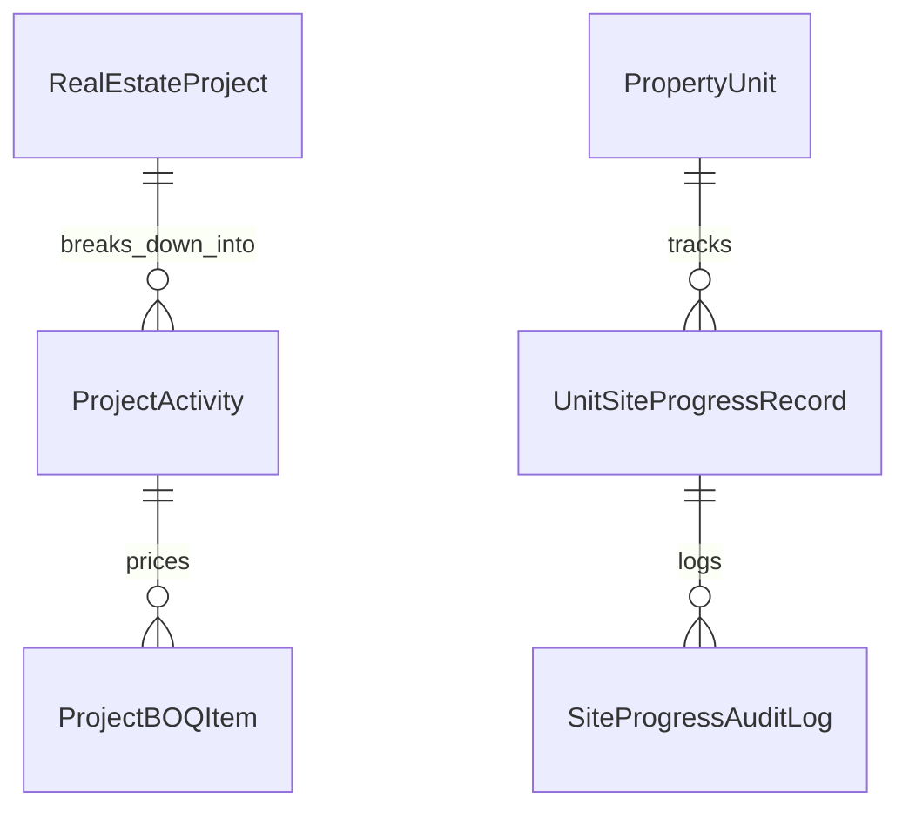

# المسار التنفيذي الثالث (Track 3) — مقايسة المشروع (WBS/BOQ) ومتابعة المواقع والتنفيذ الميداني
## Executive Implementation Plan: Project Work Breakdown Structure, Construction BOQ & Multi-Trade Site Progress Inspection

> **النطاق**: بناء شجرة بنود مقايسة المشروع التقديرية (WBS / BOQ)، جدول متابعة تنفيذ الشقق والوحدات ميدانياً بنداً بنداً، مصفوفة المتابعة الميدانية المطابقة لتقرير أبو زهرة (`site_project_report`)، واحتساب نسب الإنجاز التراكمية لتغذية معيار IFRS 15 المحاسبي.

---

### 1. الأهداف الفنية والتشغيلية (Operational Scope)

1. **شجرة أنشطة وبنود مقايسة المشروع (Project WBS & BOQ)**:
   * تقسيم المشروع الإنشائي إلى مراحل رئيسية وأنشطة فرعية وحزم عمل (حفر، خرسانات، مباني، محارة، سباكة، كهرباء، تشطيبات، واجهات، مصاعد...).
   * إدخال الكميات التقديرية والميزانيات المستهدفة (Target Budget) لكل بند لمقارنتها لاحقاً بالمصروف الفعلي من واقع مستخلصات المقاولين وفواتير الشراء.
2. **مصفوفة المتابعة الميدانية للوحدات بنداً بنداً (Site Progress Matrix)**:
   * بناء شاشة وتقرير متابعة ميداني يطابق بدقة القالب الذي تم كشفه في أبو زهرة (`site_project_report.html`):
     * **المباني**: (قد، مباني).
     * **الكهرباء**: (مواسير، علب، سحب سلك، تشطيب).
     * **البياض والمحارة**: (طرطشة وشبك، أوتار، ملو، تأميم، تشطيب).
     * **السباكة**: (عزل، تغذية، بانيو، صرف، تكييف، تشطيب).
     * **السيراميك**: (أرضيات، حوائط).
     * **الدهانات والنقاشة**: (سكينة 1، سكينة 2، سكينة 3، بطانة، فنش).
     * **النجارة والألوميتال**: (حلوق، أبواب، شبابيك، هاندريل، فيوتك).
     * **حالة الاستلام والملاحظات والمرفقات المعمارية**.
3. **التكامل مع معيار الاعتراف بالإيراد (IFRS 15 Percentage of Completion)**:
   * احتساب نسبة الإنجاز الفعلي للمشروع رياضياً من واقع نسب إنجاز البنود الميدانية الموزونة (Weighted Engineering Progress)، بدلاً من كتابة النسبة يدوياً في كارت المشروع.

---

### 2. بنية قواعد البيانات والموديلات (Database Architecture)



#### الموديلات المطلوب إنشاؤها في `real_estate/models/engineering.py`:

```python
class ProjectActivity(models.Model):
    """شجرة الأنشطة والمراحل الهندسية الإنشائية للمشروع (WBS)"""
    class TradeType(models.TextChoices):
        EARTHWORK = 'EARTHWORK', _('حفر وإحلال وسند جوانب')
        SKELETON_CONCRETE = 'SKELETON_CONCRETE', _('خرسانات مسلحة وهيكل إنشائي')
        MASONRY = 'MASONRY', _('أعمال المباني والطوب')
        PLASTERING = 'PLASTERING', _('بياض ومحارة داخلية وخارجية')
        PLUMBING = 'PLUMBING', _('تأسيس وعزل وتشطيب سباكة')
        ELECTRICAL = 'ELECTRICAL', _('تأسيس وتشطيب كهرباء وإنارة')
        FLOORING = 'FLOORING', _('أرضيات وسيراميك ورخام')
        PAINTING = 'PAINTING', _('دهانات ونقاشة وديكورات')
        CARPENTRY = 'CARPENTRY', _('أبواب ونجارة عمارة')
        ALUMINUM = 'ALUMINUM', _('ألوميتال وواجهات زجاجية')
        ELEVATORS_MEP = 'ELEVATORS_MEP', _('مصاعد وكهروميكانيك ومكافحة حريق')
        LANDSCAPING = 'LANDSCAPING', _('تنسيق موقع ومرافق خارجية')

    project = models.ForeignKey('real_estate.RealEstateProject', on_delete=models.CASCADE, related_name='wbs_activities')
    parent = models.ForeignKey('self', null=True, blank=True, on_delete=models.CASCADE, related_name='sub_activities')
    activity_code = models.CharField(max_length=50) # e.g. "ACT-01", "ACT-01.1"
    name = models.CharField(max_length=200)
    trade_type = models.CharField(max_length=30, choices=TradeType.choices)
    weight_percentage = models.DecimalField(max_digits=5, decimal_places=2, default=Decimal('0.00')) # الوزن النسبي في المشروع %
    planned_start_date = models.DateField()
    planned_end_date = models.DateField()
    actual_start_date = models.DateField(null=True, blank=True)
    actual_end_date = models.DateField(null=True, blank=True)
    progress_percentage = models.DecimalField(max_digits=5, decimal_places=2, default=Decimal('0.00')) # % الإنجاز الفعلي
    is_milestone = models.BooleanField(default=False)
    created_at = models.DateTimeField(auto_now_add=True)


class ProjectBOQItem(models.Model):
    """بنود مقايسة المشروع التقديرية المجمعة (Master BOQ)"""
    activity = models.ForeignKey(ProjectActivity, on_delete=models.CASCADE, related_name='boq_items')
    item_code = models.CharField(max_length=50)
    description = models.TextField()
    unit = models.CharField(max_length=20) # م³, م², م.ط, كجم, مقطوعية
    estimated_quantity = models.DecimalField(max_digits=14, decimal_places=3)
    budgeted_rate = models.DecimalField(max_digits=12, decimal_places=2) # الفئة التقديرية
    total_budget_amount = models.DecimalField(max_digits=15, decimal_places=2)
    actual_cost_incurred = models.DecimalField(max_digits=15, decimal_places=2, default=Decimal('0.00')) # المصروف الفعلي من المستخلصات


class UnitSiteProgressRecord(models.Model):
    """سجل متابعة مراحل إنجاز الوحدة العقارية ميدانياً بنداً بنداً"""
    class InspectionTrade(models.TextChoices):
        # 1. المباني
        MASONRY_QADD = 'MASONRY_QADD', _('مباني - قد وتحديد حوائط')
        MASONRY_FULL = 'MASONRY_FULL', _('مباني - استكمال الحوائط')
        # 2. الكهرباء
        ELEC_PIPES = 'ELEC_PIPES', _('كهرباء - شق ودفن مواسير')
        ELEC_BOXES = 'ELEC_BOXES', _('كهرباء - تركيب علب الماجيك')
        ELEC_WIRING = 'ELEC_WIRING', _('كهرباء - سحب أسلاك')
        ELEC_FITTING = 'ELEC_FITTING', _('كهرباء - تشطيب وشاسيهات وإنارة')
        # 3. البياض
        PLASTER_SPATTER = 'PLASTER_SPATTER', _('بياض - طرطشة وشبك فواصل')
        PLASTER_STRINGS = 'PLASTER_STRINGS', _('بياض - عمل بؤج وأوتار')
        PLASTER_FILLING = 'PLASTER_FILLING', _('بياض - ملو ودراعة')
        PLASTER_EDGES = 'PLASTER_EDGES', _('بياض - تأميم زوايا وأكتاف')
        PLASTER_FINISH = 'PLASTER_FINISH', _('بياض - تشطيب ومس نهائي')
        # 4. السباكة والعزل
        PLUMB_WATERPROOF = 'PLUMB_WATERPROOF', _('سباكة - عزل مائي أرضيات واختبار 48 ساعة')
        PLUMB_FEEDING = 'PLUMB_FEEDING', _('سباكة - تمديد شبكة تغذية وضغط')
        PLUMB_DRAINAGE = 'PLUMB_DRAINAGE', _('سباكة - شبكة صرف وتكييفات')
        PLUMB_TUB_FIX = 'PLUMB_TUB_FIX', _('سباكة - تثبيت شاسيهات وبانيو')
        PLUMB_FITTING = 'PLUMB_FITTING', _('سباكة - تشطيب أطقم وخلاطات')
        # 5. السيراميك
        CERAMIC_FLOORS = 'CERAMIC_FLOORS', _('سيراميك - أرضيات')
        CERAMIC_WALLS = 'CERAMIC_WALLS', _('سيراميك - حوائط حمامات ومطبخ')
        # 6. النقاشة
        PAINT_KNIFE_1 = 'PAINT_KNIFE_1', _('نقاشة - سكينة معجون أولى')
        PAINT_KNIFE_2 = 'PAINT_KNIFE_2', _('نقاشة - سكينة ثانية وسنفرة')
        PAINT_KNIFE_3 = 'PAINT_KNIFE_3', _('نقاشة - سكينة ثالثة')
        PAINT_PRIMER = 'PAINT_PRIMER', _('نقاشة - دهان بطانة أولى')
        PAINT_FINAL = 'PAINT_FINAL', _('نقاشة - تشطيب وجه نهائي')
        # 7. النجارة والألوميتال
        CARPENTRY_FRAMES = 'CARPENTRY_FRAMES', _('نجارة - تثبيت حلوق')
        CARPENTRY_DOORS = 'CARPENTRY_DOORS', _('نجارة - تركيب درف أبواب')
        ALUMINUM_WINDOWS = 'ALUMINUM_WINDOWS', _('ألوميتال - تركيب قطاعات وزجاج')
        BALCONY_HANDRAIL = 'BALCONY_HANDRAIL', _('واجهات - هاندريل بلكونات وسور')
        CORNICE_FUTEC = 'CORNICE_FUTEC', _('ديكور - كرانيش وفيوتك')

    class StageStatus(models.TextChoices):
        NOT_STARTED = 'NOT_STARTED', _('لم يبدأ')
        IN_PROGRESS = 'IN_PROGRESS', _('قيد التنفيذ')
        COMPLETED_PENDING_INSPECTION = 'COMPLETED_PENDING_INSPECTION', _('منفذ قيد معاينة المهندس')
        PASSED_AND_VERIFIED = 'PASSED_AND_VERIFIED', _('معتمد ومستلم هندسياً')
        REJECTED_DEFECT = 'REJECTED_DEFECT', _('مرفوض لوجود ملاحظات عيوب')

    unit = models.ForeignKey('real_estate.PropertyUnit', on_delete=models.CASCADE, related_name='site_progress_records')
    trade_stage = models.CharField(max_length=30, choices=InspectionTrade.choices, db_index=True)
    status = models.CharField(max_length=35, choices=StageStatus.choices, default=StageStatus.NOT_STARTED, db_index=True)
    completion_percentage = models.PositiveIntegerField(default=0) # 0 to 100%
    verified_by = models.ForeignKey(settings.AUTH_USER_MODEL, null=True, blank=True, on_delete=models.SET_NULL)
    verified_at = models.DateTimeField(null=True, blank=True)
    defect_notes = models.TextField(blank=True, default='')
    inspection_photo = models.ImageField(upload_to='site_inspections/%Y/%m/', null=True, blank=True)
    updated_at = models.DateTimeField(auto_now=True)

    class Meta:
        unique_together = ('unit', 'trade_stage')


class SiteProgressAuditLog(models.Model):
    """سجل تدقيق تاريخي غير قابل للتعديل لتحديثات نسب الإنجاز الميداني"""
    unit = models.ForeignKey('real_estate.PropertyUnit', on_delete=models.CASCADE)
    trade_stage = models.CharField(max_length=30)
    previous_status = models.CharField(max_length=35)
    new_status = models.CharField(max_length=35)
    previous_percentage = models.PositiveIntegerField()
    new_percentage = models.PositiveIntegerField()
    changed_by = models.ForeignKey(settings.AUTH_USER_MODEL, on_delete=models.PROTECT)
    timestamp = models.DateTimeField(auto_now_add=True)
```

---

### 3. خوارزميات الحساب ونسب الإنجاز (Calculation Engine)

* **`ProjectProgressCalculationService`**:
  تجميع نسب الإنجاز الصاعدة من القاع للقمة (Bottom-Up Rollup):
  1. **نسبة إنجاز الوحدة (Unit Progress %)**:
     $$\text{Unit Progress} = \sum (\text{Stage Completion \%} \times \text{Stage Weight})$$
  2. **نسبة إنجاز الدور (Floor Progress %)**:
     متوسط نسب إنجاز جميع شقق ووحدات الدور.
  3. **نسبة إنجاز العمارة/المشروع (Building / Project Progress %)**:
     $$\text{Project Total Progress} = \sum (\text{Activity Progress \%} \times \text{Activity WBS Weight})$$
  4. **ربط تلقائي مع قيود الإيراد (IFRS 15 POC Engine)**:
     تحديث نسبة إنجاز المشروع في `RealEstateProject.construction_progress_percentage` لتغذية خدمة حساب الإيراد المستحق ومقارنته بالمحفظة البيعية تلقائياً.

---

### 4. واجهات المستخدم وقوالب العرض (Frontend & Templates)

1. **تقرير متابعة التنفيذ الميداني الشبكي (`templates/real_estate/site_project_report.html`)**:
   * جدول أفقي مصفوفي ضخم مستوحى بدقة من قالب أبو زهرة:
     * الأعمدة: (الدور | الشقة | المباني: قد، استكمال | الكهرباء: مواسير، علب، سلك، تشطيب | البياض: طرطشة، أوتار، ملو، تأميم، فنش | السباكة: عزل، تغذية، بانيو، صرف، تشطيب | السيراميك: أرضيات، حوائط | النقاشة: س1، س2، س3، بطانة، فنش | النجارة | الألوميتال | الملاحظات والمرفقات).
   * إشارات ملونة سريعة (Badges): أخضر (مكتمل ومعتمد)، أصفر (جاري)، رمادي (لم يبدأ)، أحمر (مرفوض بملاحظات).
   * فلاتر فورية بدون إعادة تحميل: اختيار المشروع، العمارة، الدور، أو شقة محددة.
   * زر «تصدير إكسل Excel Export» وتصدير تقرير الطباعة الرسمي.
2. **مودال التحديث السريع للمهندس (`modals/quick_update_site_stage_modal.html`)**:
   * النقر على أي خلية في الجدول يفتح مودال سريع لتغيير الحالة، تعديل النسبة %، كتابة ملاحظة عيب، ورفع صورة من الموقع فورياً.
3. **شاشة شجرة بنود المقايسة ومقارنة التكاليف (`templates/real_estate/project_boq_list.html`)**:
   * عرض هيكل WBS ومقارنة (الميزانية التقديرية vs المصروف الفعلي من المستخلصات vs الانحراف Variance).

---

### 5. خطة الفحص والتحقق الصارم (Pytest Suite)

* ملف الاختبار: `real_estate/tests/test_track3_wbs_and_site_execution.py`
  1. `test_wbs_activities_hierarchy_and_weights`: التحقق من شجرة الأنشطة وتوازن الأوزان النسبية حتى 100٪.
  2. `test_site_progress_records_initialization_on_unit_create`: إنشاء سجلات المتابعة لجميع البنود الـ 15 تلقائياً عند إضافة أي وحدة جديدة.
  3. `test_bottom_up_progress_rollup_formula`: التأكد من دقة معادلة تصعيد نسب الإنجاز من الشقة للدور وللمشروع.
  4. `test_site_progress_audit_log_immutability`: التأكد من تسجيل كل حركة تحديث في جدول الـ Audit Log وعدم إمكانية تزييفها.
  5. `test_site_project_report_view_excel_and_html`: اختبار استجابة شاشة التقرير الشبكي والفلاتر والتصدير.
