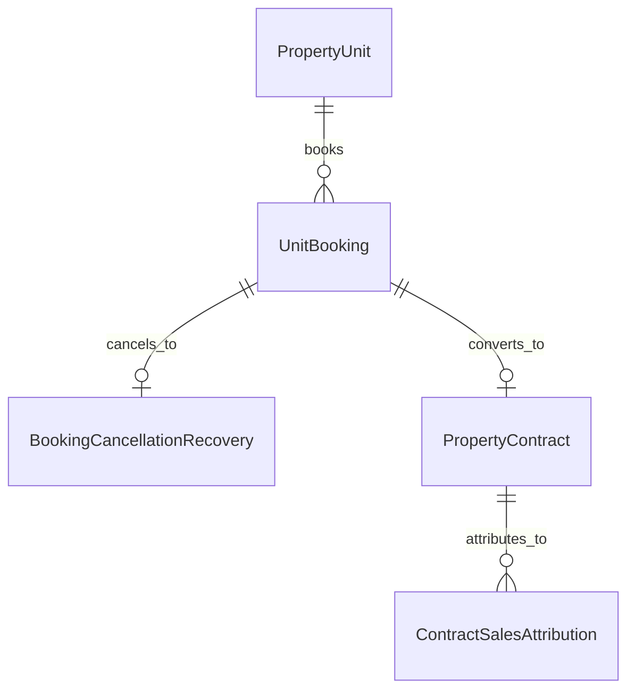

# المسار التنفيذي الرابع (Track 4) — الرقابة المزدوجة للمبيعات والموقف العقاري المالي
## Executive Implementation Plan: Sales Dual-Level Audit, Extras, Recovery Liquidation & Tower Sales Brief Report

> **النطاق**: إضافة تدقيق ومراجعة الحجوزات الثنائية، تتبع ملحقات الوحدات (الجراجات والمخازن والعدادات)، إدارات استرداد الحجوزات بالشيكات والأسباب المقننة، مصفوفة مسؤوليات البيع، وتقرير الموقف العقاري والمالي للمشروع والعمارة (`tower_sales_brief`).

---

### 1. الأهداف الفنية والتشغيلية (Operational Scope)

1. **الرقابة والاعتماد الثنائي للحجوزات (Two-Level Booking Audit)**:
   * إضافة مرحلتين متتاليتين لتدقيق الحجز كما في أبو زهرة لمنع أي تلاعب أو حجز غير مستوفٍ للشروط:
     1. `تم مراجعة الحجز ؟` (`is_reviewed_sales`): مراجعة وتدقيق موظف الحسابات/المبيعات لتطابق المستندات ودفعة الحجز.
     2. `تم تأكيد مراجعة الحجز ؟` (`is_confirmed_audit`): اعتماد وتأكيد مدير المبيعات أو المدير المالي للإفراج النهائي عن الحجز وتجهيز العقد.
2. **الفصل المالي لملحقات الوحدة وتشطيبها (Unit Associated Assets & Extras)**:
   * تخصيص حقول صريحة في استمارة الحجز والعقد لكل من:
     * سعر متر التشطيب وإجمالي قيمة التشطيب.
     * رسوم المرافق والصيانة المقررة (العدادات وشبكة الغاز).
     * أصل بايكة الجراج (Parking Slot Code & Price).
     * أصل غرفة التخزين السفلية (Storage Locker Code & Price).
   * تحديد حصة الشريك المالك وحصة الشركة المطور (`Partner Share %` vs `Company Share %`).
3. **دورة الاستردادات وإلغاء الحجز المقننة (Booking Recovery & Liquidation)**:
   * تتبع أسباب الاسترداد المقننة: (تعثر مالي، اختيار مشروع آخر، اختيار نموذج/وحدة أخرى، أسباب خاصة).
   * تسجيل بيانات شيك الاسترداد: (رقم الشيك، البنك المسحوب عليه، تاريخ الاستحقاق، والقائم بتسليم الشيك للعميل)، مع عكس قيد استحقاق الحجز تلقائياً في الحسابات العامة.
4. **مصفوفة مسؤوليات فريق البيع في العقد (Sales Responsibility Matrix)**:
   * توثيق كل من ساهم في إتمام البيع: (مسئول الاتصال التليفوني الأول، مسئول الزيارة التنسيقية، مسئول الموقع/المعرض القائم بالتعاقد)، لتوزيع عمولات البيع بدقة.
5. **لوحة وتقرير الموقف العقاري والمالي للمشروع والعمارة (`tower_sales_brief.html`)**:
   * تقرير استراتيجي موحد للإدارة العليا يعرض ملخص البرج والمشروع مقسماً إلى:
     * (الوحدات المتاحة | وحدات الحجز المؤقت | الوحدات المحجوزة | الوحدات المتعاقد عليها | حصة الشريك | حصة الشركة).
     * التحليل بأربعة أبعاد متزامنة: (عدد الوحدات، نسبة العدد ٪، إجمالي المساحات م²، نسبة المساحة ٪، إجمالي القيمة بالجنيه، نسبة القيمة ٪).

---

### 2. بنية قواعد البيانات والموديلات (Database Schema Enhancements)



#### التعديلات المطلوبة على `real_estate/models/booking.py`:

```python
# تمديد موديل UnitBooking
class UnitBooking(models.Model):
    # ... الحقول القائمة ...

    # 1. الرقابة والاعتماد الثنائي
    is_reviewed_sales = models.BooleanField(default=False, verbose_name=_('تم مراجعة الحجز ؟'))
    reviewed_by = models.ForeignKey(settings.AUTH_USER_MODEL, null=True, blank=True, on_delete=models.SET_NULL, related_name='reviewed_bookings')
    reviewed_at = models.DateTimeField(null=True, blank=True)

    is_confirmed_audit = models.BooleanField(default=False, verbose_name=_('تم تأكيد مراجعة الحجز ؟'))
    confirmed_by = models.ForeignKey(settings.AUTH_USER_MODEL, null=True, blank=True, on_delete=models.SET_NULL, related_name='confirmed_bookings')
    confirmed_at = models.DateTimeField(null=True, blank=True)

    # 2. ملحقات وتفاصيل مالية
    finishing_meter_rate = models.DecimalField(max_digits=12, decimal_places=2, default=Decimal('0.00'), verbose_name=_('سعر متر التشطيب'))
    total_finishing_amount = models.DecimalField(max_digits=14, decimal_places=2, default=Decimal('0.00'), verbose_name=_('إجمالي سعر التشطيب'))
    utilities_deposit_amount = models.DecimalField(max_digits=12, decimal_places=2, default=Decimal('0.00'), verbose_name=_('رسوم المرافق والصيانة'))
    
    parking_slot_code = models.CharField(max_length=50, blank=True, default='', verbose_name=_('كود بايكة الجراج'))
    parking_slot_price = models.DecimalField(max_digits=12, decimal_places=2, default=Decimal('0.00'), verbose_name=_('سعر الجراج'))
    storage_locker_code = models.CharField(max_length=50, blank=True, default='', verbose_name=_('كود المخزن السريع'))
    storage_locker_price = models.DecimalField(max_digits=12, decimal_places=2, default=Decimal('0.00'), verbose_name=_('سعر المخزن'))

    # 3. حصص الملكية
    company_share_percentage = models.DecimalField(max_digits=5, decimal_places=2, default=Decimal('100.00'), verbose_name=_('نسبة الشركة %'))
    partner_share_percentage = models.DecimalField(max_digits=5, decimal_places=2, default=Decimal('0.00'), verbose_name=_('نسبة الشريك %'))
    partner = models.ForeignKey('real_estate.LandownerPartnership', null=True, blank=True, on_delete=models.SET_NULL, verbose_name=_('الشريك / مالك الأرض'))

    # 4. التسويق والوساطة
    sales_channel = models.CharField(max_length=100, blank=True, default='', verbose_name=_('جهة البيع / الفرع / المعرض'))
    marketing_lead_source = models.CharField(max_length=100, blank=True, default='', verbose_name=_('طريقة المعرفة / مصدر الـ Lead'))
```

#### موديل استرداد وإلغاء الحجز المقنن (`real_estate/models/booking.py` أو `refund.py`):

```python
class BookingCancellationRecovery(models.Model):
    """سجل الاستردادات وإلغاء الحجوزات والشيكات المستردة"""
    class RecoveryReason(models.TextChoices):
        FINANCIAL_HARDSHIP = 'FINANCIAL_HARDSHIP', _('تعثر مالي للعميل')
        CHOSE_OTHER_PROJECT = 'CHOSE_OTHER_PROJECT', _('اختيار مشروع آخر للشركة')
        CHOSE_OTHER_MODEL = 'CHOSE_OTHER_MODEL', _('تغيير النموذج أو المساحة')
        TIMELINE_DELAY = 'TIMELINE_DELAY', _('تأخر في مواعيد التسليم المبدئية')
        MUTUAL_TERMINATION = 'MUTUAL_TERMINATION', _('إلغاء ودي بالتراضي')
        OTHER = 'OTHER', _('أسباب أخرى')

    booking = models.OneToOneField('real_estate.UnitBooking', on_delete=models.CASCADE, related_name='recovery_record')
    recovery_reason = models.CharField(max_length=30, choices=RecoveryReason.choices, default=RecoveryReason.FINANCIAL_HARDSHIP)
    recovery_date = models.DateField(default=timezone.localdate)
    total_booking_paid = models.DecimalField(max_digits=14, decimal_places=2, verbose_name=_('إجمالي المبلغ المسدد بالجنيه'))
    deducted_administrative_fees = models.DecimalField(max_digits=12, decimal_places=2, default=Decimal('0.00'), verbose_name=_('المصاريف الإدارية المستقطعة'))
    net_refund_amount = models.DecimalField(max_digits=14, decimal_places=2, verbose_name=_('المبلغ الصافي المسترد للعميل'))
    
    # تفاصيل شيك الاسترداد
    refund_cheque_number = models.CharField(max_length=100, blank=True, default='', verbose_name=_('رقم شيك الاسترداد'))
    refund_cheque_bank = models.CharField(max_length=100, blank=True, default='', verbose_name=_('البنك المسحوب عليه الشيك'))
    refund_cheque_due_date = models.DateField(null=True, blank=True, verbose_name=_('تاريخ استحقاق الشيك'))
    is_cheque_cleared = models.BooleanField(default=False, verbose_name=_('تم صرف وتسييل الشيك'))
    
    notes = models.TextField(blank=True, default='', verbose_name=_('ملاحظات وتفاصيل الاسترداد'))
    processed_by = models.ForeignKey(settings.AUTH_USER_MODEL, on_delete=models.PROTECT, verbose_name=_('القائم بالاسترداد'))
    created_at = models.DateTimeField(auto_now_add=True)
```

#### تمديد مصفوفة مسؤوليات البيع في العقد (`real_estate/models/contract.py`):

```python
# في موديل PropertyContract
call_specialist = models.ForeignKey(settings.AUTH_USER_MODEL, null=True, blank=True, on_delete=models.SET_NULL, related_name='contracts_as_call_rep', verbose_name=_('مسئول الاتصال'))
visit_specialist = models.ForeignKey(settings.AUTH_USER_MODEL, null=True, blank=True, on_delete=models.SET_NULL, related_name='contracts_as_visit_rep', verbose_name=_('مسئول المقابلة/الزيارة'))
site_specialist = models.ForeignKey(settings.AUTH_USER_MODEL, null=True, blank=True, on_delete=models.SET_NULL, related_name='contracts_as_site_rep', verbose_name=_('مسئول الموقع/المعرض'))
```

---

### 3. تقرير الموقف العقاري والمالي للمشروع والعمارة (`TowerSalesBriefReportView`)

#### خوارزمية التجميع الإحصائي الرباعي:
لكل برج ومشروع، يتم تجميع وتصنيف الوحدات في الحالات التالية:
1. **متاح (Available)**: وحدات مفتوحة للبيع.
2. **حجز مؤقت (Temporary Hold)**: حجز غير معتمد مالياً أو قيد مراجعة المستندات.
3. **محجوز (Booked)**: حجز رسمي معتمد ومسدد دفعة الحجز.
4. **تعاقد (Contracted)**: عقود بيع نهائية مبرمة.
5. **وحدات الشريك (Partner Units)**: الوحدات المخصصة لحصة مالك الأرض.
6. **وحدات الشركة (Company Units)**: المحفظة الصافية للمطور.

لكل حالة يتم احتساب:
* **العدد (Count)** و **النسبة المئوية من إجمالي وحدات العقار (%)**.
* **المساحة البيعية الإجمالية (Total Area m²)** و **نسبة المساحة (%)**.
* **القيمة الإجمالية التعاقدية/التسعيرية (Total Value EGP)** و **نسبة القيمة (%)**.

---

### 4. واجهات المستخدم وقوالب العرض (Frontend & Templates)

1. **تحديث شاشة جدول الحجوزات (`templates/real_estate/booking_list.html`)**:
   * إضافة أعمدة: (سعر متر التشطيب | إجمالي التشطيب | رسوم المرافق | مراجعة الحجز ؟ | تأكيد الحجز ؟).
   * إمكانية قيام الموظف المخول بالنقر المباشر السريع لتأكيد المراجعة بعد التحقق من السند.
2. **شاشة سجل الاستردادات العقارية (`templates/real_estate/booking_recovery_list.html`)**:
   * جدول شامل لحالات الإلغاء والاسترداد يطابق تقرير أبو زهرة:
     (العميل | المشروع | الوحدة | المسدد | المسترد | سبب الاسترداد المقنن | رقم الشيك | حالة التسييل | القائم بالحجز | القائم بالاسترداد).
3. **تقرير الموقف العقاري والمالي المختصر (`templates/real_estate/reports/tower_sales_brief.html`)**:
   * لوحة إحصائية ممتازة تعرض كروت KPI علوية (إجمالي الوحدات، نسبة المبيعات، المحصل الفعلي، القيمة المتبقية).
   * جدول التحليل المقارن (حالة الوحدة | العدد | % | المساحة م² | % | القيمة ج.م | %).
   * فلاتر فورية متعددة لاختيار المشروع، البرج، ونوع الوحدة (سكني، تجاري، إداري، جراج، فيلات).
   * زر طباعة رسمي بتنسيق A4 أنيق وزر تصدير إكسل فوري.

---

### 5. خطة الفحص والتحقق الصارم (Pytest Suite)

* ملف الاختبار: `real_estate/tests/test_track4_sales_booking_and_reports.py`
  1. `test_two_level_booking_audit_flow`: اختبار عمل المراجعة والتأكيد ومنع تحويل الحجز لعقد دون المراجعة والتأكيد المزدوج.
  2. `test_booking_associated_extras_pricing`: التحقق من إضافة سعر الجراج والمخزن والتشطيب بدقة لإجمالي العقد.
  3. `test_booking_recovery_reversal_and_cheque_data`: اختبار إلغاء الحجز مع تسجيل سبب التعثر وشيك الاسترداد وعكس الحالة لوحدة متاحة.
  4. `test_tower_sales_brief_aggregation_math`: التأكد من مطابقة مجموع نسب الأعداد والمساحات والقيم بدقة 100٪ رياضياً في التقرير.
  5. `test_tower_sales_brief_print_and_export`: التحقق من استجابة العرض والطباعة بدون أخطاء.
